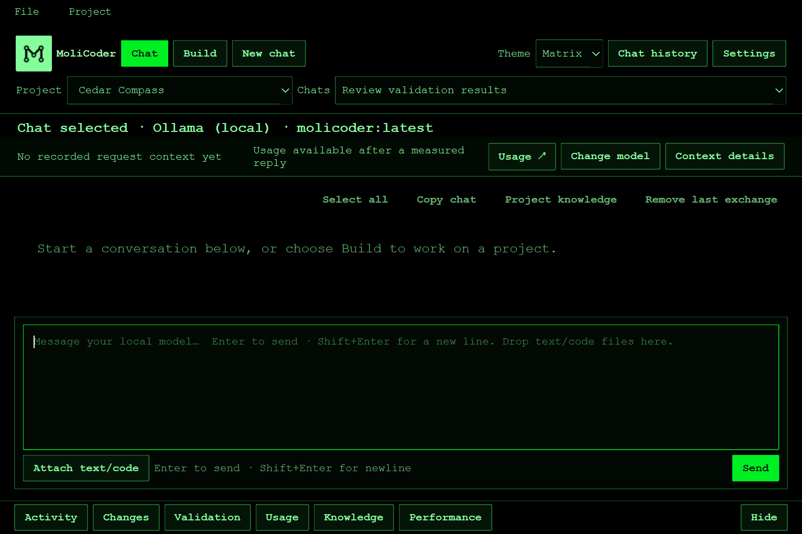
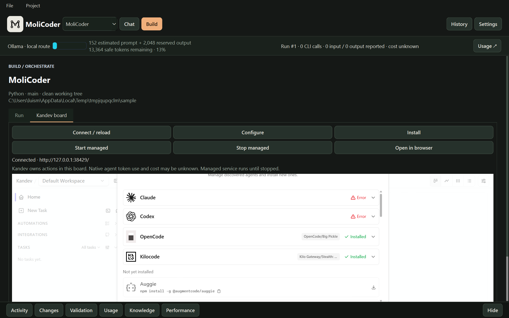

# MoliCoder

**A local-first desktop chat and coding workspace for people who want to see and control where their tokens go.**

MoliCoder combines Ollama chat, project-aware answers, and a guarded Build workflow. You can keep routine work on local models, set visible context and output limits, and choose when an external coding agent is worth using. The app records what it can measure and labels unknown subscription usage as unknown.

> **Platform checks:** Windows 11, macOS Intel, and Linux x64 have automated tests and packaged startup checks. macOS/Linux builds are unsigned CI artifacts with the [limits documented here](docs/plans/platform-support.md).

## Why token control matters

Long chat histories, oversized prompts, unnecessary model calls, and automatic retries can consume context or paid allowance without improving the result. MoliCoder gives you a way to inspect those decisions before and after a run:

| Control | What it helps with | Important limit |
| --- | --- | --- |
| Context meter and reserved output tokens | See the estimated prompt size before sending; get a warning near 80% of the configured context window and a block at the 95% safety threshold. Chat history is never trimmed silently. | The pre-send count is an estimate; Ollama reports the actual count after generation. |
| Local Ollama route | Use your own hardware for chat and local Build tasks without metered API token charges. | Local work still uses compute, memory, and electricity; model quality depends on your setup. |
| Source-backed project answers | Ask about the current task, version, or changed files using Git and saved run state without another inference call. | Only questions the deterministic handler recognizes take this path. |
| Explicit external Build selection | Choose a provider and strategy, review the route, and authorize an external agent run. Call and time ceilings bound MoliCoder's CLI launches. | A subscription CLI can make internal calls MoliCoder cannot count or price. The ceiling is **not** a hard token or spend cap inside that CLI. |
| Usage and budget records | Inspect input/output tokens, route reasons, recorded requests, and actual, estimated, or unknown costs separately. Project and task reservations guard registered metered API requests. | Provider subscription balances and opaque agent costs may be unavailable. Unknown is never shown as zero. |
| Validation and recovery evidence | See task checkpoints, failed attempts, model handoffs, and validation results before relying on generated changes. | Passing tests do not prove every behavior; review changes before pushing. |

The goal is more predictable use of local hardware and paid services, with fewer needless model calls and clearer evidence about what happened. Savings depend on your workload and provider terms; MoliCoder does not promise a fixed reduction in tokens or cost. The metered API policy layer is separate from the default desktop routes and cannot cap internal usage inside a subscription CLI.

For example, a question such as “What task are we on?” can be answered from the saved run record without sending a model prompt. A small code change can run through Local offline Build. If that route cannot handle the task, you can deliberately choose an external agent, inspect the result, and see which usage figures are known. This keeps the decision to spend external allowance with you.

## What works today

- **Chat:** stream replies from local Ollama models; adjust output length, temperature, and top-p; inspect prompt/output metrics; keep conversations and export Markdown or JSON.
- **Conversation continuity and copying:** reopened chats send their saved messages with each request, within the visible context limit. Drag across message cards or Shift-click to select a range; use Select all / Copy chat for larger copies.
- **Project context:** Chat knows its associated project's name, folder and type. Ask which project is selected or inspect authoritative run status and project knowledge using local records.
- **Read-only folder listings:** ask "What's in C:/Dev?" or "List files in src" to see immediate folder/file names without a model call, including explicit folders outside the selected project.
- **Build:** plan and execute tasks in isolated Git worktrees, run fixed validation commands, preserve failed work for review, and record task evidence.
- **Routes:** choose Local offline, Hybrid, or Frontier only. External CLI agents require project trust and an explicit Build authorization.
- **Visibility:** inspect provider state, environment doctor results, usage and budgets, event timelines, worktrees, and a privacy-filtered trace export.
- **Optional Kandev ownership:** explicitly assign a Build task to a configured local Kandev service and reconcile it by its saved external ID.

Local Ollama chat needs no cloud account. Optional external agents and services have their own installation, authentication, quota, and data-sharing rules.

## Desktop workspace

Matrix is the default theme: black surfaces, green accents, and monospace text, with the supplied MoliCode logo in the header. Use **New chat** to start a conversation in one click from Chat or Build. **Chat** supports conversation and read-only planning; **Build** starts explicitly reviewed execution. Switching between them preserves drafts.



Screenshots use demonstration records and make no inference calls. [Light theme](docs/images/usability/header-chats-light.png) · [Active Build](docs/images/usability/build-active-matrix.png) · [Visible failure](docs/images/usability/build-failed-light.png) · [Settings](docs/images/usability/settings-light.png).

### Current work and model identity

The readable identity area distinguishes the **last reply/call** from the model selected for the **next** request. Replies retain their recorded provider and model in history. Requested/configured models and provider-reported models are labeled separately. Local runtime metadata can identify a model family, but an alias is not proof of its underlying weights. Opaque CLI and Kandev models remain unknown when no supported report is available. Project-status answers and folder actions say **No AI model used**.

**Change model** opens Settings at Models & providers. The old model toolbar and permanent Chat token meter have been removed from the work area. **Context details** shows the recorded conversation turns, attachments, and basic project metadata actually included in a reply; selecting a project does not imply its repository files were sent. **Usage** and **Performance** retain detailed measurements, context estimates, generation controls, and local runtime health. Context-limit warnings remain visible near Send.

### Choose the target explicitly

The app starts in general Chat with **No project**. Choose a folder for repository work, or enable **Settings → General → Remember last workspace** to restore the last explicit selection. Build shows its target folder and offers Open folder / Create project without a Chat history detour. Opening an existing project conversation shows its saved association. An active Build keeps its target while New chat remains available.

Each project has its own **chat history**, with any number of conversations. Use the labeled **Project** selector in the header; the adjacent **Chats** dropdown immediately lists that project's conversations and opens the chat you choose. It shows the current chat and becomes selectable when there is more than one. **Chat history → Projects / conversations** also provides the full list with rename/delete actions. **New chat** creates another conversation in that project. Switching projects restores the chat you last selected there, including its unsent draft and attachments during the current session. The chat selection also survives restarting the app. Choose **General chats · No project** for conversations without a project; their chats appear in the same Chats dropdown. Existing chats keep their saved associations; unassigned older chats remain General chats. Removing a project from the list preserves its chat history; add the same folder again to reopen it.

Project history preview: [Matrix](docs/images/usability/project-chats-matrix.png) · [Light](docs/images/usability/project-chats-light.png). [Completed implementation and verification tracker](docs/plans/project-chat-tracker.md).

Continuing an existing chat sends its complete saved user/assistant history, followed by your new message. Same-chat history instructions tell the model to use those earlier turns rather than claiming every request starts a new session. Other chats are not included. The context estimate includes the system instruction; a request that exceeds the safe limit is blocked, with no silent history removal. **Context details** records the exact turn IDs used. Model answers can still be mistaken; a statement that it cannot remember is not evidence that saved messages were deleted.

To copy several messages, drag from one message body into another, or click a start position and **Shift-click** an end position. Selection scrolls when you drag near the transcript edge. **Ctrl+A / Ctrl+C** (Command on macOS) works across the transcript when a message has focus; composer shortcuts still apply only to your draft. **Select all** selects displayed message text, including expanded reasoning; **Copy chat** copies the current conversation with speaker labels and Markdown, excluding hidden reasoning and unsent drafts. Each message's own Copy button remains available. [Continuity and selection verification](docs/plans/chat-continuity-selection-tracker.md).

Explicit simple folder requests use a local confirmation showing the exact path, including destinations outside a Git project. Missing or invalid destinations produce clarification. Created, already-existing, cancelled, and failed actions are recorded under **Chat history → Local actions**. Coding agents still cannot escape their worktree scope.

Ask **"Do you know what project we're working on?"** for the current chat's saved project name, folder, and type. A General chat explains that it has no associated project. Normal model requests also include this basic metadata so follow-up wording can use it; no project file is automatically opened.

Ask **"OK, can you tell me which content is in C:/Dev?"**, **"List contents of C:/Dev"**, or **"List files in src"** for a read-only local listing. Relative folders use this chat's project; an absolute path also works from General chats. The app reads immediate names/types in a background worker, shows a checked time, and records **No AI model used**. It displays at most 100 entries and labels partial listings. It does not recurse or read file contents. Missing folders, file paths, access errors, and cancellation are shown as actual outcomes. Network/device paths require a local destination for this action. Listings and project identity answers appear in the conversation and its Context details receipt.

### Activity, failures, and recovery

A graphical activity indicator stays above scrolling Build content, with the current stage, elapsed time, and age of the last real update. Chat shows an affordance to return to an active Build. Pause requested, Paused, Cancelling, and terminal outcomes are distinct; reduced motion is available in General settings. Animation does not claim a percentage or prove model progress.

Failures remain visible with their effect and a relevant recovery action, including after reopening history. Unexpected errors finalize the saved run and active task, block untouched tasks, and preserve completed work and worktree evidence. Startup checks local process ownership before reconciling an interrupted run; Kandev sessions require external reconciliation.

### Settings and appearance

Settings stays open while navigating **General**, **Models & providers**, **Projects & Build**, **Usage & limits**, **Kandev**, and **Diagnostics**. Model cards separate installation, sign-in, model choice, and readiness. Connection checks make no inference request; paid test messages keep their separate approval and cap. API connections currently support capped tests, while main Chat uses local Ollama models. Project model overrides offer an explicit Provider default choice.

Use **Theme** in the header to choose **Matrix** or **Light**, or change appearance and text size in General. Preferences save immediately; project model overrides have their own Save action. Kandev's embedded web content keeps its own appearance settings. Windows packages use the supplied logo for executable, shortcut, and window icons; regenerate the multi-resolution icon with `.venv\Scripts\python.exe scripts\build_windows_icon.py` before packaging.

The [workspace usability tracker](docs/plans/workspace-usability-plan.md) records implementation and verification; the [earlier UI tracker](docs/plans/ui-redesign-tracker.md) preserves historical milestones.

## Run from source

Requirements: Python 3.13+, Git, and Ollama on a tested platform. On Windows, Linux x64, and macOS Intel or Apple Silicon, Environment readiness can install a pinned official Ollama runtime after showing its source, checksum, disk estimate, user-scope destination, and rollback path for your approval. The Chat presets use Ollama model names `molicoder:latest` and `local-reasoning:latest`; any other installed Ollama model also appears in Chat with conservative default generation settings. Environment readiness can inspect a public Ollama library model's official manifest, show its size and hardware estimate, and download it through Ollama after your exact approval. It does not replace model weights without approval.

```powershell
git clone https://github.com/molicoder-bit/MoliCoder.git
cd MoliCoder
py -3.13 -m venv .venv
.\.venv\Scripts\python.exe -m pip install -r requirements.lock
ollama list
.\.venv\Scripts\python.exe run_app.py
```

The app connects to Ollama on `http://127.0.0.1:11434` and tries to start the local Ollama service if it is installed but stopped. `ollama list` should show the expected aliases before you start a model-backed chat or Local offline Build.

On macOS or Linux, replace the virtual-environment commands above with:

```sh
python3.13 -m venv .venv
.venv/bin/python -m pip install -r requirements.lock
.venv/bin/python run_app.py
```

For an unsigned macOS Intel or Linux x64 package, run `.venv/bin/python scripts/build_unix.py` after installing dependencies. Automated package startup and behavior checks are in [platform support](docs/plans/platform-support.md). Metered API routes are currently unavailable on macOS and Linux because MoliCoder has no verified encrypted key store there; local Ollama and supported official CLI sign-in flows remain separate.

### First steps

1. Open **Chat** for local conversation. Watch the context meter and choose an output limit before sending a large request.
2. Add an existing Git repository under **Projects**, or create a Python, Node.js, or Flutter starter project. An existing repository needs a clean, named branch for Build.
3. In **Build**, enter a small request with a checkable outcome. Choose **Local offline** to keep model work on Ollama, or choose an external agent deliberately.
4. Review **Task evidence** and **Usage and budgets** after the run. Inspect the diff before pushing it.

For more routes, open **Environment readiness** to install supported official CLIs and local runtimes from inside the app. Each managed install shows the release, source, integrity check, destination, and rollback before you approve it. Open **Provider settings** to add a custom OpenAI-compatible endpoint and model, or choose an API preset. On Windows, you can enter a protected API key, check the connection without an inference call, review price and privacy facts, and set a project spend cap before enabling a metered route. Provider sign-in and account creation still happen in the provider's official flow; MoliCoder does not create accounts or buy credits for you.

New Python starter projects create an isolated virtual environment and install the pinned test runner from PyPI. That setup needs network access but no model provider account.

## Build routes and safeguards

| Strategy | Execution path | Token and cost visibility |
| --- | --- | --- |
| **Local offline** | Local Ollama planning and bounded local execution. | Ollama usage is recorded when reported; no metered inference API charge. |
| **Hybrid** | A selected external CLI plans; bounded local execution can handle eligible low-risk edits, with provider takeover when needed. | Local usage is measurable; the CLI's internal subscription use remains opaque. |
| **Frontier only** | The selected external CLI plans and executes in the isolated worktree. | MoliCoder records observed calls and any usage the CLI reports; exact internal cost may be unknown. |

Build supports Codex, Claude, and Copilot CLI profiles when installed, authenticated, and eligible. An optional fallback provider must be selected and trusted separately. External agents can edit files in the isolated worktree; their own native tools may have side effects outside MoliCoder's controlled tool path. After an uncertain opaque-agent outcome, MoliCoder stops automatic retry and asks for review.

Internal Build starts from a clean named branch. It validates and checkpoints changes in an isolated worktree, then fast-forwards the checkout automatically **only when its safety checks allow it**. Otherwise, it preserves the result for review and a separate apply action. Kandev-owned tasks require local acceptance and an explicit apply. No Build route pushes commits to a remote repository.

The desktop exposes current run status, validation output, and recovery actions. Project-local `.molicoder` files hold plans and run logs; the local SQLite database holds authoritative run and task state.

### Optional Kandev owner

Build defaults to **Internal Build**. To select Kandev ownership, configure a local Kandev 0.97.0 service and set these environment variables for the app process:

```text
KANDEV_ENDPOINT=http://127.0.0.1:38429/mcp
KANDEV_VERSION=0.97.0
KANDEV_WORKSPACE_ID=...
KANDEV_WORKFLOW_ID=...
KANDEV_WORKFLOW_STEP_ID=...
KANDEV_REPOSITORY_ID=...
KANDEV_AGENT_PROFILE_ID=...
```

Kandev can now be installed, started, configured, and viewed inside **Build → Kandev board**. Use **Install** for the pinned package, **Start managed** for a loopback service, and **Connect / reload** to display its real board. Starting the service does not launch an agent. Managed data lives under MoliCoder's `kandev-managed` folder and the service remains running until explicitly stopped. Stop refuses an attached service, a changed process identity, or active/unverified agent sessions. **Configure** discovers workspaces, repositories, workflows, steps, and agent profiles; create missing resources in Kandev's board and refresh. Saved project profiles replace the need to set environment variables; the variables above remain a compatibility fallback.



The endpoint must be loopback HTTP. In Build, choose **Task owner → Internal Build** or **Task owner → Kandev** for each new request. **Open Kandev board** opens the embedded view; **Open in browser** is available as a fallback. The board can open without task ownership settings, but Kandev must be running; the button uses `KANDEV_ENDPOINT`, then `KANDEV_BACKEND_PORT` or `KANDEV_PORT`, then Kandev's default port `38429`. Kandev task ownership still requires all the settings above and a separate launch confirmation. MoliCoder records ownership before dispatch, requires exact create and launch authorizations, shows pending state, and reconciles by the saved external ID. A [live Windows readiness check](docs/plans/kandev-live-readiness.md) verified an isolated worktree, local acceptance and apply, and restart recovery with Kandev 0.97.0. Its ordinary Windows launcher failed during supervisor socket setup on that host; the check used the verified executable's direct backend entry point.

Chat and Build recognize an explicit request to create one local folder, including the phrasing `create a folder in C:/Dev called "Example"`. The app shows the exact resolved destination and creates it only after confirmation. This action works outside a Git project and does not launch a coding agent.

## Build a Windows app

```powershell
.\scripts\build.ps1
.\scripts\install.ps1
```

The build is written to `dist\MoliCoder`. The installer copies it to `%LOCALAPPDATA%\Programs\MoliCoder` and creates a desktop shortcut. Run from source first if you want to inspect behavior before installing.

## Privacy and local data

- Chat database: `%LOCALAPPDATA%\LocalModelChat\chats.sqlite3`
- Default exports: `%LOCALAPPDATA%\LocalModelChat\exports`
- Task worktrees: `%LOCALAPPDATA%\LocalModelChat\worktrees`
- Project run logs: `<project>\.molicoder\logs\run-<id>.jsonl`

Local Ollama requests stay on the loopback service. Selecting an external CLI or Kandev route sends task context to that service under its own terms. Attached text and run evidence may contain sensitive project content; review exports and logs before sharing them. Deleting a chat is permanent, so back up the SQLite file if the history matters.

## Open-source license

MoliCoder's source code is licensed under the [Apache License 2.0](LICENSE). You can use, modify, and distribute it, including in commercial projects, under that license's terms. It includes an express patent grant and requires preservation of applicable license and attribution notices. The [NOTICE](NOTICE) file identifies this project.

The license covers this repository's MoliCoder code and documentation. Ollama, PySide6/Qt, optional coding agents, Kandev, model weights, and other external dependencies keep their own licenses and terms; check those separately when distributing a packaged app or models.

## Tests and project status

```powershell
$env:QT_QPA_PLATFORM = "offscreen"
.\.venv\Scripts\python.exe -m pytest -q
```

The no-cost suite uses fixtures for provider and Kandev behavior. Live Ollama and CLI tests are opt-in; an isolated Kandev readiness check is documented separately. The [platform transformation tracker](docs/plans/platform-transformation-tracker.md) shows completed work and remaining tasks, including measured routing economics and optional remote workers. Issues and feedback are welcome; include reproduction steps and avoid posting credentials or private run logs.

The embedded browser adds Qt WebEngine helper processes and resources to packaged builds. A separate package smoke check renders a harmless local page and checks JavaScript completion without contacting an inference provider.
