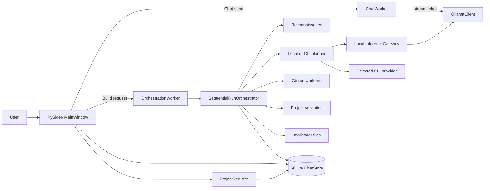

# Current MoliCoder architecture — P01 audit

**Inspected:** 2026-10-15, working tree on `main` at `69106e7`. This is a source-level map of the current checkout, including pre-existing uncommitted changes. The no-cost tests passed, but live-provider behavior and full packaging remain unverified.

## Process and startup

The application is a Python/PySide6 desktop process. `src/local_model_chat/main.py:13` creates `QApplication`, applies the theme, creates `MainWindow`, and starts the Qt event loop. `MainWindow.__init__` constructs `ChatStore`, marks interrupted runs for recovery, creates `ProjectRegistry` and `OllamaClient`, builds the UI, restores selected project and conversation, starts an Ollama check, and starts a telemetry timer (`src/local_model_chat/ui/main_window.py:33`). The default SQLite path is `%LOCALAPPDATA%/LocalModelChat/chats.sqlite3` on Windows (`src/local_model_chat/config.py:62`).

The shell has a sidebar for projects and conversations, separate Chat and Build center views, and a context/performance inspector (`src/local_model_chat/ui/main_window.py:80`, `:114`, `:187`, `:195`, `:272`, `:383`). The selected project ID is stored in the `settings` table by `ProjectRegistry.select`; the registry adds or bootstraps projects through `projectstate.py` (`src/local_model_chat/molicoder/registry.py:17`, `:30`, `:40`).

## Actual chat path

1. The Chat view loads messages for the chosen conversation from SQLite and uses the conversation's saved model preset (`src/local_model_chat/ui/main_window.py:1293`, `:1321`). Presets are fixed in `src/local_model_chat/config.py:29`.
2. On send, `MainWindow._send_message` estimates the context budget and blocks an over-limit request. It persists the user message, constructs an Ollama message list from the saved conversation, and starts `ChatWorker` (`src/local_model_chat/ui/main_window.py:1387`, `:1417`). Attached text is included in the pending content (`:1384`).
3. `ChatWorker.run` calls `OllamaClient.stream_chat` and emits content and thinking deltas to the UI (`src/local_model_chat/workers.py:11`, `:28`; `src/local_model_chat/ollama.py:123`). Stop closes the generator (`src/local_model_chat/workers.py:25`).
4. On completion, the UI saves the assistant message and generation metrics in SQLite (`src/local_model_chat/ui/main_window.py:1488`; `src/local_model_chat/storage.py:266`).

**Boundary finding:** this chat path calls `OllamaClient` directly. It does not pass through `molicoder/gateway.py:InferenceGateway` or a unified intent/controller policy. A selected project exists in the UI, but the constructed chat request comes from conversation messages and the model preset; the inspected send path does not attach the project's run state or architectural decisions. This makes I01's deterministic status answer a useful first seam.

## Actual Build path

1. The Build view requires a selected project, a Git repository on a named clean branch, and a request. Non-local strategies check project trust for the selected provider (`src/local_model_chat/ui/main_window.py:782`, `:814`).
2. `_run_build` creates an orchestrator through `molicoder/runtime.py:136`, starts `OrchestrationWorker`, and receives progress through Qt signals (`src/local_model_chat/ui/main_window.py:845`, `:852`; `src/local_model_chat/workers.py:68`, `:105`).
3. The runtime chooses a local Ollama planner for `LOCAL_OFFLINE`, otherwise probes and uses a selected CLI provider. Local planning/execution uses `molicoder/gateway.py:InferenceGateway`, a serialized lane over `OllamaClient`. The runtime supplies a validator, local executor, and bounded repair loop (`src/local_model_chat/molicoder/runtime.py:136`; `src/local_model_chat/molicoder/gateway.py:19`).
4. `SequentialRunOrchestrator.run` creates a SQLite run/event record, collects repository evidence, generates and saves a plan of no more than five tasks, creates an isolated run worktree, then records task dependencies (`src/local_model_chat/molicoder/orchestrator.py:685`). The repository plan schema also has `maxItems: 5` (`src/local_model_chat/molicoder/planner/plan.schema.json:9`).
5. Each ordered task uses bounded local or CLI attempts, runs scope and project validation, commits passing work as a checkpoint, and records task/worker/provider events (`src/local_model_chat/molicoder/orchestrator.py:735`, `:764`, `:789`, `:833`). Final validation runs before completion (`:845`). `ChatStore` holds runs, plans, tasks, dependencies, worker runs, validations, external calls, and events (`src/local_model_chat/storage.py:57`). The orchestrator also writes `.molicoder/plans/`, `.molicoder/runs/`, and `.molicoder/logs/` artifacts (`src/local_model_chat/molicoder/orchestrator.py:64`, `:717`).
6. The current runtime passes `auto_apply=True`. After final validation, the orchestrator attempts a fast-forward of the user's checkout; if that is unsafe or fails, it returns `ready_to_apply` for later action (`src/local_model_chat/molicoder/runtime.py:198`; `src/local_model_chat/molicoder/orchestrator.py:855`). This differs from the older `README.md` description of an always explicit merge. P01-04 should verify the current behavior in tests before documentation or design relies on it.

## Storage and state ownership

`ChatStore` initializes SQLite with WAL and foreign keys (`src/local_model_chat/storage.py:14`, `:20`, `:27`). It owns conversations/messages/settings, projects/preferences, runs/plans/tasks/dependencies, execution/validation/failure data, external calls, and event history. `ProjectRegistry` wraps project registration and selection. `MainWindow` currently coordinates both the chat worker and Build worker directly. The Build orchestrator owns execution transitions and emits events to both SQLite and project-local JSONL. There is no single controller shared by the two user flows in the inspected code.

## Source-grounded component diagram

## P01-01 conclusion and limits

The current application has two distinct entry paths: local conversational chat and structured Build execution. SQLite gives both persistence, but shared context selection and inference authorization are not present at their common UI boundary. Build already has useful reconnaissance, planning, isolation, validation, checkpointing, and recovery state; later plans should extend these instead of replacing them by default.

This map does not establish whether the current uncommitted code passes tests, what each external CLI is permitted to do under current terms, whether all inference entry points have been found, or how storage migrations and packaging behave across operating systems. Those are explicit P01-02 through P01-04 tasks.

## P01-02 — Inference and provider path inventory

I searched all Python sources for Ollama calls, gateway calls, planner/execute calls, provider construction, and subprocess invocation. The following distinguishes active UI/CLI entry points from retained older code. This is a source inventory, not a claim that an installed external account is usable.

| Entry point | Request path | Gate/bounds visible in source | Accounting visible in source |
|---|---|---|---|
| Chat UI | `ui/main_window.py:1417` → `workers.py:28` → `ollama.py:123` | UI context estimate, selected fixed preset, cancel | Assistant message and Ollama metrics in `storage.py:266` |
| Build UI | `ui/main_window.py:814` → `runtime.py:136` → `orchestrator.py:685` | clean named Git branch, trusted provider, provider probe, ≤5 planned tasks, worktree, validation, ≤2 frontier attempts/task, 1200 s/task | runs/tasks/events, worker runs and external calls in `storage.py` |
| Local Build planning | `runtime.py:148` → `planner/local.py:30` → `gateway.py:25` → `ollama.py:87` | serialized local lane, context/output parameters; no universal request policy | run/plan records; local inference metrics are not a unified per-request ledger |
| Local Build execution/diagnosis | `runtime.py:165`, `runtime.py:108` → `executor.py:92` / gateway → Ollama | tool dispatcher, turn/time bounds, validation; same local lane | worker/run records where orchestration writes them |
| External Build | `runtime.py:156` → `providers.py:538` → `providers.py:227` | selected CLI, version/auth probe, filtered environment, process timeout/cancel, redacted emitted text | `orchestrator.py:680` records reported tokens/duration/status; no reliable subscription balance or hard token cap |
| Standalone executor CLI | `molicoder/cli.py:61` → `gateway.py` → Ollama | its own branch/validation guard | separate from UI controller; inspect in later CLI workflow tests |
| Retained older orchestration | `orchestrator.py:85`, `:243`, `planner/codex_cli.py` | older Phase2/worktree planners and Codex call budget remain in source | separate `external_calls` path; active `runtime.py` constructs `SequentialRunOrchestrator` |

`providers.py:47` defines the current CLI provider protocol. `create_provider` selects Codex, Claude, or Copilot by name (`providers.py:538`). Codex discovery and read-only planning/writable execution command construction are in `providers.py:423`; Claude in `:477`; Copilot in `:511`. The current UI exposes a provider setting and trust list (`ui/main_window.py:716`, `:814`). `CliFrontierProvider.probe` checks binary/version and, where defined, an auth command (`providers.py:183`). Codex's `auth_command` returns `None`; the probe labels authentication provisional and the actual build is the effective check (`providers.py:439`). Executable presence therefore must not be treated as authorization, quota, or terms validation.

The local `InferenceGateway` currently serializes only Ollama requests (`gateway.py:19`). It has no provider registry, project privacy eligibility, monetary reservation, or central policy API. The direct chat path does not use it. External CLI inference occurs inside the launched process and is not transported through this local gateway. `_usage_from_events` extracts token numbers only when CLI events contain them (`providers.py:91`), so zero/unknown must not be interpreted as free usage. `storage.py:140` stores an optional estimated cost for external calls, but this is not a provider-confirmed charge or universal ledger.

CLI arguments and filtered environment are code facts only. Official provider terms, subscription compatibility, and exact sandbox guarantees remain P02/P04 research items. P01-04 will test the no-cost mocked paths and the currently dirty checkout before accepting behavior claims.

## P01-03 — Storage, packaging, and platform assumptions

### Storage map and migration boundary

`storage.py:27` initializes the SQLite schema in `ChatStore._initialize`. Core tables are `conversations`, `messages`, `settings`, `projects`, `runs`, `plans`, `tasks`, `task_deps`, `worker_runs`, `validations`, `failures`, `external_calls`, `events`, and `project_preferences` (`storage.py:31`–`:162`). Foreign keys link messages to conversations and runs/tasks/events to projects and runs. The connection enables foreign keys and WAL (`storage.py:20`). Project-local `.molicoder` files hold additional plans, run summaries, and JSONL logs; these are not a substitute for the SQLite state (`molicoder/orchestrator.py:60`, `:713`).

Migration is currently implemented by `CREATE TABLE IF NOT EXISTS`, `PRAGMA table_info`, targeted `ALTER TABLE` for some columns, and `PRAGMA user_version = 2` (`storage.py:181`–`:209`). There is no separate migration runner in the inspected source. Future schema work should make forward migration idempotent, test a copy of an older database, and preserve an explicit backup/restore path. The current source does not define a canonical project-knowledge or provider-offering schema; that remains P03/I03/I05 work.

`config.py:62` places app data under `%LOCALAPPDATA%/LocalModelChat` or a home-directory fallback. `registry.py:40` saves selected project ID as a setting. `projectstate.py:71` creates a Windows-style `.venv/Scripts/python.exe` for new Python projects and installs pinned pytest. Existing project folders may contain `.molicoder` metadata (`projectstate.py:216`).

### Build and installation boundary

`pyproject.toml` requires Python 3.13+ and pins PySide6; `requirements.lock` pins PySide6, PyInstaller, pytest, and pytest-qt. `LocalModelChat.spec` builds a PyInstaller one-folder `MoliCoder` executable and contains Windows-specific ICU filtering. `scripts/build.ps1` creates a Windows venv, installs requirements, runs pytest, builds with PyInstaller, and launches a packaged health check. `scripts/install.ps1` installs into `%LOCALAPPDATA%/Programs/MoliCoder`, stages and backs up the prior installation, and creates a Windows desktop shortcut. These scripts mutate their environment and were only read, not run, for this audit.

`.github/workflows/build.yml` tests on `windows-latest` with Python 3.13 and attempts to archive `dist/LocalModelChat/*`, while the PyInstaller spec names the output `dist/MoliCoder`. This is a source-visible packaging mismatch to verify in P01-04; the current workflow may fail at the archive step. The file contains no macOS or Linux build job. Cross-platform behavior is unverified, and the Windows venv path, PowerShell installer, shortcut COM API, and installation path need adapters or replacements before those platforms can be supported.

### Platform status at this audit

| Platform | Source-supported claim | Unverified or missing |
|---|---|---|
| Windows | Primary source/deployment target; PowerShell build/install and PyInstaller spec exist | Current dirty source test/build result; CI archive mismatch |
| macOS | Python/Qt source may be portable in parts | No packaged build, installer, CI smoke test, keychain/onboarding policy |
| Linux | Python/Qt source may be portable in parts | No packaged build, installer, CI smoke test, secret-store/onboarding policy |

The package-health-check branch in `main.py:14` exits before creating the UI. Passing it verifies import and startup packaging only; it does not prove chat, Build, provider auth, or model inference.

## P01-04 — No-cost validation record

On 2026-10-15, `QT_QPA_PLATFORM=offscreen .venv/Scripts/python.exe -m pytest -q` completed on the working tree: **128 passed, 6 skipped, 34.13 s**. The six skips are opt-in real Ollama/Codex/Claude tests; no paid inference was launched. A copied source/test tree under the system temporary directory was also run with explicit `PYTHONPATH`, pytest configuration, and test path: **128 passed, 6 skipped, 35.67 s**. The interpreter came from the existing local `.venv`; no dependencies were installed. `tests/test_packaging.py` checks the schema declaration, package-health-check branch, ICU filter, build script health check, and staged installer structure. A full PyInstaller build and installer run were not performed because they would install/build artifacts and do not belong to this planning audit. The static CI archive path discrepancy above remains a finding, not a reproduced CI failure.

## P01-05 — Component treatment and immediate risks

| Component | Treatment | Why |
|---|---|---|
| PySide6 shell/chat widgets (`ui/`, `workers.py`) | Extend | Working chat and Build surfaces with passing tests; add controller seam, preserve streaming UX. |
| Ollama client and local model presets (`ollama.py`, `config.py`) | Keep and extend | Existing local inference; wrap in shared policy without replacing transport. |
| SQLite `ChatStore` (`storage.py`) | Extend | Existing authoritative task/conversation data; add versioned knowledge, registry, ledger via tested migrations. |
| Project registry/state (`molicoder/registry.py`, `projectstate.py`) | Extend | Existing project selection/bootstrap; adjust OS-specific setup later. |
| Recon/planning/orchestration/worktrees/validation (`molicoder/`) | Keep and refactor boundaries | Valuable task pipeline already exists; reconcile legacy and sequential paths after behavior tests. |
| Local `InferenceGateway` (`molicoder/gateway.py`) | Refactor/extend | Serializes Ollama only; needs authorization and adapter contract. |
| CLI provider adapters (`molicoder/providers.py`, `planner/codex_cli.py`) | Reconcile/extend | Multiple paths coexist; external usage remains opaque and requires current terms research. |
| Packaging (`LocalModelChat.spec`, `scripts/`, CI) | Fix and extend | Windows path exists; CI archive path appears stale; macOS/Linux paths absent. |
| Main Controller, canonical project knowledge, offering registry, spend ledger, environment manager, Kandev adapter | Missing in inspected source | Introduce only after planning gate and interface review; no evidence supports wholesale rewrite. |

**Risk and uncertainty:** the inspected branch has pre-existing uncommitted implementation changes. Its no-cost test suite passes, but live-provider behavior, commercial permissions, full packaged deployment, and cross-platform operation remain unverified. The CI archive path and auto-apply versus README mismatch should be tracked as specific follow-up findings. This audit does not recommend replacing functioning chat or Build components.
