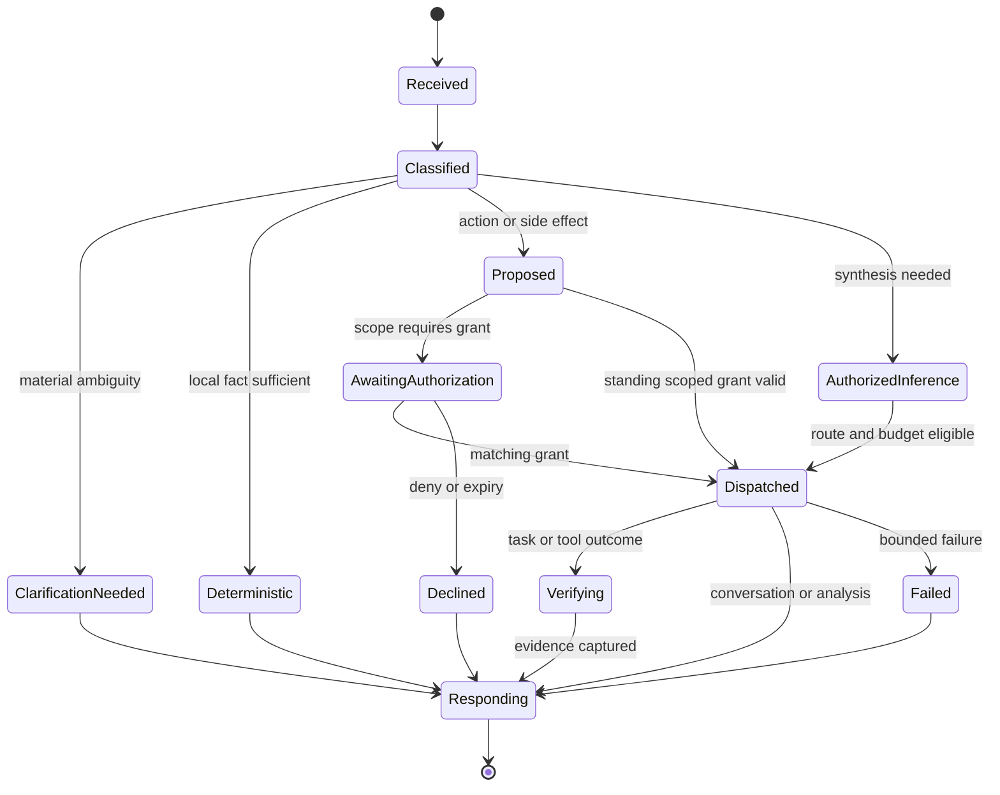
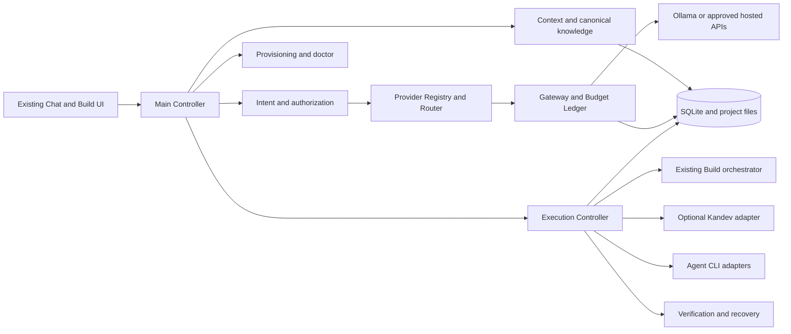

# MoliCode platform blueprint

**Status:** design complete; I01 implemented and I02 underway following the user's later implementation instruction.
**Source:** user-supplied 33-section “MoliCode — Complete Platform Transformation Plan,” reviewed 2026-10-15.
**Companion evidence:** [current architecture](current-architecture.md), [provider research](provider-research.md), and [checkable task tracker](platform-transformation-tracker.md).

## Executive summary and deliverable guide

MoliCode should become the user's primary Chat and software development interface while retaining its existing Python/PySide6 app, SQLite state, local Ollama chat, and Build orchestration. Add an in-process Main Controller that separates conversation, read-only queries, analysis, authorized mutations and autonomous tasks. Versioned project knowledge provides continuity; a provider registry, gateway, router and ledger control app-owned inference and costs. Agent CLIs remain visibly opaque where their internal calls cannot be controlled. Provisioning and Kandev are optional, scoped adapters. The first useful change is a source-backed current-task answer in Chat with no model call. The migration has seven stages and explicit rollback, tests, privacy and financial gates.

The source brief's 25 final deliverables appear below in its requested order. Links identify the authoritative section or companion file, keeping the small-task tracker readable.

| # | Deliverable | Location |
|---|---|---|
| 1 | Executive summary | This section |
| 2 | Existing repository audit | [Current architecture](current-architecture.md) |
| 3 | Current provider research | [Provider research](provider-research.md) |
| 4 | Requirements and invariants | [Traceability matrix](#p03-01--requirement-traceability-matrix), [tracker invariants](platform-transformation-tracker.md#nonnegotiable-invariants) |
| 5 | Architecture alternatives | [P06-01](#p06-01--architecture-alternatives-and-decision) |
| 6 | Target architecture | [P06-02 diagram](#p06-02--target-boundaries-contracts-and-migration-roadmap) |
| 7 | Component responsibilities | [P06-02](#p06-02--target-boundaries-contracts-and-migration-roadmap) |
| 8 | Interfaces and contracts | [P03-02](#p03-02--main-controller-intent-and-action-contracts), [P04-02](#p04-02--inference-authorization-and-adapter-contracts), [P06-02](#p06-02--target-boundaries-contracts-and-migration-roadmap) |
| 9 | Data model | [P03-05](#p03-05--persistence-schema-and-migration-path) |
| 10 | Context continuity | [P03-03](#p03-03--canonical-project-knowledge-and-provenance), [P03-04](#p03-04--context-selection-and-handoff-packet) |
| 11 | Provider integration | [P04-01](#p04-01--provider-registry-and-offering-lifecycle), [research](provider-research.md) |
| 12 | Automatic installation | [P05-01](#p05-01--provisioning-doctor-and-partial-readiness) |
| 13 | Kandev management | [P05-02](#p05-02--optional-kandev-adapter) |
| 14 | Inference routing | [P04-03](#p04-03--budget-ledger-routing-and-pacing) |
| 15 | Budget architecture | [P04-03](#p04-03--budget-ledger-routing-and-pacing) |
| 16 | Execution and recovery | [P05-03](#p05-03--execution-verification-and-recovery) |
| 17 | Security | [P04-04](#p04-04--privacy-credentials-and-trust) |
| 18 | UI design | [P05-04](#p05-04--ui-surfaces-and-user-journeys) |
| 19 | End-to-end workflows | [P05-05](#p05-05--required-end-to-end-scenario-walkthroughs) |
| 20 | Migration roadmap | [P06-02](#p06-02--target-boundaries-contracts-and-migration-roadmap) |
| 21 | Kandev-ready backlog | [I01–I17 tracker](platform-transformation-tracker.md#implementation-backlog--small-dependency-ordered-mini-plans) |
| 22 | Benchmarking plan | [P04-05](#p04-05--benchmark-and-monthly-economic-scenarios) |
| 23 | Monthly cost scenarios | [P04-05](#p04-05--benchmark-and-monthly-economic-scenarios) |
| 24 | Risks and open decisions | [P06-03](#p06-03--risk-register-and-open-decisions) |
| 25 | First milestone | [P06-05](#p06-05--first-implementation-milestone-decision-record) |

## P03-01 — Requirement traceability matrix

This matrix covers every numbered source section. **M** means mandatory product or planning requirement; **O** means an optional integration or candidate architecture whose interface still needs design. Implementation references use the small tasks in the tracker. Validation scenarios A–M are the source brief's end-to-end scenarios; G1–G10 are the tracker's release gates. A planning-only item is validated by a reviewed document, not by application code.

| Source section | Scope | Design section / decision to produce | Implementation tasks | Validation |
|---|---|---|---|---|
| 1 Fundamental vision | M | Controller, intent, conversational UI; natural requests do not always create tasks or calls | I01, I02, I15 | A–F, G1, G2 |
| 2 Primary objectives | M | Continuity, centralized authorization, efficiency, provisioning, independence | I01–I11, I13–I17 | A–M, G1–G10 |
| 3 Subscriptions and finance | M | Codex retained; Copilot cancelling; Claude cancelled; new purchases optional; OpenRouter isolated from EcoDominicano | I05–I08, I11, I16 | H, G4–G6; no unapproved spend |
| 4 Existing repository audit | M | Existing/target boundary and preservation map in `current-architecture.md` | P01; I01, I11, I14 | Source citations, baseline test record, G8 |
| 5 High-level target architecture | M | Component diagram and ownership/contracts for 13 named components | I02–I15 | A–M, G1–G10 |
| 6 Main Controller | M | Request classes, action authorization, deterministic dispatch and model escalation | I01–I02 | A–F, G1–G4 |
| 7 Global Context Orchestrator | M | Five context layers, canonical knowledge lifecycle, context router, conflict policy | I03–I04, I13 | B–E, K–L, G2–G3 |
| 8 Current AI services research | M | Dated provider-specific facts and unknown fields in `provider-research.md` | P02; I05, I16 | Source/date audit, G5–G6 |
| 9 Provider/model registry | M | Provider, model, offering, entitlement, health, source freshness and deprecation | I05 | H, M, G5–G6 |
| 10 Environment provisioning | M | Doctor, pinned manifests, policy, safe install, repair, uninstall, auth wait | I09–I10 | I, M, G5, G9 |
| 11 Kandev | O | Disabled/attached/managed modes and adapter boundary; independent core always usable | I12 | J, G1, G8–G9 |
| 12 Inference gateway | M | Authorization, strict enforcement versus opaque clients, normalized usage/errors | I06 | G4–G6, G9 |
| 13 Dynamic inference router | M | Eligibility first, then accepted-task economics and explainable fallback | I08, I16 | F–H, G5–G6 |
| 14 Context/token optimization | M | Relevance order, token allocations, deduplication, privacy and stale evidence | I04, I08 | B, D, K, G3, G6 |
| 15 Execution Controller | M | Task packet, lifecycle, isolated work and checkpoints | I14 | F–G, G7–G8 |
| 16 Failure recovery/model switching | M | Failure taxonomy, bounded repair/alternate provider, side-effect idempotency | I08, I14 | G–H, G5, G7 |
| 17 Verification Engine | M | Deterministic checks and architectural consistency separate from model claims | I13–I14 | D, F–G, L, G7 |
| 18 Budget/quota/monthly pacing | M | Atomic reservation, reconciliation, windows, per-task/project/month hard stops | I07–I08 | H, G5 |
| 19 Provider latency/performance | M | Comparable direct/gateway benchmarks and accepted-task outcomes | I16 | I16-02–I16-04, G6 |
| 20 UI | M | Conversation, provider/setup/usage/task/context surfaces with reason and approval | I01–I02, I09, I15 | A–M, G1–G2, G5 |
| 21 General tool integration | M | Tool registry, scopes, authorization, result provenance and audit | I02, I06, I11 | C–F, I, G4, G9 |
| 22 Security/privacy | M | Sensitivity tiers, credentials, trusted installs, prompt-injection and network policy | I02, I05–I06, I10, I13 | G4, G9 |
| 23 Cross-platform/multi-machine | M core OS, O remote workers | Windows baseline, macOS/Linux ports; explicit remote-worker boundaries | I17 | G10; remote optional |
| 24 Architecture options | M planning | Compare incremental extension, modular control plane, external gateway foundation | P06-01–P06-02 | Decision record with tradeoffs |
| 25 Data model/persistence | M | Project/task/decision/evidence/usage/credential-reference entities and migrations | I03, I05, I07, I14 | K–L, G2–G3, G5 |
| 26 End-to-end scenarios | M | Call/state/inference/permission/failure/outcome walkthrough for A–M | P05-05; I01–I17 | A–M explicitly |
| 27 Testing | M | Unit/contract/integration/E2E gates including no-cost and paid-call exclusion | I01–I17 | G1–G10 |
| 28 Migration roadmap | M | Phased dependency and rollback plan preserving Chat/Build | P06-02, P06-04; I01–I17 | Milestone exits and G8 |
| 29 Small executable tasks | M | Five-task mini-plans with dependencies, artifacts, verification, risk | tracker P01–P06, I01–I17 | Checklist review P06-04 |
| 30 Cost modeling | M | Free-first, Codex+free, Codex+one plan, capped API scenarios | P04-05, I16-05 | Dated assumptions, G5–G6 |
| 31 Risk assessment | M | Trigger, mitigation, owner, residual limit and open decisions | P06-03 | Risk register review |
| 32 Final deliverables | M planning | All 25 requested blueprint sections and evidence links | P03–P06 | Planning-gate exit audit |
| 33 Design rules | M | Eighteen design rules, including planning-only; mapped to release gates | All I tasks, especially I02–I08, I13–I14 | G1–G10; no application changes before P06 |

### Optional choices and non-negotiable boundaries

- Kandev management and remote workers are optional integrations. The base Chat and Build workflows must work when they are absent.
- A second subscription, metered APIs, and local model downloads are decisions after measured benefit, hardware fit, and explicit budget authorization.
- “Free” has separate meanings for endpoint, token allowance, trial credit, CLI binary, and subscription feature. The provider registry must not collapse them.
- The source's planning-only instruction governs this phase: the checked planning tasks represent research and design, not implementation or entitlement to run paid inference.

## P03-02 — Main Controller, intent, and action contracts

**Design status:** proposed contract, not implemented. Preserve the existing PySide6 streaming chat and `SequentialRunOrchestrator` as adapters behind one controller. `MainWindow._send_message` currently builds an Ollama request directly, while `_run_build` invokes the orchestrator; `workers.py` exposes separate Chat and Build threads. The controller is the seam where user intent, project selection, authorization, and response mode become explicit. See `current-architecture.md` for verified call paths.

### Typed boundary objects

These are schema-level definitions for review, not Python declarations:

| Contract | Required fields | Invariants |
|---|---|---|
| `UserTurn` | `turn_id`, `conversation_id`, optional `project_id`, `text`, attachment references, timestamp, user scope, source UI action (`send`, `build`, `resume`, `approve`) | Text and attachments are untrusted data; a selected project must resolve to a registered project revision. |
| `IntentDecision` | `kind`, `confidence`, `signals`, `ambiguous_alternatives`, `requires_project`, `side_effect_level`, `proposed_action`, `policy_version` | `kind` is one of `conversation`, `read_only_retrieval`, `analysis`, `tool_action`, `mutation`, `autonomous_work`, `administration`. Classifier uncertainty is surfaced; it never authorizes a side effect. |
| `ActionProposal` | `action_id`, `turn_id`, `kind`, `project_id`, exact targets, expected writes/network/credential/spend effects, preconditions, rollback/checkpoint, expiration | Preview has concrete targets and consequences. Scope cannot expand after approval; a changed proposal requires renewed authorization. |
| `AuthorizationDecision` | `action_id`, actor, scope, grant/deny, time, expiry, policy revision, reason | Authorization is bound to one proposal hash, not a broad chat phrase. Persistent grants are an explicit product choice. |
| `ControllerDispatch` | `turn_id`, `intent`, `mode` (`deterministic`, `retrieval`, `inference`, `tool`, `execution`, `setup`), `context_packet_id`, `authorization_id`, budget reservation, cancel token | Inference dispatch requires an eligible offering and budget decision. Tool/execution dispatch requires scope approval when it can mutate or spend. |
| `ControllerOutcome` | `turn_id`, `status`, user-visible text/stream reference, evidence IDs, work/run IDs, model/route if used, usage estimate/actual, next action, error category | A model response is not proof of task completion. Terminal status distinguishes completed, declined, blocked, failed, and cancelled. |

The controller should be deterministic orchestration state, not a permanently running model. It can answer greetings, known task status, selected project identity, and readiness from local state without inference. Read-only repository questions use retrieval and may use inference only when synthesis is needed. The model may propose an action, but the controller performs policy and permission checks.

### Intent-to-dispatch table

| Intent | Example | Default route | Authorization and result |
|---|---|---|---|
| Conversation | “Hi.” | Local deterministic response where sufficient; otherwise authorized low-cost inference | No task created; save the turn and answer. |
| Read-only retrieval | “Where did we leave off?” | SQLite run/knowledge lookup with source revision | No external call if state answers it; cite run and last verified step. |
| Analysis | “Evaluate this implementation.” | Bounded retrieval/context packet, then eligible inference if reasoning is required | No edits; report evidence, uncertainty, and findings. |
| Tool action | “Run the tests.” | Proposed scoped tool command on selected project | Execute only under applicable tool policy; show result and exit status. |
| Mutation | “Install this dependency.” | Concrete install plan with package/version/source/target and rollback | Explicit authorization for installation, privilege, network, and spend as applicable; record receipt. |
| Autonomous work | “Implement these three features.” | Task proposal then existing Build orchestrator through execution controller | Bind project/branch/worktree/scope, bounded attempts and budget; verified result before completion. |
| Administration | “Change my monthly budget.” | Settings proposal | Authenticate actor; require explicit new limit and confirmation of any higher spend capacity. |

### Transition and ambiguity rules

Material ambiguity means the action target, project, provider, spend, or permission cannot be inferred safely. The controller asks one narrow question and may continue independent read-only work. For a greeting or clear status query, classification should not need an LLM. A request to “get the latest version” is ambiguous between checking, downloading, and installing; perform a read-only version check first, then present the concrete update proposal. A request to “continue” resolves the last resumable run and its checkpoint; it must not start unrelated work. Cancellation propagates to worker/CLI process, records what already changed, and releases unused budget reservations.

### Existing-adapter boundary and acceptance checks

`ChatWorker` remains the streaming UI adapter; `OrchestrationWorker` remains the Build progress adapter. The controller owns dispatch decisions and records a single turn/run correlation ID across them. `OllamaClient` is transport, `ChatStore` is durable state, and the Build orchestrator is execution, not an alternative authority for user intent. No direct UI-to-model or UI-to-external-CLI path should bypass the controller after migration.

Acceptance examples for I02: “Hi” produces no run and zero inference calls; “current task?” reads stored task state; “evaluate” performs no writes; “install” has a versioned target and grant before mutation; “implement” shows selected project and budget, then creates one run; ambiguous “latest version” checks only and requests a scoped follow-up; denied or cancelled actions leave an auditable terminal outcome.

## P03-03 — Canonical project knowledge and provenance

**Design status:** proposed persistence contract. Extend the existing SQLite `ChatStore`, which already stores projects, messages, runs, tasks, and events. New knowledge tables are authoritative only after a migration and explicit promotion rules. The project-local `.molicoder` logs and Git files remain evidence/artifacts, not an independent source of truth.

| Entity | Minimum durable fields | Ownership and promotion rule |
|---|---|---|
| `KnowledgeItem` | `id`, `project_id`, `kind` (`requirement`, `constraint`, `fact`, `decision`, `rationale`, `open_question`, `rejected_alternative`), normalized statement, status, confidence, created/updated time, author type, canonical revision | `proposed` by ingestion/model; `verified` only against a source or user confirmation; `approved` for decisions only by authorized user. A model cannot promote itself. |
| `KnowledgeEvidence` | `id`, `item_id`, source kind (`user_turn`, `repo_blob`, `git_commit`, `test`, `official_doc`, `run_artifact`), source URI/path, content hash, project Git SHA, line/fragment, observed time, verification method | Append-only provenance. Source content remains in its own store; persist bounded excerpts and hashes, not full secret-bearing prompts. |
| `DecisionRecord` | `item_id`, problem, accepted option, rationale, alternatives and rejection reasons, affected modules, effective Git SHA, approver, approval time | Versioned architectural decision. Conflicting new proposals become a review issue, not an overwrite. |
| `KnowledgeRevision` | item ID, monotonic revision, previous revision, editor, reason, change diff, time | Append-only correction/supersession trail; current view points to one revision. |
| `KnowledgeLink` | from/to IDs, relation (`depends_on`, `constrains`, `supports`, `contradicts`, `supersedes`, `implements`), source revision | Allows retrieval and consistency checks without flattening all rationale into summaries. |
| `ContextSnapshot` | ID, project/conversation/run IDs, Git SHA, selected item revision IDs, evidence hashes, token budget, policy version, created time | Immutable selection receipt for a model request or task handoff. It is not a second knowledge store. |

Unique IDs and foreign keys connect knowledge to the existing `projects`, `conversations`, `runs`, and `tasks`; an optional `run_id` or `turn_id` records origin. SQLite FTS may index approved/verified statements and bounded excerpts. Targeted path, symbol, and Git lookups precede embedding search; a vector store is justified only if measured retrieval failures remain after deterministic/FTS lookup. Rebuildable indexes are never authoritative.

### Lifecycle and authority

1. **Create/classify:** capture a user statement, repository observation, test result, or model hypothesis with author and source; redact secrets at intake.
2. **Validate/version:** verify repository claims against a specific Git SHA and path/hash, external claims against a dated source, and architectural decisions through an explicit user approval. Store a revision and evidence; unknown remains unknown.
3. **Retrieve:** select only current, applicable revisions; label stale or conflicting evidence and include its source. A past run's assertion is a claim until independently verified.
4. **Update/correct:** add a revision with reason and source. Corrections preserve the prior version for audit. A changed repository file invalidates affected source-linked facts until rechecked.
5. **Supersede/invalidate/archive:** record a relationship to the replacement and effective time; exclude inactive entries from ordinary context but keep them for history and explanation.

Authoritative precedence for a conflict is: explicit current user instruction and approved decision within its scope; verified current repository/test evidence for implementation facts; dated official source for provider facts; then unverified model interpretation. This is a **conflict review order**, not a rule that user preference can make an outdated technical claim true. The UI should show both conflicting claims and their sources. A failed agent can append failure evidence and a proposed correction, but it cannot change an approved decision, mark its own work verified, or archive contrary evidence.

Acceptance checks: restart restores the same approved decision and rationale; a modified source hash marks linked implementation facts stale; correcting a decision records both revisions; a failed run cannot overwrite an approved requirement; a retrieval result includes its provenance and confidence; deletion/archival never silently erases an execution audit trail.

## P03-04 — Context selection and handoff packet

**Design status:** proposed contract. Existing `molicoder/recon.py` collects source-grounded repository evidence and `orchestrator.py` carries task/run state. The Context Router should build a bounded packet from these and the new canonical knowledge store. It selects **information**; P04's Model Router selects **where to run inference**.

`ContextRequest` contains `turn_id`, `project_id`, optional `run_id`/`task_id`, intent, question/goal, current Git SHA, provider sensitivity ceiling, capability need, total input token cap, and policy revision. `ContextPacket` contains ordered snippets with IDs, source revision/hash, confidence/status, privacy class, token count, reason selected, and truncation marker. It also carries excluded-item counts and a snapshot ID. A packet is immutable once dispatched.

Selection order, stopping at the token cap:

1. Exact user goal, authorized scope, safety/budget constraints, and current task state.
2. Applicable approved requirements, decisions, rationales, and known conflicts.
3. Verified recent findings, failing tests/diagnostics, and touched-file evidence at the current Git SHA.
4. Narrow repository excerpts via path/symbol/dependency expansion, then recent conversational turns required to resolve references such as “that design.”
5. Older summaries or lower-confidence hypotheses, clearly labeled, only when the task needs them.

Reserve a fixed response/output allowance **before** retrieval. For a first design target, allocate the remaining input window up to 15% to goal/policy, 20% to approved decisions, 45% to current code/evidence, 15% to recent working history, and 5% to provenance/diagnostics. These are adjustable caps, not quotas to fill; unused space stays unused. A small status answer may have no model context at all. A large coding packet expands only affected modules and direct dependencies, with a hard excerpt size and per-file cap. Count actual target-model tokens where available and use conservative byte estimates when not.

Deduplicate by canonical item ID plus revision and by source blob/hash/span. Keep the highest-authority version of repeated claims while retaining a contradiction marker and links to both claims. Filter secret values, personal data, and disallowed repository material **before** caching or sending externally; for an opaque agent, prepare only a packet within its approved sensitivity class. Stale Git SHA or changed content hash causes reinspection, exclusion, or a prominently marked stale item, never quiet reuse. Cache keys include project, Git SHA, policy revision, privacy class, model tokenizer/format, and source revision IDs; invalidate on any change to these.

### Canonical task handoff packet

`TaskHandoff` fields: `packet_version`, `project_id`, `run_id`, `task_id`, `source_branch` and `base_sha`, `goal`, acceptance criteria, allowed write paths/tool scopes, approved architecture constraints, model/provider eligibility, remaining call/spend/time budget, verified findings with source hashes, failed-attempt IDs and diagnostics, checkpoint commit or artifact IDs, current worktree state, open questions, and next safe action. It excludes full prior transcripts and raw secrets. The receiving model or agent must acknowledge the packet revision and may propose a correction, but cannot rewrite the verified findings or expand scope. The controller compares its proposed action to the packet before dispatch; verification after the attempt determines whether new findings become canonical.

Acceptance checks: switching models preserves goal/constraints/failure evidence and excludes secrets; repeated source excerpts appear once; a source change invalidates the cached packet; a low-cost status request uses deterministic state; a packet over budget reports which lower-priority categories were truncated; a sensitive project blocks ineligible providers before any data leaves the machine.

## P03-05 — Persistence schema and migration path

**Design status:** logical schema and migration requirements. `ChatStore` already owns SQLite conversations/messages/settings/projects/runs/plans/tasks/dependencies/worker runs/validations/failures/external calls/events/preferences. Keep those IDs and history stable; add tables rather than reinterpret old rows. `domain.py` may define typed values, while one storage layer owns transactions and migrations. All times are UTC, all mutable rows carry a revision, and foreign keys are enforced.

| Owned aggregate | Tables or logical entities and key relationships | Lifecycle and retention |
|---|---|---|
| Identity, UI and conversation | Existing `settings`, `projects`, `conversations`, `messages`; add `conversation_context` keyed by conversation/project and selected knowledge snapshot; `user_settings` can remain typed settings rows. | Project selection is a pointer, not a copy of project knowledge. Conversation deletion follows user retention controls; audit references retain identifiers and bounded non-sensitive metadata. |
| Canonical knowledge | `knowledge_items(project_id,id)`, `knowledge_revisions(item_id,revision)`, `knowledge_evidence(item_id,source_id)`, `decision_records(item_id)`, `knowledge_links`, `context_snapshots`; keys and authority follow P03-03. | Proposed → verified → approved where applicable → superseded/invalidated/archived. Append-only revisions/evidence; current pointer in a transaction. Retain approved decision lineage until project deletion/export. |
| Provider catalog | `providers(id)`, `models(id,family,version)`, `offerings(id,provider_id,model_id,route_id,region)`, `offering_capabilities`, `pricing_records(offering_id,effective_at)`, `terms_records`, `health_observations`. | Discovered → researched → eligible/ineligible → stale → deprecated. Historical price/terms rows persist for usage reconstruction. Unknown price or terms never imply zero. |
| Accounts and entitlement | `provider_accounts(id,provider_id,owner_scope,secret_ref)`, `auth_status(account_id,checked_at)`, `quota_records(account_id,offering_id,window)`, `subscription_allowances(account_id,plan,window,units)`. | Credential values live in OS secret storage, **never** SQLite. DB stores opaque reference and status only. Entitlement observations expire; a cached “authenticated” flag is not current permission or balance. |
| Budget and inference | `budgets(id,scope,period,currency,hard_limit)`, `reservations(id,budget_id,request_id,amount,status)`, `inference_requests(id,turn_id,offering_id,context_snapshot_id)`, `routing_decisions(request_id,policy_version,reasons)`, `usage_records(request_id,units,cost,source,confidence)`. | Request proposed → reserved → dispatched → settled/failed/cancelled. Reservation and budget decrement are atomic; usage is append-only with correction rows. Retain financial audit according to user policy, with prompt bodies omitted. |
| Agents and environment | `coding_agents(id,version,install_ref,account_id)`, `dependency_manifests(id,version,hash)`, `environment_installations(id,manifest_id,platform,receipt)`, `installation_jobs(id,state,authorization_id)`, `kandev_connections(id,mode,endpoint,owner)`. | Discovered → planned → authorized → installed/ready or failed/rolled-back. Kandev has disabled/attached/managed ownership; an attached install is never claimed as managed. Store receipts and non-secret diagnostics. |
| Execution | Existing `runs`, `plans`, `tasks`, `task_deps`, `worker_runs`, `validations`, `failures`, `external_calls`, `events`; add typed `execution_attempts(task_id,provider_id,checkpoint)`, `verification_results(attempt_id,check_id)`, `task_artifacts(run_id,path,hash)`. | Run/task state changes are transactional and evented. `completed` requires verifier evidence; retries point to prior attempt and immutable handoff snapshot. Worktree path is a locator, not permanent truth; commit/hash is durable provenance. |
| Audit | Existing `events` plus `audit_events(actor,action,target,policy_revision,authorization_id,redacted_summary)` or a normalized extension of existing event rows. | Append-only, scoped to project/run/account; never store credentials or complete sensitive prompts. Record mutation, approval, denied dispatch, budget stop, correction, and provider-route change. |

Every new aggregate has a stable ID and `created_at`; event, price, usage, and revision rows are immutable. Update optimistic revisions or transactions for mutable pointers. Index project/time for conversation and run status, offering/region/state for eligibility, source hash for knowledge invalidation, and account/window for quota and budget. Foreign keys use restrictive deletion for active financial and execution references; project deletion is a deliberate export/purge workflow with retention policy, not cascading loss of audit evidence by accident.

### Forward migration sequence

1. Read `PRAGMA user_version`, check database integrity, record application/schema version, and make a timestamped backup of the DB and its WAL/SHM state using SQLite's online backup API. Do not copy an open WAL database with a plain file copy.
2. In a single migration transaction per version, create additive tables and indexes, add nullable foreign keys to existing records where needed, and update `user_version` last. Keep every step idempotent and fail closed on an unexpected schema.
3. Backfill references from existing project/conversation/run IDs without inventing approved decisions or provider charges. Legacy external-call token counts get `source=legacy_estimate`, `confidence=low`; missing cost remains unknown.
4. Reopen and run invariants: old Chat messages and Build runs load; foreign keys pass; no new table is required for old UI behavior; backup can restore after failed migration. Only after verification should new paths start writing.
5. Treat schema downgrade as restoring the verified backup, not reverse-dropping tables. Export a human-readable migration receipt with version, row counts, duration, and backup path; redact secrets and prompt text.

Retention defaults remain a P04 privacy decision. The minimum schema avoids duplicating full transcripts, full repository blobs, and raw inference prompts in knowledge, context snapshots, or audit events. Required traceability comes from hashes, bounded excerpts, task artifacts, IDs, and source locators.

## P04-01 — Provider registry and offering lifecycle

**Design status:** proposed eligibility contract from the dated research in `provider-research.md`. `Provider` is the organization and API/service; `Model` is the family/version and intrinsic capabilities; `Offering` is one model through one provider, route, region, account class, and billing schedule. A model served by Groq, Cloudflare, or Ollama Cloud creates three offerings. A rotating gateway route is its own composite offering until the upstream provider can be fixed and observed.

| Registry layer | Required facts | Refresh and eligibility meaning |
|---|---|---|
| Provider | Official domain/source, service/API identity, supported protocol, status, terms link, regional availability | A provider's existence does not prove any model or account entitlement. |
| Model | Exact version ID, family, modalities, context/output bounds, tools/structured output/streaming support, deprecation date | Capability unknown blocks a task that requires it; model version and alias must be distinct. |
| Offering | Provider+model+endpoint/route+region, class (recurring free, trial, paid, subscription, interactive agent, local), price units, cache/reasoning/tool charges, quota/reset, privacy and retention, unattended-use rule, source URL/date/confidence | The unit of routing and cost comparison. Free labels from aggregators never override current provider/account facts. |
| Account | Owner, credential reference, auth status, approved projects/sensitivity, payment/autoreload status, account-specific limit observations | A credential is never copied into catalog records. Entitlement must be checked separately from a public catalog. |
| Health observation | Checked time, no-cost status, latency series, 429/retry, availability, last successful version | Transient health changes route selection, not historical price/terms records. |

Lifecycle: `discovered` → `researched` → `pending_account` → `eligible` or `ineligible`; eligible offerings may become `degraded`, `stale`, or `deprecated`. A source refresh creates a new versioned catalog record and shows a diff; it cannot silently activate a paid plan, raise a spend limit, or loosen privacy. Expired promotion moves to stale/disabled unless a separate paid route is explicitly approved. An account check may establish an entitlement but cannot replace terms review. A successful inference probe can establish working access for that one request; it does not establish future quota or permanent eligibility.

Eligibility is an intersection: exact model and required capabilities; acceptable privacy/region; documented permitted use; authorized account; known price or truly free billing; live quota and health; budget reservation; and user/project policy. Unknown paid price, unknown unattended-use terms, expired evidence, or unresolved sensitivity yields `pending_verification` and **no autonomous dispatch**. Interactive-only tools remain selectable by a human but outside programmatic routing. Opaque subscription agents need their own call allowance and displayed enforcement limitation, not a fictional per-token hard cap.

Catalog refresh should ingest explicit official URLs/manual records or provider-supported model-list APIs with timestamps, never scrape undocumented billing endpoints. Recheck fast-changing pricing and promotions before enabling a route or purchase, capability/terms after version changes, and account quota before each relevant dispatch. Keep the previous record for audit and explain why a route became unavailable. Acceptance: a stale trial cannot fall into paid use; a new model alias does not inherit old privacy approval; a route with unknown output price cannot be autonomously metered; two providers serving one model have separate limits; a free CLI is not marked free inference.

## P04-02 — Inference authorization and adapter contracts

**Design status:** proposed common boundary. Today's `molicoder/gateway.py` serializes only local Ollama `chat`; `ChatWorker` streams from Ollama directly, and external CLI agents make their own internal calls. Retain the local lane for model residency while placing policy authorization before every app-initiated inference path. An agent that cannot be configured to use the controlled endpoint is marked **opaque** in records and UI.

`InferenceRequest` fields: request/turn/run IDs, account and exact offering/route IDs, model version, purpose, project/sensitivity class, immutable context packet ID/hash, messages or structured input, required capabilities, tools and their scopes, output/context cap, reasoning effort, timeout/deadline, streaming flag, retry budget, cancellation token, idempotency key, policy revision and budget reservation ID. No adapter accepts a bare model string and prompt as sufficient authorization. Validate size, capability, account, privacy, terms, and reservation before network/CLI dispatch.

`InferenceEvent` variants: `started`, `content_delta`, `reasoning_delta` (only when provider exposes it and policy allows), `tool_call_proposed`, `usage_delta`, `heartbeat`, `completed`, `failed`, `cancelled`. Every event has request ID, monotonic sequence, timestamp, provider trace ID if supplied, and redacted payload. `InferenceResult` has terminal status, normalized content/tool calls/structured output, actual model/provider route, finish reason, input/output/cache/reasoning/tool units, raw-provider usage reference, latency (first token and total), retries, error category, and verification status. Missing usage is `unknown`, never zero. A stream without a terminal success event is incomplete even if text was emitted.

Adapter operations: `probe_capabilities` (read-only, no paid call), `estimate` (clearly labeled), `invoke`/`stream`, and `cancel`. Adapter implementations translate native tool and JSON-schema features only when documented; unsupported combinations reject before dispatch. Tool calls return **proposals** to a separate tool authorization/dispatcher, not direct filesystem effects from the model transport. Preserve provider request IDs and original error detail in restricted diagnostics while exposing normalized categories: auth, permission, quota, price/budget, capability, rate limit, timeout, unavailable, invalid response, cancelled, and unknown.

### Strict and opaque paths

| Path | Enforcement available | Required label and handling |
|---|---|---|
| Ollama local, direct hosted API, configurable agent through MoliCoder-owned local endpoint | Strict pre-dispatch eligibility, context filtering, reservation, request cap, timeout, tool scopes, metered reconciliation | `strict_gateway`; all app-initiated calls use the same request ID and ledger. The existing Ollama lock remains within its transport adapter. |
| External Codex/OpenCode/other CLI using its own login and internal network calls | Process start/cancel, prompt scope, wall-clock/call count, observed CLI usage and artifacts; per-internal-call token or price ceiling may be unenforceable | `opaque_agent`; show subscription/paid fallback uncertainty, require separate authorization and conservative call quota. No claim that internal inference traversed MoliCoder's gateway. |

Retries occur only through the controller, with a new attempt ID tied to the same logical request and reserved total. Retry a transport failure only if provider semantics and idempotency make duplicate billing/tool effects safe; never replay a model-issued mutation without checking its recorded effect. Cancellation stops streaming and child processes, records partial output/usage, and reconciles the reservation. A timeout is a failed/unknown-completion state until the provider response is resolved. Acceptance: unauthorized requests produce no network/CLI launch; unsupported tools fail before billing; concurrent requests have distinct reservations/traces; a midstream error cannot be reported as completed; an opaque agent is never advertised as strict; cancellation releases only unused budget.

## P04-03 — Budget ledger, routing, and pacing

**Design status:** proposed financial control plane. Budget units are never mixed: paid API dollars, provider credits, subscription-window units, free requests/tokens, and local compute/time each have separate accounts. Estimated cost is for reservation; confirmed provider usage is for reconciliation. Unknown or unbounded cost makes a metered route ineligible for autonomous work.

### Ledger transaction and concurrency

For a metered request, the router estimates worst-case input, output, cache write/read, reasoning, tool, retry, and gateway fees using the current offering record. In one SQLite `BEGIN IMMEDIATE` transaction, it verifies task, project, account, and monthly remaining balances, creates a unique reservation, and debits available capacity. Only then may dispatch start. Each concurrent request reserves independently; one task cannot race another past the cap. On terminal provider usage, settle actual charge, append a usage row with the provider's ID/source, and release unused reserve. If usage is missing or a timeout leaves billing uncertain, keep a conservative hold until account reconciliation or an explicit resolution; never assume zero. Corrections are additive ledger entries with provenance. A hard monthly cap has no automatic override or auto top-up.

Free allowances and subscription windows have the same reservation discipline in native units (requests, credits, or tokens) when those units are documented and observable. A ChatGPT/Codex or other opaque CLI with no reliable per-request unit count is paced by a configured maximum invocations and elapsed time plus account usage observations; label its spend ceiling **not strictly enforceable inside the agent**. Refuse an opaque path when the task requires a true hard monetary cap. Reset rules are account/provider specific and expressed as UTC instants or provider-reported rolling windows, never assumed to occur at local midnight.

### Routing decision

Filter candidates by P04-01 eligibility, project privacy, required capability, context/output size, auth, current quota, health, cost bounds, and enforcement class. Among eligible candidates, choose the lowest **expected cost per accepted task** subject to minimum quality and latency. Estimate from measured accepted tasks: `(inference cost + retries + review/repair cost + human intervention cost estimate) / accepted outcomes`, alongside completion time and uncertainty. Initially, use conservative rules where outcome data are sparse: deterministic operation where sufficient; suitable recurring free capacity; retained subscription when authorized; capped low-cost paid API; premium route only for a justified capability gap. This is a preference order after eligibility, not an instruction to send private code to any free endpoint.

Reasoning effort is a bounded request parameter selected by task complexity, model support, and budget. Start low for simple explanation/classification, escalate only when tests or task complexity justify it, and count reasoning/output tokens under that offering's price. Failure fallback excludes a candidate that repeats the same failure mode, checks the remaining aggregate reservation, and carries the immutable P03-04 handoff packet. Maximum retries, calls, tokens, duration, and total project/month spend are independent stop conditions.

Every decision record shows eligible candidates, rejection reasons, chosen provider/model/route, expected cost and confidence, available allowance, privacy class, latency evidence, budget reservation, and fallback order. A user can see “why this model” before and after a task. Hard-stop cases include missing/expired price or terms, unknown paid overage, quota exhaustion, unapproved plan, sensitive-data mismatch, no strict route for a strict cap, inability to reserve, and unresolved billing after repeated timeout. Acceptance: two simultaneous requests cannot exceed the cap; retry uses remaining task budget; a subscription call cannot consume metered API funds silently; provider billing corrections preserve an audit trail; monthly pacing never invents allowance from a public plan page.

## P04-04 — Privacy, credentials, and trust

**Design status:** default policy for review. Project sensitivity is `public`, `private`, or `restricted`, with per-path overrides for secrets and personal data. A public repository may still contain restricted files. The policy labels context fragments before routing and permits only offerings whose documented collection, retention, training, region, and provider-chain practices satisfy the project's setting. Unknown data handling is ineligible for private/restricted context. Free Google Gemini tier's improvement use, Kilo Auto Free's possible collection, and temporary free routes are explicit separate classes in the research file; “free” alone never grants consent to upload a repository.

Credential values belong in the OS credential store (Windows Credential Manager/DPAPI, macOS Keychain, Linux Secret Service or a documented encrypted fallback) with least-privilege account scope. SQLite stores an opaque credential reference, owner, permission class, expiry and last-auth result. Never pass secrets in command arguments, URLs, logs, task packets, crash reports, or project files; use process environment only for a trusted child and clear it after exit. Sign-in with ChatGPT requires the official OAuth consent and refresh lifecycle; do not read another app's cached token. Provider keys and subscription OAuth grants are different credential types. Show authentication-needed state and continue unrelated local setup.

Install manifests pin official source, version, checksum/signature where available, OS/architecture, requested privileges, expected files, and uninstall/rollback. A dry run displays downloads and disk use. Do not execute an unreviewed remote `curl | sh` or PowerShell `irm | iex` in the managed installer merely because a vendor publishes it; prefer verified release assets/package-manager packages. Installation jobs run with explicit scopes and capture a receipt. Project-provided instructions, web pages, model responses, and tool output are untrusted inputs; they cannot widen file/network permissions, disclose secrets, change budget, or override system architecture. Tool dispatch uses allowlisted command/path/network scopes and per-run worktrees.

For strict adapters, outbound destinations are restricted to the approved route and loopback local inference. Opaque CLI clients may have internal network access and their own credential stores; the product must display that limitation and use OS sandboxing or process policy where available, without claiming cross-platform network isolation is guaranteed. On Windows, do not claim a child process can be fully confined merely by filtering environment variables; filesystem and network controls need tested OS-specific mechanisms. macOS and Linux require separate sandbox and secret-store verification. Logs use request IDs and redacted metadata; raw prompts and repository snapshots are opt-in diagnostics with bounded retention. Consent, route, and policy revisions are auditable.

Acceptance: a secret-bearing file is filtered before provider dispatch; a provider with unknown training policy is excluded for private work; a CLI's opaque status is visible; a denied tool cannot call the OS; restoring a backup does not embed plaintext credentials; a revoked account is not treated as ready from cached status.

## P04-05 — Benchmark and monthly economic scenarios

**Design status:** comparison method; no forecast or purchase recommendation. Use the same representative workload across routes: for an **illustrative** month, 100 candidate development tasks, 60 simple conversations/status questions, 25 code analyses, and 15 multi-step edits. Actual request sizes, accepted outcomes, free quota, and retained subscription capacity are **unknown** until telemetry. For the illustrative arithmetic only, assume 10 million input and 2 million output tokens if every task were inferred, with 20% of tokens requiring a paid fallback. Cache/write and gateway fees are excluded from the arithmetic and must be added when applicable. A task counts as accepted only after the user or deterministic verification accepts its outcome.

| Scenario | Included capacity and incremental cash | Illustrative metered component | Decision threshold |
|---|---|---|---|
| **A Free-first** | Local Ollama and eligible recurring-free endpoints; $0 incremental inference invoice if within actual quotas. Hardware power/time and privacy tradeoffs remain real. | No paid calls permitted. When quality/quota fails, stop or ask to use already-authorized Codex. | Measure accepted-task rate, p95 latency and human repair time. “Free” is not adequate if it cannot complete the workload. |
| **B Retained Codex + free** | Existing ChatGPT/Codex subscription cost is a baseline sunk/current expense; exact plan price and remaining usage are account facts, not inferred here. | $0 new metered API budget; free routes handle eligible simple work and Codex handles tasks that need it. | Preferred provisional baseline while measuring quota exhaustion and accepted tasks. No new subscription implied. |
| **C Codex + one optional subscription** | Existing Codex plus a candidate such as OpenCode Go ($10/month), Z.ai Lite (from $18/month), or MiniMax Token Plan (current purchase-page price/allowance to confirm). Only **one** candidate is compared at a time. | Included allowance is provider-native (Go per-model dollar-valued windows, Z.ai credits, MiniMax Token Plan units); do not convert it to unrestricted tokens. | Purchase only if measured incremental accepted tasks, time saved, or Codex headroom exceed its monthly price and integration burden. |
| **D Codex + free + capped direct API** | Existing subscription and free routes, plus a user-approved monthly reserve, e.g. **$2 illustrative cap** for fallback only. | If 2M input and 0.4M output tokens use Groq `openai/gpt-oss-120b` at its documented $0.15/$0.60 per million, token charge would be **$0.54** before cache, tax, retries, or other fees. The $2 cap is a sample control, not authorization. | Require real input/output distribution, privacy eligibility, current pricing, account limits, and measured quality before enabling any paid dispatch. |

The 20% fallback assumption and 100-task month are test inputs, **not observed MoliCoder usage**. Keep `fixed subscription charge`, `included allowance consumption`, `metered charge`, `local compute cost estimate`, and `human intervention` separate. A 429 or provider refusal counts in success rate and time. Do not credit a route with “savings” for a task it failed to complete. For each route and task type collect at least 30 comparable attempts where feasible, cold/warm first-token and total latency, tokens/cache/reasoning/tool usage, provider-reported cost, retry count, deterministic checks, human intervention, and accepted outcome. Compare median and p95 completion time, acceptance proportion, incremental dollars, and **cost per accepted task** with uncertainty. The direct-versus-gateway paired method is in P02-02. Recheck provider rates and account limits immediately before the I16-05 purchase decision.

## P05-01 — Provisioning, doctor, and partial readiness

**Design status:** proposed environment manager. `doctor` is read-only and returns a versioned `EnvironmentReport`: OS/architecture, Python/runtime, CPU/RAM/GPU/VRAM, disk space, Git/repository state, Ollama/local models, agent binaries and versions, Kandev location/endpoint if present, credential *status only*, manifest compatibility, and per-component readiness. It never prints tokens, runs paid model probes, installs packages, or silently starts a service. A probe is bounded by time and reports `ready`, `limited`, `login_needed`, `permission_needed`, `unsupported`, `failed`, or `update_available`, with source of evidence and next action. The app remains usable in Chat/local modes when optional components are missing.

`InstallManifest` holds tool ID, pinned version, official release URL/package identity, SHA-256/signature, license, OS/architecture, disk estimate, prerequisites, privilege requirement, executable/version check, configuration footprint, health check, rollback path, and uninstall ownership. `SetupPlan` lists manifest IDs, actions, expected downloads, disk/privilege/network changes, external auth/payment steps, and affected paths. A dry run is the only default action. Execute an install only after scoped user authorization and a trusted artifact check; record the receipt, hash, previous state, and rollback handle. Prefer installing one needed lightweight tool at a time; cloud offerings are catalog entries and require **no model weight download**.

Installation state: `discovered` → `planned` → `authorized` → `downloading` → `verified` → `installing` → `ready`; any step may enter `waiting_for_auth`, `waiting_for_permission`, `failed`, or `rolled_back`. Re-running a completed plan is idempotent if version/hash/health still match. An interrupted install resumes from a verified artifact or rolls back. Never overwrite a user-owned installation, especially Kandev, merely because its version differs. Update and uninstall use the same ownership and backup checks. Platform manifests are distinct: Windows installer/registry/shortcut, macOS app/signing/Keychain, Linux package/service/Secret Service need their own validated paths.

Authentication is a separate workflow: identify provider and permitted method from official docs, show a human sign-in or key-entry step, store secrets in OS secret storage, then do a non-billing auth/status probe where supported. If only inference can prove access, state that a no-cost or approved-cost test is needed; never classify executable presence as authenticated. Continue independent setup and preserve the pending plan while login/payment/elevation waits for the user. Readiness is a vector, not a single green/red bit: `chat_local=ready`, `codex=login_needed`, `opencode=not_installed`, `kandev=disabled` is a valid usable state.

Acceptance: a fresh machine receives a read-only inventory and dry-run path; missing optional agents do not block Chat; a mismatched hash aborts before execution; repair leaves a recorded previous version; no cloud model download is proposed; a login-needed tool is shown accurately; repeated doctor calls do not mutate the system.

## P05-02 — Optional Kandev adapter

**Verified integration surface (2026-10-15):** [Kandev CLI](https://kandev.ai/docs/cli) documents a single native executable with UI, HTTP API, WebSocket and MCP, Windows x64/macOS/Linux builds, and `--headless`/`--no-browser`. The [automation/MCP guide](https://kandev.ai/docs/automation-and-mcp) recommends the external `/mcp` endpoint and documents task `external_id`; it also says the endpoint is open when Kandev authentication is disabled. The [service guide](https://kandev.ai/docs/run-as-a-service) covers systemd/launchd, with no native Windows service support. Treat version-specific tool names and schemas as capabilities to discover at connection time, not permanent private API contracts. ACP is an agent integration path to validate against the installed release, not an assumed MoliCoder control API.

`KandevConnection` has `mode=disabled|attached|managed`, endpoint, discovered version/capabilities, auth-reference, owner, and health state. `disabled` is the default and routes Build through today's internal orchestrator. `attached` connects only to an explicitly selected existing instance; MoliCoder never upgrades, restarts or changes its global settings. `managed` requires a separate scoped setup decision, pinned verified binary, MoliCoder-owned data/config directory and process receipt. On Windows run a foreground child under MoliCoder or a separately reviewed supervisor; do not pretend Windows service manager integration exists. On macOS/Linux service registration is another explicit choice. `--debug` and raw frame logging stay off by default because agent traffic can include secrets.

The adapter exposes `probe`, `list_capabilities`, `create_task`, `get_task`, `subscribe_events`, `cancel_task`, and `reconcile`. It maps local run/task IDs to Kandev IDs and records a stable `external_id` to avoid duplicate task creation after timeout/restart. The authoritative owner of a task is fixed at creation: MoliCoder owns intent, approvals, provider policy, budget, canonical project knowledge and final acceptance; Kandev owns its task/session/worktree orchestration and event stream when selected. The adapter records source IDs, timestamps and last event cursor, and treats unknown/missing task state as `reconciliation_required`, never success. Agent/model profile configuration is version-gated and consented. A Kandev agent that invokes its own provider directly is classified `opaque_agent` unless a tested profile actually sends every request through MoliCoder's controlled endpoint.

Readiness requires loopback reachability, expected version, recognized auth mode, discovered task/cancel/event capabilities, isolated smoke task **without paid inference**, and event/state mapping proof. Bind the managed instance to loopback and use Kandev authentication or a local authenticated proxy for attached access; loopback alone does not make an unauthenticated endpoint safe from local processes. Never expose `/mcp` on a public interface by default. Back up only MoliCoder-owned config/data before migration; for attached mode export the mapping and leave the foreign instance untouched. If Kandev is down, show existing tasks as unavailable/reconciling and allow independent Chat/Internal Build tasks. Disabling the adapter never deletes external Kandev tasks or silently reassigns live tasks; require an explicit drain/cancel/leave-running choice and reconcile receipts afterward.

Acceptance: default installation and Build work without Kandev; an attached instance is never modified by doctor; managed shutdown affects only its owned process; repeated create with one `external_id` yields one task; a dropped event stream resumes or reconciles without fabricated completion; unauthenticated remote binding fails readiness; provider calls made inside Kandev are labeled accurately.

## P05-03 — Execution, verification, and recovery

**Current touch points:** `molicoder/orchestrator.py` drives the existing Build run; `worktree.py` isolates work, `validate.py` runs checks, and `repair.py` provides bounded repair. The new controller wraps these rather than replacing them in the first milestone. A task records `planned → awaiting_approval → queued → preparing → running → verifying → accepted`; terminal/side states are `rejected`, `cancelled`, `failed`, `blocked`, and `reconciling`. A run may enter `repairing` only from a failed verification with budget, attempt and scope remaining. Every transition is append-only with actor, reason, timestamp, state revision and evidence ID. SQLite controls the logical state; Git/worktree state and Kandev state are reconciled observations.

Before an edit, freeze the approved task packet (P03-04), base commit, architectural invariants, allowed paths/tools/network, provider route, maximum cost/calls/time, acceptance checks and rollback strategy. Create an isolated worktree/checkpoint and record its path/HEAD before launching an agent. For read-only analysis, use a read-only sandbox and produce findings without a mutation checkpoint. A deterministic verification pipeline checks process exit, schema/format/static checks, focused tests, regression tests when warranted, diff scope, secret exposure, invariant consistency and acceptance evidence. Model review may suggest findings but cannot override failed deterministic checks or assert tests passed without logs.

Failure categories: environment/setup, authentication, policy/permission, model capability/quality, tool invocation, code/test regression, architecture conflict, timeout/cancel, quota/budget and unknown state. Repair starts from the failed check and bounded diff; an alternate-model handoff uses the same task intent plus verified artifact hashes, failure evidence and remaining budget. It must not inherit an unverified conversational claim as fact. Maximum repair attempts and total cost/time are independent limits; exhaustion becomes `blocked` with next action. A rate limit may defer, while budget or privacy denial never triggers a more expensive/unapproved fallback.

Side effects have an idempotency key and receipt: file edits are tied to worktree/base revision, Git commit/push to exact hashes, task creation to stable external IDs, and install/update to manifest receipt. Before retry, inspect the receipt and target state; do not blindly repeat a command that may have succeeded after an acknowledgement timeout. Cancellation requests are persisted before signalling processes/Kandev, then child exit, worktree condition and billable usage are reconciled. A task can be accepted only when the required checks pass and the authorized actor accepts its result; failure preserves the checkpoint for inspection and a bounded retention policy. Acceptance: duplicate queue events produce one run, cancellation cannot produce accepted state, tests and architecture checks show actual commands/results, alternate-model repair retains the verified base, and crash recovery discovers an unfinished external task rather than starting another.

## P05-04 — UI surfaces and user journeys

Extend the existing Chat and Build screens in `ui/main_window.py`/`ui/widgets.py` with a compact status and action layer. The conversation answers from controller evidence and shows citations into decisions/files/task records; a stale answer shows its as-of revision. An editable context panel shows selected project, objective, relevant decisions, included files and excluded sensitive material. Corrections to a decision or task assumption are explicit user edits with revision history, not silent transcript rewriting. The Build screen keeps its current entry and progress flow, adding plan/approval/checkpoint/verification receipts; Kandev mode shows linked task status and opens its own UI for its detailed session controls.

Provider settings show separately: installed/authenticated tools, model offerings with verified date, privacy class, eligibility, and strict/opaque enforcement; local model disk/VRAM use; free allowance, subscription account and metered API budgets in their own units. A pre-run panel explains **why this model** using capability, privacy, quota, quality/latency evidence and estimated cost. A usage view distinguishes reserved/estimated, provider-confirmed and unknown charges, and shows reset timestamps only when known. An auth card starts the vendor-supported login outside the app or accepts a key into OS secret storage; the app never renders stored secret values.

Approval cards specify exact action, paths, external destination, projected maximum spend, required permissions and rollback. Mutating code, installing, enabling paid fallback, changing Kandev ownership and updating tools are separate scopes. `waiting_for_auth` or `waiting_for_permission` leaves unrelated work actionable. Every run has a compact timeline: intent, context revision, chosen route, state, tool effects, tests, usage and next action. Error cards include a recoverable action for quota, unavailable provider, failed tests, stale context and lost Kandev connection. Accessibility: keyboard access and textual status independent of color; streaming text and state events remain distinguishable. No full Kandev workspace/session clone is planned.

Acceptance walkthroughs: a greeting stays on Chat; status reads the authoritative task record with no model call; a review displays included context and offers read-only approval; an update asks before mutation; budget exhaustion visibly defers; login-needed setup still allows local Chat; Kandev disabled leaves normal Build available.

## P05-05 — Required end-to-end scenario walkthroughs

The state arrow in each row describes persisted controller/task state. “Allowed” means the existing project policy and user scope permit the action; it is never implied by the wording of a request. These are design traces to validate in I01–I17, not claims that the current app implements them.

| Scenario | Component calls and state transition | Inference and authorization | Failure path and visible outcome |
|---|---|---|---|
| **A Greeting** “Hi” | Chat UI → Main Controller → intent `conversation` → response; turn `received → answered` | Zero-call template reply if natural; otherwise eligible low-cost conversational route under its policy; no Build authorization | If route absent, greet locally. Chat displays a short response, no task/run. |
| **B Project explanation** | Controller → Context selector → canonical decisions/source refs → answer; turn `received → context_bound → answered` | One eligible explanatory call only if synthesis needed; project data filtered by sensitivity | Stale/missing decision yields “unknown/as of” with source links and a correction action, never invented architecture. |
| **C Task status** | Controller → Execution repository or Kandev adapter for externally owned run → status projection; `received → authoritative_lookup → answered` | No inference or new execution permission | Unreachable Kandev yields last-observed timestamp and `reconciling`, not a false completion. |
| **D Code evaluation** | Controller → read-only intent → Context selector for auth code, requirements, decisions → router/gateway → findings with paths; `received → approved_read → reviewing → reported` | Read scope and approved provider privacy route; bounded review inference, no edit tool grant | Missing files/unknown privacy policy blocks remote review; show partial evidence and ask for a permitted scope. |
| **E Latest version** | Controller disambiguates app/dependency → official release source → compatibility/manifest → `researching → proposed → awaiting_update_approval`; execution only after approval | Usually no inference; perhaps a bounded compatibility explanation call. Install/update permission is separate | Unknown target or incompatible release stops at proposal; show current/candidate version, source, changes, rollback. |
| **F Multiple tasks** “Implement X, Y, Z” | Intent → dependency planner → task packet and approval → execution controller → internal orchestrator or Kandev by selected mode → verify/accept each; `planned → queued → running → verifying → accepted/blocked` | Each task gets eligible route and separate reservation; mutate scope approved before edits | Failed prerequisite blocks dependents; show per-task checks, artifacts and remaining work. |
| **G Model failure** | Verification records failed output → classifier → router reevaluates candidates → immutable handoff → bounded repair; `verifying → repairing → verifying/blocked` | Alternate model must pass privacy, capabilities and remaining budget; fresh reservation and attempt ID | No eligible route or repeated failure stops; display failure evidence and proposed manual next step. |
| **H Quota depletion** | Ledger/account observation → pacing policy → re-rank or defer queued work; `queued → deferred` for nonurgent tasks | Existing authorized free/subscription capacity only; no silent paid upgrade | Unknown reset/overage blocks that route; show allowance evidence, next known reset and opt-in choices. |
| **I Fresh installation** | Setup UI → read-only doctor → manifest plan → scoped approval → verified install → auth waits → readiness; `discovered → planned → authorized → installing → ready/limited` | No model call needed; install/network/elevation require separate consent | Failed hash or unavailable login leaves a usable partial-ready app and repair receipt. |
| **J Optional Kandev** | User selects attached/managed → discovery/manifest → approval → connect → capability and no-cost smoke probe → task mapping; `disabled → planned → ready/limited` | Kandev agent route labeled strict only after tested gateway configuration; otherwise opaque authorization | Existing instance/version mismatch leaves it untouched; disabled internal Build still works and UI shows action to reconcile. |
| **K Long-term continuity** | Controller → project objective/decision/task repository + evidence timestamps → context selection → status/explanation; `received → context_bound → answered` | Bounded synthesis only for rationale; status itself deterministic | If weeks-old summary conflicts with current SQLite/Git, show authoritative newer state and flag stale record for correction. |
| **L Architectural contradiction** | Agent diff → verification rule/decision lookup → invariant check → `verifying → blocked` or explicit exception review | Optional model review augments deterministic check; no inference can waive the rule | Show violating lines, decision ID, test/check evidence and permissible repair/exception workflow. |
| **M Authentication required** | Installer receipt → auth state → provider login card; `installed → waiting_for_auth → ready` only after supported probe | No paid test without approved cap; unrelated local setup continues | Cancelled/failed login keeps exact pending state and recovery instructions; never displays a stored secret. |

## P06-01 — Architecture alternatives and decision

| Criterion | Incremental extension of current UI/orchestrator | Modular control plane in the existing app **(recommended)** | External gateway or Kandev as foundation |
|---|---|---|---|
| Existing Chat/Build compatibility | Highest near-term, but intent/provider rules would spread through workers/UI | High with adapters around current ChatWorker, Build orchestrator and SQLite | Lower: core flows move behind another process/protocol |
| Upkeep and extension | Low initial code, rising coupling for provider/ledger/knowledge additions | Explicit contracts and migrations add work, then isolate additions | Vendor/API drift and process supervision become core upkeep |
| Performance | Fewest new boundaries, but hard to control prompt size | In-process controller/context/registry are cheap; network remains provider dominated | Extra IPC/process startup and synchronization |
| Security and financial control | Existing direct/opaque routes make central policy difficult | Central pre-dispatch gate and ledger for owned requests; opaque agents explicitly limited | External system may bypass one ledger or expose MCP/control endpoint |
| Cost and deployment | Minimal migration cost, expensive later refactors | Moderate staged migration, no mandatory new server or paid service | New runtime, installs and possibly subscription dependence |
| Windows/macOS/Linux | Inherits current support | Same Python/Qt footprint; OS-specific install/secret adapters | More service/packaging variation; Kandev Windows service unsupported |
| Migration/rollback | Easy per patch, difficult to prove system-wide boundaries | Contract-by-contract feature flags, old Build path remains until verified | Cutover risk for task state/worktrees and rollback |

Choose the modular in-process control plane. Keep SQLite, Python/Qt, current local Ollama path and Build orchestrator as the initial adapters. Introduce process boundaries only for model/agent runtimes and optional Kandev. This minimizes mandatory installs, keeps Chat usable when every optional provider is down, and makes a strict-vs-opaque distinction possible. A plugin-capable external gateway can be evaluated later as a transport adapter when observed usage warrants its upkeep.

## P06-02 — Target boundaries, contracts and migration roadmap

All named controller, intent, context, registry, router, gateway, ledger, provisioning, execution and verification components start as **modules in the existing Python process** with typed interfaces and SQLite transactions. The UI is another module in that process. Ollama, hosted APIs, agent CLIs and optional Kandev are external processes/services; no mandatory background daemon is proposed. External provider traffic crosses only the gateway for strict routes. Opaque CLI traffic is still admitted by the controller's task-scope approval and recorded as an unenforceable internal-cost boundary.

| Boundary | Request → response | Authority and failure rule |
|---|---|---|
| UI → Main Controller | `UserTurn(project_id, text, attachments, actor)` → `TurnResult(kind, evidence, actions, state)` | Controller owns interpretation; UI renders evidence and never selects a provider directly. |
| Controller → Intent/authorization | turn + project policy → `IntentDecision(scope, confidence, clarification, approval)` | Ambiguity blocks mutation; read-only answer can proceed with a declared assumption. |
| Controller → Context | task/intent + repository/knowledge revision → immutable `ContextPacket` and citations | No whole-repo prompt by default; stale/secret fragments rejected. |
| Controller → Registry/Router | capability/privacy/budget constraints → eligible offering and decision trace | Versioned offering facts; absence of route yields a visible stop. |
| Router → Gateway/Ledger | full `InferenceRequest` → event stream/result + reservation/settlement | Atomic reservation precedes owned calls; unknown usage holds reserve. |
| Controller → Provisioning | `doctor`/scoped `SetupPlan` → report/receipt | Read-only default; explicit install and authentication states. |
| Controller → Execution | approved `TaskPacket` → task/run ID, evidence events, final acceptance | Current orchestrator or Kandev chosen once per task; idempotent retries. |
| Execution → Verification | checkpoint/diff/criteria → checks, findings, disposition | Deterministic failure cannot be overridden by a model claim. |

Migration is additive: **M1** I01 authoritative task status in Chat without inference; **M2** I02–I04 intent/context and revisioned knowledge, initially shadowed against existing Build; **M3** I05–I08 registry, gateway and ledger with local Ollama first, hosted routes only after cost/privacy proof; **M4** I09–I12 read-only doctor, consented onboarding, agents and optional Kandev; **M5** I13–I15 verification, bounded execution and UI evidence; **M6** I16 measured optimization; **M7** I17 platform hardening and remote workers only if selected. Each milestone preserves the previous working Chat/Build route behind a flag until regression and state-migration checks pass. Database migrations are forward versioned with backup; no task state or Kandev ownership is silently converted. Roll back a module route by flag/config and use the saved DB/worktree snapshot if schema migration fails. This sequence intentionally avoids buying capacity or installing optional systems merely to deliver M1.

## P06-03 — Risk register and open decisions

Owners below are proposed component owners, not named people. A trigger is an observable signal to test during implementation. The residual column states what the mitigation cannot guarantee.

| Risk | Trigger | Mitigation / owner | Residual limit |
|---|---|---|---|
| Provider pricing changes | Catalog price differs from current official rate or bill | Dated offering expiry and pre-dispatch revalidation; Registry/Ledger | Provider billing correction can arrive later |
| Free tier discontinued | Official tier removed or account quota zero | Health disable and re-rank eligible routes; Registry | Work may defer |
| Subscription quota exhaustion | Reported remaining window low/unknown | Pacing, native-unit reservation and optional deferral; Ledger | Opaque CLI allowance may be unobservable |
| Undocumented account restrictions | Auth succeeds but request denied | Small authorized probe and normalized error; Adapter | Account-specific limits may appear only on use |
| Rate limits | 429/retry-after | Bounded queue/cooldown, provider timestamp; Router | Urgent latency may worsen |
| Service outages | Health failure/timeouts | Circuit breaker and eligible fallback; Router | No eligible route may remain |
| Model quality variation | Acceptance checks fail or regression trend | Fixed benchmark cases and measured outcomes; Verification | Human judgment remains needed |
| Inaccurate model routing | Chosen route misses capability/privacy/budget | Eligibility trace and preflight contract; Router | Catalog data can age between refreshes |
| Context corruption | Source revision/hash mismatch | Immutable packet, provenance and stale check; Context | Unrecorded user intent still needs clarification |
| Architectural drift | Diff conflicts with approved decision | Invariant lookup, deterministic rule and review; Verification | Some design rules cannot be automated |
| Infinite execution loops | Attempt/time/token ceiling approaches | Independent hard limits and no-progress detector; Execution | A single long attempt can still waste its cap |
| Broken task handoffs | Alternate model lacks verified state | Revision-bound handoff packet and receipt comparison; Execution | External agent may ignore parts of prompt |
| Installation complexity | Setup fails/needs unexpected privileges | Read-only doctor, smallest verified manifest, partial readiness; Provisioning | OS/package-manager variations remain |
| Supply-chain attacks | Hash/signature mismatch or source drift | Pin official artifact, verify before run, record receipt; Provisioning | Official source itself can be compromised |
| Credential leaks | Secret in log, args, file or child scope | OS store, redaction, scoped env and tests; Security/Provisioning | Opaque third-party agent handling is outside app control |
| Confidential repository exposure | Sensitive fragment selected for remote route | Path/content classification and eligibility block; Context/Gateway | Automatic detection can miss secrets; user review remains available |
| Unexpected API charges | Charge exceeds reservation or unknown usage | Worst-case reserve, hard caps, uncertainty hold; Ledger | Provider delayed billing/fees may differ |
| Inaccurate usage reporting | Provider and local counts differ | Preserve raw usage ID, reconcile corrections; Ledger | Some subscriptions expose no granular counts |
| Cross-platform incompatibility | Install/sandbox differs by OS | Per-OS manifest and smoke gate; Provisioning | Unverified OS remains limited, not claimed supported |
| Kandev API changes | Capability probe/schema mismatch | Version-gated adapter and disabled mode; Kandev adapter | External tasks may need manual reconciliation |
| Multi-machine state conflicts | Divergent revision or duplicate external task | Single writer, revision checks and external IDs; Persistence/Execution | Offline concurrent edits need explicit conflict resolution |
| Excessive maintenance burden | Adapter churn exceeds measured benefit | Optional integration, narrow contracts, usage review; Product/Architecture | Some desired integrations may remain unsupported |

**Verified facts:** repository architecture in `current-architecture.md`, provider URLs/dates in `provider-research.md`, and Kandev's documented CLI/MCP surfaces in P05-02. **Design assumptions:** this project's actual workload, accepted-task rate, provider account limits, and any working Kandev profile are unknown. **Approval decisions:** M1 scope, install/paid-provider activation, project privacy policy, Kandev mode, remote workers, and a second subscription or API reserve. None is inferred from a public price page. Before a later purchase or rollout, rerun account-specific checks and the I16 benchmark rather than treating the illustrative P04-05 arithmetic as observed savings.

## P06-04 — Implementation packet review against repository

Review date: 2026-10-15. The tracker contains 17 implementation mini-plans with five checkable tasks each. Each I task states dependencies (`D`), existing touch points (`A`) where relevant, proposed new artifact (`N`), verification (`V`), complexity/risk (`C/R`) and the additional invariants (`G`). All paths in those packets are **shorthand under `src/local_model_chat/` unless prefixed by `tests/`, `docs/`, `scripts/`, `.github/` or a repository-root filename**. Proposed paths do not have to exist yet. Existing touch points were compared with the current source tree; `molicoder/providers.py` and its frontier tests currently exist as uncommitted work, so the first implementation pass must inspect their then-current behavior before editing them. Two `A` references name files planned earlier in the dependency chain rather than files present now: `inference/router.py` in I16-04 and `environment/auth.py` in I17-03. The other existing touch points named in I01–I17 resolve under this prefix, apart from intentional directory-level references. The current working tree also contains application/test changes predating this planning pass; the blueprint does not count them as implementation completion.

Packet ownership follows component boundaries: I01–I02 controller/intent and UI; I03–I04 knowledge/context and SQLite; I05–I08 registry/gateway/ledger/router; I09–I10 provisioning; I11 agents; I12 optional Kandev; I13–I14 execution/verification; I15 observability/UI; I16 benchmarks; I17 platform and opt-in remote. Before starting each packet, recheck its `A` files against `git status` and current signatures, run its focused no-cost tests, and capture a baseline for its affected behavior. Do not mark tasks complete based solely on file existence. Where packets touch the same module (notably `storage.py`, `ui/main_window.py`, `molicoder/orchestrator.py`), work in dependency order and preserve each task's separate evidence. I01 is the first smallest value slice and has no external provider, installer or Kandev dependency.

## P06-05 — First implementation milestone decision record

**Proposed milestone M1 / I01:** A user selecting a project in Chat can ask “What task are we on?” and receive a source-backed answer from the current SQLite run/task state without invoking Ollama or any hosted provider. It names project/run/task and freshness; if no run exists, it says so. Existing ordinary chat streaming and Build execution remain usable. The implementation is the five I01 packets in dependency order, with a feature flag/rollback path and focused status, greeting, Chat and Build regression checks. No provider account, spend, installation, credential or Kandev configuration is needed. Privacy default is local read of the selected project's state. Financial default is zero new inference dispatch for status. The user-facing behavior is reviewable in the tracker and scenario C.

**Decision status:** approved through the user's subsequent instruction to implement tasks and continue in sequence. The source brief's planning-only constraint governed preparation of the blueprint; the later user direction authorized I01 code work. Before I01, the no-cost baseline `.venv\Scripts\python.exe -m pytest -q -m "not live"` on 2026-10-15 yielded **128 passed, 6 skipped** (the skipped cases require optional live provider/local-model access). The existing checkout had unrelated uncommitted application/test work, which was preserved.

### I01 implementation evidence — 2026-10-15

The user's subsequent instruction to implement tasks superseded the planning-only constraint for code work. `controller.py` now handles only high-confidence current-task questions; all other messages continue to the existing chat worker. `ChatStore.current_project_run_status` reads the selected project's newest SQLite run and tasks with a freshness timestamp. The Chat view saves and renders the deterministic answer without a model call, including no-project and no-run cases. The status path works even when the selected Ollama model is missing or the accumulated chat context is full. No provider, Kandev, credential or paid inference setting changed.

Verification: focused controller/storage/UI tests **22 passed**. Full no-cost suite `.venv\Scripts\python.exe -m pytest -q -m "not live"` **135 passed, 6 skipped**; it includes Chat UI behavior and the scripted full Build workflow. The baseline before I01 was 128 passed, 6 skipped. This is an automated Chat/Build smoke proof; visual appearance on a live desktop has not been manually reviewed.

### I02 implementation evidence — 2026-10-15

`intent.py` classifies conversation, retrieval, analysis, tool, mutation, execution and administration with confidence; only exact current-task, Git commit/branch, and changed-file questions get deterministic answers. Ambiguous follow-ups continue to normal Chat. `tool_queries.py` reads Git with bounded, read-only subprocess calls and reports missing folders/Git errors. `authorization.py` and the new SQLite authorization table bind an approval to project, action, exact scope, risk, actor and expiry; a later denial or revocation overrides an earlier approval. The existing Build Run button writes and checks a short-lived receipt for that exact request before it launches its worker.

“Implement…”/“Build…” in Chat now creates a visible proposal, with project-selection wait, Review in Build and Cancel. Switching views preserves the pending proposal; reviewing pre-fills Build but does not start it. “Evaluate…” stays on the existing read-only Chat path. Full no-cost suite: **158 passed, 6 skipped**. This milestone does not yet provide autonomous intent execution, a spend ledger or strict control of opaque CLI calls; those remain I06–I08 and I14 work.

### I03 implementation evidence — 2026-10-15

SQLite schema versions 3 and 4 add revisioned project knowledge, decision approval lineage, conversation/project association and explicit decision links to conversations or runs. Opening an older database performs an integrity check and SQLite online backup before a transactional additive migration. Upgrade/restore tests cover both version 2 and version 3 inputs. Approved decisions remain authoritative while a proposed correction awaits review; later approval, supersession, invalidation and archive retain history. Model-authored notes cannot approve or correct an approved decision through the knowledge service.

Chat conversations now remember their project across switches and restarts. “Where did we leave off?” builds a deterministic answer from a verified objective, approved decisions, recently completed tasks, current blockers and source revisions, explicitly marking missing evidence. The Project knowledge dialog lets the user inspect provenance and correct or approve a decision without editing a transcript. Full no-cost suite: **168 passed, 6 skipped**. Knowledge extraction from arbitrary chat and relevant-context selection remain I04 work; approved knowledge is not inferred automatically from model text.

### I04 implementation evidence — 2026-10-15

The repository index records a Git commit and per-file hashes, paths, symbols and test markers while excluding known sensitive and generated locations. The context selector ranks a bounded set of matching code, tests and approved decisions. Packet assembly reserves output space first, keeps goal/approved constraints intact, truncates lower-priority file excerpts, deduplicates identical blobs and rejects a file whose hash changed after indexing. A freshness check detects changes after packet assembly, including a newly approved decision revision.

Sequential Build prompts now use a versioned `TaskHandoff` with IDs, base commit, goal, expected paths, approved decision references, verified prior work, validation evidence and remaining attempts. The explicit approved decision form `Do not modify <relative-path>` blocks a conflicting worktree edit and cites its decision ID. Other prose architecture rules still require review; I13 expands the verifier. Full no-cost suite: **174 passed, 6 skipped**.

### I05 implementation evidence — 2026-10-15

Schema v5 separates providers, model versions, account references and route-specific offerings; one model can have different providers, prices, terms and privacy classes. The local discovery adapter reads Ollama tags and known CLI binaries/versions without starting a service or model call, and leaves CLI authentication `unknown` until an independent supported check exists. Catalog imports require dated HTTPS evidence, preserve prior snapshots and do not enable a route. Eligibility checks capability, project sensitivity, unattended-use terms, health, account state, quota and fresh known price. Health observations, explicit enable/disable and deprecation are auditable; enabling metered capacity requires an exact financial authorization record. Full no-cost suite: **181 passed, 6 skipped**. No hosted route or provider account was activated by this work.

### I06 implementation evidence — 2026-10-15

`inference/contracts.py` defines request, event, result, error and adapter contracts. Chat streaming and Build local inference now evaluate the offering policy before dispatch and carry request IDs. Chat preserves content/thinking, completion metrics and cancellation. CLI Build uses an exact, expiring Build-button or Resume-button authorization scope. Each opaque CLI plan or execution call rechecks it, with eight-call and one-hour ceilings, timeout forwarding, event relay and cancellation. Internal CLI token use and subscription charges are not observable, so these ceilings are not strict token or spend limits. Direct legacy `InferenceGateway` construction can omit policy, but the app-owned Build runtime supplies it. Focused and full non-live verification passed: **191 passed, 6 skipped** after I06.

### I07 partial implementation evidence — 2026-10-15

Schema v6 adds append-only inference request metadata and usage transitions. The ledger omits prompts and errors; local Chat and Build record denied, started, completed and failed paths with request IDs and local-zero cost provenance. It also adds serialized project budget reservations. Metered policy now requires an active reservation bound to the same request and project, sized for the worst-case configured input and output tokens. A concurrency fixture proves two workers cannot both reserve past a shared hard project limit; released reservations free capacity, while unknown actual cost remains conservatively settled at the reserved amount. Full non-live suite: **198 passed, 6 skipped**. Task/monthly scope, premium reserve, provider allowance provenance and pacing UI remain I07-03 through I07-05. No metered provider was called.

### I07 completion evidence — 2026-10-15

Schema v7 adds task and UTC-month limits plus a protected premium reserve. Reservations serialize in SQLite; an explicit exact financial authorization can permit a named exception. Unknown provider charges settle conservatively at the reserved worst-case amount. Capacity snapshots distinguish local, free, subscription, trial and metered routes. Subscription allowance stays unknown unless a provider-reported observation includes a source and timezone-aware timestamp; metered capacity is shown as budget rather than quota. The inspector shows monthly pacing and the latest policy denial or allowed completion, with estimates labeled separately from provider-confirmed amounts. No paid route was activated or called. Full non-live suite: **205 passed, 6 skipped**.

### I08 partial implementation evidence — 2026-10-15

The router classifies intent and verified capabilities, keeps ambiguous requests from selecting a paid route, and ranks eligible candidates by quoted price, measured accepted fraction, retries, latency and urgency when enough observations exist. Local Offline Build now uses its explicit Build-button execution intent to preflight the selected local model, and Build run events record selected route, constraints, alternatives and usage accuracy. Provider-specific reasoning-effort options and context bounds are checked before dispatch; cached/reasoning token counts are recorded when reported. A failure classifier stops same-route retries for auth, quota, model and outage errors, with cooldown tracking and a preserved worktree on quota failure.

Only I08-01 and I08-03 meet their complete verification criteria. Ranking is not yet used for multi-offering automatic dispatch, fallback does not yet select an alternate eligible route, and the route event does not yet correlate all local inference usage to the Build run. I08-02, I08-04 and I08-05 remain unchecked. Full no-cost suite after this slice: **218 passed, 6 skipped**.

### I08 completion evidence — 2026-10-15

A two-offering fixture proves the ranked route can prefer a higher raw price when measured acceptance and retries lower expected accepted-task cost. Local Offline Build consumes the verified route choice at preflight. Schema v9 correlates local inference requests to the Build run; the route event and UI expose selected route, constraints, alternatives, local token usage and opaque CLI reported usage with cost accuracy. Failed CLI calls classify auth, quota, model and outage separately; quota stops the same-provider retry after one attempt, and outage/quota actions establish cooldowns. The opaque wrapper still bounds launch count and elapsed time, while metered inference requires a budget reservation. This is bounded recovery, not an automatic alternate-model handoff; I14-04 owns that later behavior. Full no-cost suite: **220 passed, 6 skipped**.

### I09 implementation evidence — 2026-10-15

`environment/discovery.py` inventories OS/architecture, CPU/RAM/disk/GPU, tool paths/versions, package managers and optional Kandev without installing, logging in or starting a model/service. Fixtures cover Windows, macOS and Linux; a live Windows doctor run showed `AMD64`, which is normalized to the manifest's `x86_64`. Four pinned read-only install manifests cover Ollama and Kandev on Windows x64 and Linux x64. Asset URL, size and SHA-256 came from the official GitHub release metadata, checked 2026-10-15; license files were checked at [Ollama](https://github.com/ollama/ollama/blob/v0.34.2/LICENSE) and [Kandev](https://github.com/kdlbs/kandev/blob/v0.97.0/LICENSE). [Ollama v0.34.2](https://github.com/ollama/ollama/releases/tag/v0.34.2) and [Kandev v0.97.0](https://github.com/kdlbs/kandev/releases/tag/v0.97.0) are pinned examples, not a claim that they are today's newest or suitable for automatic rollout. Mac manifests and actual install execution remain later work.

`molicoder doctor --json` emits versioned readiness with next actions and no credential values. A setup dry run reports exact asset/checksum, estimated disk, privilege and an exact-scope authorization status; it preserves an existing user-owned installation. The Build screen's nonmodal Environment doctor displays the same read-only report while Chat remains available. No download, install, login or Kandev change occurred. Full non-live suite: **236 passed, 6 skipped**.

### I10 partial implementation evidence — 2026-10-15

`environment/install.py` now has a managed archive installer that recomputes the exact approval scope from the pinned manifest, verifies asset size and SHA-256, rejects archive traversal and links, writes an ownership receipt, and treats a matching managed version as idempotent. Fixture archives exercised successful install, checksum failure, unsafe paths, and a forged scope. This has **not** downloaded or installed an official tool on this machine, so I10-01 remains open.

Schema v10 adds independent setup jobs. Queued jobs recheck their own approval before execution; a login/permission wait does not block another job, and a running job becomes a review-required state on restart. Provider settings link to official CLI setup and sign-in guidance; for registered API providers, a user can enter a key explicitly into a Windows user-scoped DPAPI store. SQLite contains only an opaque reference, and the account remains `unknown` with no inference route enabled. A dummy-key fixture verified that neither the database nor the credential file contains plaintext. No real provider key or login was used. Local model planning reports estimated RAM, VRAM, and disk requirements and requires an exact `pull_local_model` approval before calling Ollama; no weights were pulled.

`environment/maintenance.py` now supports version activation, rollback to the recorded prior version, repair through the verified installer with restore on failure, an update bound to current and target receipt hashes and platform, and an explicitly approved uninstall that quarantines the managed folder to preserve user data. Fixture tests cover compatibility, approval, rollback and preservation. Breaking version changes require a privileged-risk authorization. The non-live suite discovered only stale schema-v9 expectations after this slice; those tests were updated to v10. Full non-live suite: **249 passed, 6 skipped** before the final update fixture; that focused fixture then passed. I10-01 remains open because an official tool has not actually been installed.

### I11-01 implementation evidence — 2026-10-15

The active Build runtime uses `CodexProvider` through `BoundedOpaqueProvider` for both planning and worktree execution; the older `CodexCliPlanner` and `CodexCliConsultant` classes have no runtime caller and remain for compatibility. The unused legacy runtime import was removed. Command fixtures confirm read-only planning and scoped writable execution, and the wrapper rechecks exact Build authorization for every CLI launch. The provider's planning completion now enters the same run-linked `external_calls` trail as execution results, including reported token counts where available. Focused adapter, legacy compatibility, authorization and orchestration tests: **22 passed**. CLI internal token usage and account entitlement remain opaque.

### I11-02 implementation evidence — 2026-10-15

`OpenCodeProvider` discovers a binary and version, checks the official `auth list` output for the selected `provider/model` profile, and builds the documented `run --format json --agent plan|build --dir` commands. It passes the prompt as a command argument, as the [OpenCode CLI documentation](https://opencode.ai/docs/cli/) specifies, and extracts text events from JSON output. It uses `--pure`, disables automatic updates/downloads, and supplies restrictive permissions; it does not use `--auto`. [OpenCode's agent documentation](https://opencode.ai/docs/agents/) describes the Plan agent as restricted and the Build agent as writable. A fixture verifies commands, auth/profile detection and a mocked invocation (**16 focused tests passed**). This adapter is not yet selectable in Build; its profile, entitlement, permissions and gateway route must pass I11-03/I11-04. The free OpenCode binary is not counted as free inference capacity.

### I11-03 implementation evidence — 2026-10-15

OpenCode receives an inline profile limited to one loopback HTTP `/v1` endpoint and one explicit `molicoder-local/<model>` route. Both its main and small model are pinned locally, and an allowlist excludes loaded paid providers even if their credentials exist in OpenCode's own store. Invocation passes an opaque request ID in the [documented custom provider headers](https://opencode.ai/docs/providers/) and command title. `LocalPolicyHttpGateway` now binds a token-protected loopback port, accepts only the selected model and chat-completions endpoint, checks MoliCoder's inference policy, records the request in the run ledger, and forwards to Ollama's [documented local OpenAI-compatible API](https://docs.ollama.com/api/openai-compatibility). It does not forward its access token to Ollama. An HTTP fixture confirms the profile, request ID, policy and ledger path, model-only routing, and rejection without the local token (**12 focused tests passed**). No live OpenCode or model call was made; selectable Build integration and agent permission review remain I11-04/I11-05.

### I11-04 partial implementation evidence — 2026-10-15

The OpenCode planning profile permits repository reads and denies edits, shell and network tools; its implementation profile permits the edit tool while denying shell execution and access to paths outside the selected worktree. Both use the documented [`permission` configuration](https://opencode.ai/docs/permissions/) with a deny default and no auto-approval flag. Focused fixtures pass (**13 tests** with the HTTP gateway). OpenCode is still not selectable or claimed eligible for Build because a live sandbox and cancellation regression have not been verified. The existing Codex, Claude and Copilot CLI routes remain opaque agents under exact Build authorization.

### I11-05 partial implementation evidence — 2026-10-15

Provider settings now labels each selectable Codex, Claude and Copilot route as opaque, including its unverified internal usage and subscription balance. It shows the OpenCode local gateway profile as unavailable for Build pending agent validation and links to the official provider guide. Existing provider selection remains unchanged. Focused UI suite: **15 passed**. The fuller provider/model/health/quota display and eligible OpenCode selection remain open in I11-04/I11-05 and I15.

The subsequent profile review added explicit route, auth guide, terms link, permission, cancellation and availability metadata. Provider settings now distinguishes a CLI version check from verified sign-in, labels all three selectable CLIs opaque, and explains why OpenCode remains unavailable. The OpenCode terms field is intentionally unset because model-provider terms depend on the chosen route. Focused provider and UI tests: **28 passed**. This improves visibility but does not satisfy the pending live sandbox/cancellation evidence for I11-04.

### I12-01 implementation evidence — 2026-10-15

`kandev/contracts.py` now defines disabled, attached and managed connection modes plus task, snapshot, event and adapter contracts. Task references carry stable local run/task IDs and an external ID; snapshots retain session/worktree identity and an event cursor for later reconciliation. The Build runtime defaults to disabled and uses the existing internal orchestrator. Explicit attached/managed selection fails before a run starts until the adapter passes readiness; neither mode starts or alters Kandev yet. Contract and Build policy fixtures: **5 passed**. Discovery, installation and task/session mapping remain I12-02 through I12-05.

### I12-02 implementation evidence — 2026-10-15

`kandev/discovery.py` inspects an existing executable with the documented `--version` flag and reports its path, configured/candidate endpoint, Kandev home and first config file under the documented search order. It marks compatibility as pinned only for a version in the verified manifest; other versions remain unverified. It does not connect, parse credentials, start, stop or modify the installation. Fixtures verify missing installs, a pinned existing install, config precedence, invalid ports and unchanged binary/config bytes (**6 focused tests passed**). Endpoint reachability and adapter capability checks remain I12-04/I12-05. Discovery rules follow the [official Kandev CLI documentation](https://kandev.ai/docs/cli).

### I12-03 implementation evidence — 2026-10-15

`kandev/manager.py` checks the release against the pinned manifest catalog and platform, requires separate exact managed-setup and archive-install approvals, and creates a MoliCoder-owned data root with loopback-only `server.host` configuration. It refuses existing unowned data. An approved backup records version, managed path and a content digest; rollback verifies the snapshot, requires a destructive restore approval and the existing maintenance rollback approval, restores the prior version/data, and retains displaced data for inspection. Tests cover setup denial, unsupported platform, install, backup, tampering, rollback and preservation (**3 focused tests passed**). These used fixture archives; no official asset was downloaded or installed. Live backend and lifecycle readiness remain I12-05.

The managed backup now copies the default Kandev SQLite database through SQLite's online backup API, excluding its live WAL/SHM files from raw copying. A fixture keeps the source database open in WAL mode and verifies that the snapshot contains the committed row. Other managed files are hashed before and after copying; a changed tree aborts the backup.

### I12-04 partial implementation evidence — 2026-10-15

`kandev/adapter.py` now maps stable local run/task IDs and Kandev `external_id` into remote task snapshots. An unsettled, missing or unknown remote state becomes `reconciliation_required`; Kandev completion maps to local verification pending MoliCoder acceptance. Event cursors, task IDs and cancellation requests have fixtures, and duplicate creation returns the existing remote task (**3 focused tests passed**). I12-04 remains open because a negotiated live MCP/HTTP transport and orchestrator ownership switch are not implemented. The [official Kandev automation/MCP documentation](https://kandev.ai/docs/automation-and-mcp) confirms `external_id` idempotency and cautions that external MCP does not expose task-scoped stop tools.

### I13-01 implementation evidence — 2026-10-15

Planner tasks now carry one to five bounded acceptance criteria and one to five named verification checks. New structured plans require both; the parser fills explicit compatible defaults for older plans. SQLite schema v11 stores them on each task, including through restart and v10 migration backup. The local planner requests the fields, and all Build orchestrators persist them; task handoffs use the recorded acceptance criteria. Check names reference an approved project validation profile rather than arbitrary model-generated shell text. Focused schema, migration, inference and orchestration tests: **34 passed**. I13-02 will resolve and run the named checks through the approved command allowlist.

### I13-02 implementation evidence — 2026-10-15

Validation profiles accept compile, type, lint, test, static, security and build categories with bounded timeouts. A task selects named checks only from the approved project configuration; unknown names fail before subprocess launch. Intermediate task validation runs those selected checks, while the final gate still runs the full approved profile. Crucially, task worktree edits cannot replace the command allowlist: Build reads it from the source checkout and executes in the worktree. Results retain category, exit code, extracted errors, timeout code and a log path. Focused validator/runtime tests: **11 passed**.

### I13-03 implementation evidence — 2026-10-15

Architecture assessment enforces exact approved `Do not modify <path>` decisions against changed files, citing the decision ID and revision even when ordinary tests pass. Approved `Architecture:` or `Rule:` decisions that cannot be checked mechanically produce `review_required` task state and an event; the Build run stops for attention without sending the same uncertain rule through another provider attempt. The worktree remains available for inspection. Focused architecture, orchestrator and Build policy tests: **16 passed**. Broader prose-rule interpretation remains human review rather than an automated pass.

### I13-04 implementation evidence — 2026-10-15

Each accepted task now has an append-only completion record with checkpoint revision, selected checks, validation summary, output paths, unmet criteria and human-review status. The store rejects a completion record without a revision and passing validation evidence. Criteria outside the deterministic `Configured validation must pass` or `Check <approved-name> passes` forms remain unmet and place the task in `review_required`, preserving its checkpoint without applying it. Resume no longer marks multiple unfinished tasks complete from one passing validation; it asks for separate evidence. Focused storage and orchestrator tests: **20 passed**. Selective model review and a path to approve pending criteria remain I13-05 and later UI work.

### I14-01 implementation evidence — 2026-10-15

Task creation and every state update now write an append-only `task_state_changed` event in the same SQLite transaction as the task row, including actor, reason, attempts, revision and timestamp. The sequential Build path records ready, running, verifying, retrying and completed states plus blocked, quota, approval, auth, cancelled and review waits. On restart, a task interrupted while running/verifying/retrying moves to `review_required` with a recovery reason; other wait states remain intact. A restart fixture covers every named lifecycle/wait state and verifies event revisions and reasons. Focused storage/orchestrator tests: **22 passed**.

### I14-02 implementation evidence — 2026-10-15

Accepted work remains in a Git checkpoint with a recorded commit revision. Before another agent attempt, the worktree manager verifies the managed worktree root, saves tracked and untracked failed edits in a recoverable Git stash commit, and confirms the retry workspace is clean. The run event records both the stash commit and accepted checkpoint. A two-attempt fixture proves an out-of-scope first file is absent on retry, the accepted second output is applied, and the failed attempt remains recoverable (**14 focused tests passed**). A final failed attempt is preserved in its worktree for review; it is not silently reset.

If a failed attempt leaves ignored output outside MoliCoder's own metadata folder, the retry stops for review and retains that output. It does not let Git stash's default ignored-file omission silently carry the file into the next attempt. A dedicated ignored-output fixture passes.

### I14-03 implementation evidence — 2026-10-15

`molicoder/repair.py` now produces a bounded recovery decision with category, action, retry permission and normalized fingerprint. Fixtures distinguish provider auth/quota, agent process timeout, deterministic validation, approved architecture conflict, no-progress loops and interrupted runs. A failed sequential task records the decision in its run event trail; the quota fixture confirms the decision is `wait_for_reset` and the task remains in `waiting_quota`. Focused recovery, orchestrator and worktree tests: **23 passed**.

### I16-01 implementation evidence — 2026-10-15

Six fixed benchmark cases cover chat, retrieval, code review, patch, recovery and architecture decisions. Each has a privacy label and deterministic acceptance check; the loader rejects malformed or duplicate fixtures. A no-cost test checks category coverage, privacy labels and positive/negative acceptance outcomes (**1 passed**). No provider was called.

### I16-02 implementation evidence — 2026-10-15

`benchmarks/runner.py` plans six finite fixture calls without invoking a provider by default. A live callback requires an exact, expiring provider/cap/privacy authorization; metered and trial offerings additionally require a positive spend cap and quoted token rates. The runner reserves the configured worst-case input/output tokens and spend before each call, stops at call, token, spend and elapsed-time caps, excludes cases above the permitted privacy label, and records normalized acceptance, usage, time-to-first-token, total time and failure data. Five focused benchmark tests passed. These tests use fixture callbacks; no provider was called. The callback's provider adapter must enforce its own timeout and output cap because a synchronous callback cannot be interrupted by the runner.

### I15-01 implementation evidence — 2026-10-15

Provider settings now lists each registered provider/model offering with its class, account authentication state, capabilities, privacy class, health, quota, source URL and price/terms check dates. Each offering has an enable checkbox, saved as a registry state change only when the dialog is accepted. Existing Build agent status and project trust controls remain in the same view. The focused provider settings UI tests passed (**2 passed**), including a fixture offering enabled through the dialog. Route eligibility still performs separate auth, terms, privacy and capability checks before use.

### I15-02 implementation evidence — 2026-10-15

The nonmodal Environment doctor now displays a live summary count for installed/ready, ready with limits, waiting login, waiting permission, failed, unsupported and update available. Its detailed report retains each component's evidence and suggested repair action. Refresh checks rerun the read-only worker without blocking Chat; the dialog reuses the current scan and disables duplicate refreshes while it runs. A focused Qt fixture verified the transition from login wait to permission wait while the Chat model control stayed enabled (**3 related UI tests passed**). The view performs no installation or authentication action itself.

### I15-03 implementation evidence — 2026-10-15

Build now opens a read-only Usage and budgets dialog. It groups recorded API requests by UTC day and month, keeps reported/local amounts separate from estimates and unknown costs, and shows token totals and accuracy labels. It displays project hard and task limits, monthly pacing, opaque subscription CLI call count with unknown internal usage, provider-sourced balances and reset dates when available, and the latest recorded Build route with its constraints. Accepted-task cost is explicitly unknown until attribution is measured. Five focused usage/UI tests passed; no provider call was made. The view does not claim a subscription balance from local ledger data.

### I15-04 partial implementation evidence — 2026-10-15

A Task evidence dialog now opens the selected project's recorded Build runs and summarizes task state, worktree, checkpoint, verification checks, output, unmet criteria, saved failed attempts, recovery decisions and any existing local-to-provider takeover event. A fixture verifies the summary (**1 passed**). I15-04 remains open because I14-04's alternate eligible model handoff is not yet implemented; the view cannot demonstrate that handoff until its events exist.

### I13-05 implementation evidence — 2026-10-15

Sequential Build now offers a local model review only after selected deterministic checks pass and a Git checkpoint exists, and only for acceptance criteria explicitly prefixed `Model review:`. The reviewer sees a bounded checkpoint diff and validation summary, returns a strict JSON verdict for numbered criteria, and travels through the project-bound inference gateway with policy eligibility, route authorization, usage ledger and a `review` purpose. Unsupported routes, oversized diffs, invalid verdicts and model errors leave the criteria unmet and the task in `review_required`. Human-only criteria never trigger the model; failed deterministic checks never reach the reviewer. Focused review, policy and orchestrator tests: **14 passed**. No real model was called.

### I14-04 implementation evidence — 2026-10-15

Build now accepts an explicitly selected fallback CLI provider only when it differs from the primary, is trusted for the project, has verified authentication, and has a separate exact Build authorization. Both providers retain independent bounded CLI wrappers. After a classified primary provider failure, one remaining task attempt can hand off to the fallback. The next prompt includes verified prior tasks, the accepted checkpoint, the failure diagnostics and the remaining attempt count; failed edits are stashed before that prompt executes. The run records the handoff and actual provider usage, stops when the same failure fingerprint repeats, and never exceeds `max_task_attempts`. Focused handoff, authorization and UI tests passed; the full non-live suite passed **311 tests, 6 skipped**. The tests use fixture providers and make no live CLI calls.

### I15-04 implementation evidence — 2026-10-15

The Task evidence dialog lists recorded Build runs and summarizes each task's lifecycle state, worktree, checkpoint, verification results, output paths, saved failed attempts, recovery decisions and model handoffs. An end-to-end fixture runs a quota-triggered handoff and verifies that the dialog's source report includes the fallback provider and preserved attempt. No raw JSONL inspection is needed for these routine details.

### I15-05 implementation evidence — 2026-10-15

`observability.py` exports an allowlisted JSONL trace for a selected Build run. It correlates run/task state events with inference request IDs, offering IDs, usage counts and cost-accuracy labels while omitting prompts, provider output, free-form error text and secret-bearing source fields. String identifiers are constrained and redacted. The default trace window is 30 days; older events are omitted, and old app-owned trace exports are pruned without touching authoritative run history. The Task evidence dialog exposes export on demand. Focused tests verify request/run correlation, secret and prompt exclusion, old file pruning, old event filtering and the UI action (**3 passed**). No live provider was called.

### I14-05 partial implementation evidence — 2026-10-15

`actions/receipts.py` now reserves an exact, authorized idempotency key and payload digest before dispatch, persists an external receipt after success, returns the same receipt on replay, and blocks uncertain outcomes after a timeout or crash. Fixtures cover deployment, payment and destructive action kinds, separate risk approvals, ambiguous dispatch and an interrupted in-progress receipt. Local agent requests for unsupported external-action tools now stop immediately in `review_required`; RepairLoop and the sequential orchestrator do not retry or switch providers after that state. The full non-live suite passed **324 tests, 6 skipped**. I14-05 remains open until the opaque CLI permission boundary is verified to prevent its native tools from bypassing the controlled action path; no real external action was dispatched.

### I11-04 and I11-05 implementation evidence — 2026-10-15

The Codex, Claude and Copilot agent profiles now explicitly describe their auth and terms guides, tool permissions, sandbox boundary, process cancellation, supported capabilities and known unknown usage. OpenCode remains a documented local-gateway preview and is excluded from Build selection while its isolation and cancellation are unverified. Provider regression fixtures cover the selectable set, profile fields and exclusion. Build shows the selected agent's opaque route and limits next to the controls; Provider settings shows install and sign-in state, sandbox, capabilities and the reason an agent is unavailable. Provider and Qt UI tests passed **33 tests**. No provider was invoked. GitHub's [official Copilot CLI permission documentation](https://docs.github.com/en/copilot/how-tos/copilot-cli/use-copilot-cli/allowing-tools) describes the tool controls and warns that shell commands can act with the user's account permissions.

### I12-04 integration boundary evidence — 2026-10-15

The [official Kandev automation and MCP documentation](https://kandev.ai/docs/automation-and-mcp) documents idempotent task creation with `external_id` but says its external MCP endpoint omits task-scoped stop operations. The existing adapter contract and fixture mapping remain useful, but a verified external cancellation and event transport plus orchestrator ownership switch are still required before I12-04 can be checked.

The adapter now recognizes Kandev's published `TODO` and `WAITING_FOR_INPUT` states and the `primary_session_id` field used in the current task DTO. A fixture confirms those mappings while keeping Kandev `COMPLETED` in local verification rather than claiming acceptance; **4 adapter tests passed**. This remains partial I12-04 work. The field names and state constants were checked against the [Kandev task API source](https://github.com/kdlbs/kandev/blob/5302566674b5db307a5d03fed79f4b62f884fe79/apps/backend/internal/task/dto/dto.go) and [state definitions](https://github.com/kdlbs/kandev/blob/5302566674b5db307a5d03fed79f4b62f884fe79/apps/backend/pkg/api/v1/task.go). The source revision is newer than the pinned managed-install manifest, so transport compatibility still needs a version-specific check.

### I12-04 pinned REST boundary — 2026-10-15

The pinned v0.97.0 [task route registration](https://github.com/kdlbs/kandev/blob/v0.97.0/apps/backend/internal/task/handlers/task_handlers.go) and [request/response handlers](https://github.com/kdlbs/kandev/blob/v0.97.0/apps/backend/internal/task/handlers/task_http_handlers.go) establish `POST /api/v1/tasks`, `GET /api/v1/tasks/:id`, and workspace lookup by `external_id`. `kandev/rest.py` implements those calls only for v0.97.0 on loopback, with a five-second timeout, bounded JSON, redirect rejection and sanitized HTTP failures. Create uses an exact external authorization and does not launch an agent. This first transport increment passed **9 focused REST/adapter tests**. No Kandev process or task was started.

### I12-04b event/log recovery evidence — 2026-10-15

The pinned v0.97.0 [message REST handler](https://github.com/kdlbs/kandev/blob/v0.97.0/apps/backend/internal/task/handlers/message_handlers.go) provides `after`, `sort=asc`, `limit`, `has_more`, and a message cursor. The REST client now polls up to 50 session messages per call, validates task/session/message identities, includes bounded and best-effort-redacted content, and returns a session-qualified cursor. The adapter records that cursor in the local run ledger and resumes from it after a new adapter instance opens the same database. A session change starts at the new session's first page. **11 focused tests passed**. I12-04b is checked; the parent I12-04 remains open pending Kandev ownership integration. No Kandev process, external task, or model was started.

### I12-04c cancellation boundary evidence — 2026-10-15

The pinned v0.97.0 [agent stop handler](https://github.com/kdlbs/kandev/blob/v0.97.0/apps/backend/internal/agent/handlers/handlers.go) accepts an `agent_id`, and its [controller](https://github.com/kdlbs/kandev/blob/v0.97.0/apps/backend/internal/agent/controller/controller.go) identifies that as the unique agent execution ID. Before sending `agent.stop`, the client reads the task and its primary session, confirms the session still belongs to that task, and extracts the observed `agent_execution_id`. A WebSocket fixture validates the actual request envelope; mismatched or missing execution IDs refuse the stop. The adapter still reads the task again after acknowledgement and does not claim that a stop request alone proves a cancelled task. **14 focused Kandev REST/adapter tests passed**. I12-04c is checked; I12-04d and the parent remain open. No Kandev process or agent was started.

The pinned v0.97.0 [REST create request](https://github.com/kdlbs/kandev/blob/v0.97.0/apps/backend/internal/task/handlers/task_http_handlers.go) supports `start_agent` with an explicit `agent_profile_id`. The REST transport now has a separate `create_and_launch` operation. It requires exact authorizations for both task creation and agent launch before sending the request, and keeps ordinary `create` inert. A fixture confirms denied or mismatched launch scopes make no HTTP request and the approved request carries `start_agent=true`. **15 focused Kandev tests and 336 non-live suite tests passed**. I12-04d1 is checked; selected Build ownership and worktree reconciliation remain open. No Kandev process, task, or agent was started.

The task adapter now uses `create_and_launch` for Kandev-owned tasks. If the create response is lost after Kandev accepts the task, it looks up the stable `external_id` once and maps only that observed task. If the lookup finds nothing, the error remains unresolved; it does not retry launch or execute the work internally. **17 focused Kandev REST/adapter tests and 338 non-live suite tests passed**. I12-04d2a is checked; the Build run ownership selector and worktree acceptance remain open.

The Build factory now accepts an explicit attached/managed Kandev connection and a matching adapter. That selected path creates a local run and task, records `kandev_owner_selected` before dispatch, and submits exactly one Kandev task. Restart reconciliation uses the saved external ID and endpoint; missing or remotely completed work remains `needs_attention` until MoliCoder verifies its worktree. There is no internal executor fallback after selection. The default disabled path still builds the existing internal orchestrator. **22 focused Kandev tests and 340 non-live suite tests passed**. I12-04d2b is checked; user-facing selection, live readiness, and worktree acceptance remain open.

The pinned v0.97.0 [task-session DTO](https://github.com/kdlbs/kandev/blob/v0.97.0/apps/backend/internal/task/dto/dto.go) carries the worktree path, branch, base commit SHA, and repository ID on the primary session. The REST client now reads that session during task reconciliation and requires matching task and session IDs before copying those fields into a local snapshot. Mismatched identity is rejected. **21 focused Kandev tests passed**. I12-04d3a is checked; Git ownership and deterministic acceptance checks remain open.

Worktree reconciliation now requires the expected Kandev repository ID, a path registered in the selected project's Git worktree list, matching Git root and branch, a base commit that is an ancestor of a changed HEAD, and a clean working tree. Only then does the Build run record the remote path and checkpoint. Missing, foreign, dirty, or mismatched worktrees remain in review. **25 focused Kandev tests and 346 non-live suite tests passed**. I12-04d3b is checked; deterministic task validation and final application remain open.

The selected Build backend can now move a Kandev checkpoint to `ready_to_apply` only after its changed paths pass architectural checks, the project's configured validation reports success, and a second Git identity check confirms the same clean commit. It records task completion against that revision and refuses to reuse a completion record for a different checkpoint. Failed validation leaves the task for review. I12-04d3c1 is checked; application to the user's checkout remains separate.

An explicit backend `apply` operation now compares the accepted completion revision with the current remote worktree, the originally selected project branch and base commit, and the checkout's clean state. It fast-forwards only from the selected base and recognizes an already applied checkpoint after a crash without merging again. A fixture verifies dirty-checkout refusal and idempotent application; the full non-live suite has **346 passed, 6 skipped**. I12-04d3c2, I12-04d3c, and I12-04d3 are checked; the remaining I12-04d work is user-facing selection and lifecycle handling of the Kandev-owned run.

The external-action receipt service now supports reconciliation after an ambiguous dispatch. A human-verified provider receipt, exact action identity, and separate reconciliation authorization can close an uncertain record without issuing the action again. Mismatched payloads or receipts remain blocked. **7 focused receipt tests passed**. I14-05a is checked.

An opaque CLI execution that fails, raises after dispatch, or produces output that fails validation now ends in `review_required` with its worktree retained. The sequential orchestrator does not automatically retry that agent or hand the task to another model. A provider refusal before its call counter advances can still end as a blocked dispatch. Two outcome fixtures verify one execution and no handoff; **21 focused orchestrator and receipt tests passed**, and the full non-live suite passed **349 tests, 6 skipped**. I14-05b is checked. I14-05 stays open because native tools inside an opaque CLI agent can still bypass the controlled receipt path; enforcing or otherwise verifying that boundary remains required.
