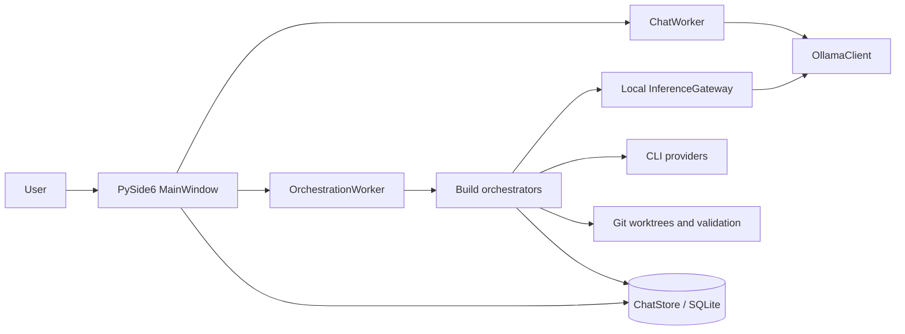
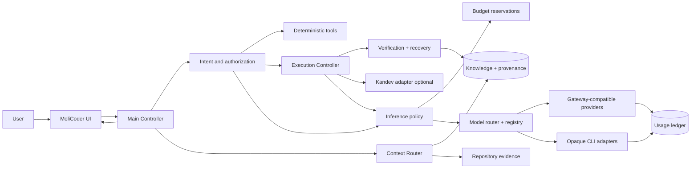

# MoliCoder platform transformation — execution tracker

**Created:** 2026-10-15
**Source:** user supplied “MoliCode — Complete Platform Transformation Plan”
**Status:** planning gate complete; implementation underway in dependency order. The user's later instruction to implement tasks superseded the source brief's planning-only limit for code work. Existing uncommitted work is preserved; paid inference, installations, credentials, and Kandev changes still require their own scoped authorization.

## How to use this file

- Check a task only after its stated result is saved and its verification passes. Put the evidence link or commit beside the checkbox.
- A checked research task means its facts were verified against dated primary sources; it does **not** mean an integration was implemented.
- Keep `?` for an unknown provider price, limit, license, privacy condition, or platform capability. Recheck volatile facts before implementation.
- Finish the **P** plans before starting the **I** plans. Each I plan has a small, independently reviewable outcome. Within a plan, tasks with no dependency on each other can run in parallel.
- `A` means affected existing modules; `N` means likely new modules or documents; `D` is prerequisite task ID; `V` is acceptance evidence; `C/R` is relative complexity/risk (S/M/L and low/medium/high). Paths are proposed touch points, not an instruction to replace a working module.
- Every implementation task inherits [the invariants](#nonnegotiable-invariants), must include a regression check for its touched boundary, and must leave the existing local chat and Build workflow usable. A task is ready for an agent only when its specified interface, inputs, output, and verification are in its task packet.
- The existing `.molicoder` plan schema allows **at most five tasks per run** (`src/local_model_chat/molicoder/planner/plan.schema.json`). Each mini-plan below is five tasks or fewer so it can be entered as one run after the corresponding design is approved. Research tasks can be done without an agent run.

## Snapshot of the actual repository

This is a read-only source inspection, not a completed behavior audit. The checkout was on `main` at `69106e7` when this file was written and had pre-existing uncommitted source and test changes. Re-audit changed modules before implementation. The older `MOLICODER_PLAN.md` documents the earlier local-first build effort; preserve it as historical context.

| Area | Observed implementation | Treatment |
|---|---|---|
| Desktop shell | PySide6 app in `src/local_model_chat/main.py` and `ui/main_window.py`; Chat and Build views | Extend |
| Local chat | `workers.py:ChatWorker` streams directly through `ollama.py:OllamaClient`; presets in `config.py`; token estimate in `context.py` | Keep UX; refactor inference entry point |
| Persistence | `storage.py:ChatStore` uses SQLite for conversations, messages, projects, runs, tasks, validation, events, preferences, and external calls | Extend with migrations |
| Project/build | `molicoder/registry.py`, `projectstate.py`, `recon.py`, `planner/`, `scheduler.py`, `orchestrator.py`, `worktree.py`, `validate.py` | Reuse and extend |
| Local inference | `molicoder/gateway.py:InferenceGateway` serializes Ollama calls | Extend; it is not yet a universal authorization gateway |
| External agents | `molicoder/providers.py` contains Codex, Claude, and Copilot CLI adapters in the working tree; `planner/codex_cli.py` contains earlier Codex planning/consulting | Reconcile and verify; CLI accounting can be opaque |
| Quality and telemetry | `validate.py`, `repair.py`, `metrics.py`, `storage.py` provide bounded validation, repair, and run metrics | Extend to acceptance evidence and unified usage ledger |
| Packaging | `pyproject.toml`, `requirements.lock`, `LocalModelChat.spec`, `scripts/build.ps1`, `scripts/install.ps1` are Windows focused | Extend after platform assessment |
| Tests | `tests/` has unit, UI, orchestration, packaging, and opt-in live model coverage; `.github/workflows/build.yml` | Reuse; add contract tests where needed |

### Baseline gaps to confirm in P01

The source inspection did not show a universal request authorization layer, provider offering/pricing registry, cross-provider spend ledger, canonical architectural-decision store, environment installer, or Kandev adapter. Treat these as **unverified or missing**, not as proven absent across all history and runtime configurations. Chat currently uses a direct Ollama path, so central routing requires a deliberate migration. The current UI's Build path and provider behavior have uncommitted changes and need tests before being called stable.

## Nonnegotiable invariants

`G1` MoliCoder remains the user-facing application and works without Kandev.
`G2` Conversation, read-only tools, and executable development tasks have separate intent and authorization paths.
`G3` Preserve source-linked project decisions, provenance, and verified task state across sessions and models.
`G4` All MoliCoder-owned inference is authorized and recorded; claim strict transport enforcement only for integrations where it is technically enforceable.
`G5` No unapproved subscription, metered call, privileged install, destructive action, or external side effect. Opaque subscription usage is labeled opaque.
`G6` Provider eligibility includes capability, terms, privacy, health, quota, and cost; unknown metered price is ineligible by default.
`G7` Deterministic checks decide completion; retries have hard attempt, time, token, and spend ceilings.
`G8` Reuse working chat, SQLite, worktree, validation, and Codex paths; prefer one local process with internal modules.
`G9` Credentials stay in supported secure stores; do not extract another app's tokens or bypass provider limits.
`G10` Keep the initial milestone single-machine and local-first; remote workers follow only after local recovery is reliable.

## Recommended direction (P06 design decision; implementation pending approval)

Extend the current Python/PySide6 modular monolith. Add a Main Controller between the UI and chat/build workers, a Context Router over versioned SQLite knowledge and repository evidence, and an Inference Control Plane that authorizes requests before dispatching to Ollama or provider adapters. Keep the existing Git worktree and validation machinery. Put a Kandev adapter behind the execution interface, disabled by default. A network gateway is optional for agents that support configurable endpoints; an opaque CLI remains a task-budgeted adapter. Do not use OpenRouter as a required hub. These are P06 design decisions, not claims that the code already implements them.

## Planning gate — research and architecture

The artifact for this gate is a dated, repository-specific blueprint linked from this tracker. Use official provider and project documentation for current external facts. Do not infer capabilities from an executable name or a marketing page. These tasks are intentionally checkable one at a time; no code changes are part of this gate.

### P01 — Verify the current product (5 tasks)

- [x] **P01-01 Inventory startup, UI, chat, Build, and data flow.** D: none. A: `main.py`, `ui/main_window.py`, `workers.py`, `ollama.py`, `storage.py`. N: `docs/plans/current-architecture.md`. V: source-cited component map and actual data-flow diagram distinguish chat from Build. C/R: S/low. Evidence: `docs/plans/current-architecture.md` (2026-10-15 source inspection).
- [x] **P01-02 Inventory execution and provider paths.** D: P01-01. A: `molicoder/runtime.py`, `orchestrator.py`, `providers.py`, `planner/`, `gateway.py`, `worktree.py`. N: same audit. V: list every inference entry point, CLI mode, auth path, enforcement limit, and where usage is recorded. C/R: M/medium. Evidence: `docs/plans/current-architecture.md` P01-02 inventory (2026-10-15).
- [x] **P01-03 Inventory storage, configuration, packaging, and OS assumptions.** D: P01-01. A: `storage.py`, `config.py`, `pyproject.toml`, `LocalModelChat.spec`, `scripts/`, `.github/`. N: same audit. V: schema map, migration strategy, install boundaries, and Windows/macOS/Linux gap list. C/R: M/low. Evidence: `docs/plans/current-architecture.md` P01-03 inventory (2026-10-15).
- [x] **P01-04 Run the existing no-cost test and packaging checks in a clean copy.** D: P01-01. A: `tests/`, `scripts/`. N: audit test log. V: record exact command, environment, pass/fail, and defects; do not run opt-in live inference. C/R: M/low. Evidence: `docs/plans/current-architecture.md` P01-04; 128 passed, 6 opt-in skipped. Full installer/build remains unrun by planning policy.
- [x] **P01-05 Classify every significant component.** D: P01-02, P01-03, P01-04. A: repository-wide. N: audit classification table. V: each area is Keep, Extend, Refactor, Replace, Remove, or Missing with file paths and rationale; mark uncertain claims. C/R: S/low. Evidence: `docs/plans/current-architecture.md` P01-05 classification.

### P02 — Verify provider and tool facts (5 tasks)

- [x] **P02-01 Define the evidence template.** D: P01-02. A: none. N: `docs/plans/provider-research.md`. V: each offering has exact ID/version, class (recurring free, trial, metered, subscription programmable, interactive CLI, automation agent, or local), capability, price, quotas, reset, terms, privacy, region, auth, official URL, date, confidence, and unknown fields. C/R: S/low. Evidence: `docs/plans/provider-research.md` template (2026-10-15).
- [x] **P02-02 Research direct hosted inference.** D: P02-01. N: provider research. V: dated primary-source rows for Google Gemini API, Groq, Cerebras, Cloudflare Workers AI, Mistral, Hugging Face, NVIDIA NIM, Cohere, and other viable direct APIs; compare latency test method. C/R: L/medium. Evidence: eight provider-specific documentation rows and comparable latency method in `docs/plans/provider-research.md` (2026-10-15); account facts and live measurements explicitly pending.
- [x] **P02-03 Research gateways and cloud catalogs.** D: P02-01. N: provider research. V: dated rows for OpenCode Zen, Kilo Gateway, OpenRouter, Vercel AI Gateway, Ollama Cloud, and relevant alternatives; document OpenRouter account and credential isolation from EcoDominicano. C/R: M/medium. Evidence: five current official-source rows, routing caveats, and explicit OpenRouter isolation rule in `docs/plans/provider-research.md` (2026-10-15).
- [x] **P02-04 Research subscriptions and official agent interoperability.** D: P02-01. A: `molicoder/providers.py`, `planner/codex_cli.py` (read only). N: provider research. V: verify Codex/ChatGPT subscription methods and limits, OpenCode Go, MiniMax and Z.ai coding plans, and whether OpenCode can officially use retained Codex access; explicitly separate API access from subscription capacity. C/R: L/high. Evidence: six documented access paths, local adapter inspection, and explicit unknown entitlements in `docs/plans/provider-research.md` (2026-10-15).
- [x] **P02-05 Research CLIs and local inference.** D: P02-01. N: provider research. V: official installation and unattended-use facts for OpenCode, Codex CLI, Copilot CLI, Claude Code, Kilo Code, Qwen Code, Antigravity/Gemini CLI, Amazon Q, Freebuff, Ollama, and llama.cpp; mark nonexistent/unsupported entries instead of guessing; verify hardware requirements for candidate local models. C/R: L/medium. Evidence: eleven source-grounded entries, unsupported headless distinctions, and local RAM/VRAM/Ollama inventory in `docs/plans/provider-research.md` (2026-10-15).

### P03 — Requirements, contracts, and context (5 tasks)

- [x] **P03-01 Convert the 33-section brief into a requirement matrix.** D: P01-05. N: `docs/plans/platform-blueprint.md`. V: every requirement maps to a design section, implementation mini-plan, and validation scenario; mandatory versus optional is explicit. C/R: M/low. Evidence: 33-row source-section traceability matrix in `docs/plans/platform-blueprint.md` (2026-10-15).
- [x] **P03-02 Specify intent, authorization, and controller contracts.** D: P01-01, P03-01. A: `ui/main_window.py`, `workers.py`, `molicoder/runtime.py`. N: blueprint. V: typed inputs/outputs and transitions for conversation, read-only retrieval, analysis, tool action, mutation, autonomous work, administration; ambiguity and permission handling shown. C/R: M/medium. Evidence: typed boundary table, seven-intent dispatch matrix, transitions, and acceptance examples in `docs/plans/platform-blueprint.md` (2026-10-15).
- [x] **P03-03 Specify canonical knowledge and provenance.** D: P01-03, P03-01. A: `storage.py`, `molicoder/recon.py`. N: blueprint. V: entities for approved decisions, requirements, rationale, rejected alternatives, source revision, confidence, supersession, correction, and archival; failed model output cannot become authoritative automatically. C/R: M/medium. Evidence: six-entity schema, lifecycle and authority rules in `docs/plans/platform-blueprint.md` (2026-10-15).
- [x] **P03-04 Specify retrieval and handoff packets.** D: P03-03. A: `context.py`, `molicoder/recon.py`, `orchestrator.py`. N: blueprint. V: selection order, token allocation, deduplication, stale-revision detection, privacy filter, and canonical task packet with goal, constraints, verified findings, failure evidence. C/R: M/medium. Evidence: ContextRequest/Packet and TaskHandoff contracts, selection and cache rules in `docs/plans/platform-blueprint.md` (2026-10-15).
- [x] **P03-05 Specify the data model and migration plan.** D: P03-02, P03-03. A: `storage.py`, `domain.py`. N: blueprint schema appendix. V: ownership, keys, state transitions, retention and migrations for conversations, project knowledge, decisions, providers, offerings, accounts, quotas, budgets, requests, usage, installs, Kandev connections, runs, attempts, artifacts, audit events. C/R: L/medium. Evidence: eight-aggregate schema and five-step backup/forward-migration design in `docs/plans/platform-blueprint.md` (2026-10-15).

### P04 — Inference, cost, and security design (5 tasks)

- [x] **P04-01 Specify registry and offering lifecycle.** D: P02-02 through P02-05, P03-05. N: blueprint. V: provider/model/offering separation, discovery, freshness, deprecation, auth, terms, capabilities, privacy, eligibility states, and unknown-price exclusion. C/R: M/medium. Evidence: registry layers, state transitions, eligibility intersection, and acceptance checks in `docs/plans/platform-blueprint.md` (2026-10-15).
- [x] **P04-02 Specify inference authorization and adapter contracts.** D: P04-01. A: `molicoder/gateway.py`, `ollama.py`, `providers.py`, `workers.py`. N: blueprint. V: request/response, streaming, tools, structured output, cancellation, timeout, retries, usage, tracing, and error normalization; strict versus opaque enforcement clearly labeled. C/R: L/high. Evidence: request/event/result and adapter contracts, strict/opaque table, retry/cancel semantics in `docs/plans/platform-blueprint.md` (2026-10-15).
- [x] **P04-03 Specify budget ledger and routing policy.** D: P04-01, P04-02. N: blueprint. V: atomic reservations, reconciliation, concurrent runs, per-task/project/month limits, subscription pacing, reasoning effort, expected cost per accepted task, fallback, explainability, and hard-stop cases. C/R: L/high. Evidence: transaction, pacing, economic selection, decision record, and hard-stop rules in `docs/plans/platform-blueprint.md` (2026-10-15).
- [x] **P04-04 Specify privacy and credential policy.** D: P02-02 through P02-05, P04-02. N: blueprint. V: repository sensitivity, provider data policy, OS secret storage, redaction, prompt injection, installer trust, network limits, and documented OS-specific bypass limits. C/R: M/high. Evidence: privacy classes, credential/installer/network policy, OS limits and acceptance checks in `docs/plans/platform-blueprint.md` (2026-10-15).
- [x] **P04-05 Specify benchmarking and monthly cost scenarios.** D: P04-03. N: blueprint. V: four scenarios (free-first, Codex+free, Codex+one subscription, Codex+free+capped API), explicit assumptions, latency/quality/success data collection, accepted-task cost metric, and no purchase recommendation without measured benefit. C/R: M/medium. Evidence: four-scenario comparison, labeled illustrative arithmetic, and measurement gates in `docs/plans/platform-blueprint.md` (2026-10-15).

### P05 — Operations, execution, and UI design (5 tasks)

- [x] **P05-01 Design provisioning and doctor.** D: P01-03, P02-05, P04-04. N: blueprint. V: OS/hardware/tool discovery, official pinned install method, setup policy, authentication wait states, compatibility check, rollback, repair, update, uninstall, and usable partial-readiness state. C/R: L/high. Evidence: report/manifest/setup contracts, state transitions and acceptance checks in `docs/plans/platform-blueprint.md` (2026-10-15).
- [x] **P05-02 Design optional Kandev adapter.** D: P02-05, P03-02. N: blueprint. V: verify current official API/MCP/ACP/installation facts; disabled, attached, managed modes; ownership boundaries, readiness test, lifecycle, backup, local binding, and clean independence. C/R: L/high. Evidence: official CLI/MCP/service sources and adapter/mode/readiness contracts in `docs/plans/platform-blueprint.md` (2026-10-15).
- [x] **P05-03 Design execution, verification, and recovery.** D: P03-04, P04-03. A: `molicoder/orchestrator.py`, `worktree.py`, `validate.py`, `repair.py`. N: blueprint. V: explicit state machine, isolated checkpoint, deterministic and architectural checks, failure categories, bounded alternate-model handoff, side-effect idempotency, cancellation, and evidence record. C/R: L/high. Evidence: lifecycle, checkpoint, failure/retry/cancel/receipt contract in `docs/plans/platform-blueprint.md` (2026-10-15).
- [x] **P05-04 Design UI surfaces and user journeys.** D: P03-02, P04-03, P05-01 through P05-03. A: `ui/main_window.py`, `ui/widgets.py`. N: blueprint. V: conversation, context correction, providers, setup/auth, usage, task state, why this model, and approval flows drawn without duplicating Kandev's full UI. C/R: M/medium. Evidence: proposed Chat/Build, provider, usage, approval and timeline surfaces in `docs/plans/platform-blueprint.md` (2026-10-15).
- [x] **P05-05 Walk all 13 required scenarios.** D: P05-04. N: blueprint scenario appendix. V: A–M each show component calls, state changes, inference use, authorization, failure path, and visible outcome; cover greeting through authentication-required. C/R: L/medium. Evidence: A–M design traces in `docs/plans/platform-blueprint.md` (2026-10-15).

### P06 — Decide and release the implementation blueprint (5 tasks)

- [x] **P06-01 Compare three architectures.** D: P01-05, P04-02, P05-03. N: blueprint. V: incremental extension, modular monolith control plane, and external gateway foundation compared for compatibility, upkeep, performance, security, cost, deployment, platforms, extension, and migration risk. C/R: M/medium. Evidence: comparison/decision table in `docs/plans/platform-blueprint.md` (2026-10-15).
- [x] **P06-02 Decide boundaries and interfaces.** D: P06-01. N: blueprint. V: target Mermaid diagram and component contracts name Main Controller, Context, Intent, Registry, Router, Gateway, Ledger, Provisioning, Execution, Verification, and Kandev adapter; specify which are modules versus processes. C/R: M/medium. Evidence: target diagram, contracts and M1–M7 roadmap in `docs/plans/platform-blueprint.md` (2026-10-15).
- [x] **P06-03 Publish the risk register and open decisions.** D: P02-02 through P02-05, P06-02. N: blueprint. V: every risk in source brief has trigger, mitigation, owner, residual limit; separate verified facts from assumptions and approval decisions. C/R: M/medium. Evidence: 22-risk register and decision status in `docs/plans/platform-blueprint.md` (2026-10-15).
- [x] **P06-04 Review task packets against the current repository.** D: P06-02, P06-03. N: this tracker. V: each I task has real touch points, contract, dependencies, test, output, complexity/risk, and applicable invariants; rebase for intervening source changes. C/R: M/low. Evidence: packet review and path convention in `docs/plans/platform-blueprint.md` (2026-10-15).
- [x] **P06-05 Approve the first implementation milestone.** D: P06-04. N: blueprint decision record. V: smallest useful milestone is defined, baseline tests pass, privacy and cost defaults are explicit, and user-facing behavior is reviewable before code work. C/R: S/medium. Evidence: user directed implementation; M1 scope and 128-pass baseline in `docs/plans/platform-blueprint.md` (2026-10-15).

**Planning gate exit:** `platform-blueprint.md` contains the 25 final-deliverable sections requested by the source brief, with source links for current provider facts, repository file citations, current/target diagrams, the backlog below, cost scenarios, risks, and a concrete first milestone. Implementation remains blocked until this gate is complete.

## Implementation backlog — small, dependency-ordered mini-plans

The module names below are proposed until P06-04 confirms interfaces. Each checked task requires a test or a documented manual proof. All tasks obey G1–G10; a task lists extra invariants where a failure would be particularly costly. Each mini-plan has no more than five tasks. Parallel work is safe only when prerequisites are checked and touch points do not conflict.

### I01 — First useful milestone: reliable project status in chat (5 tasks)

**Outcome:** From the Chat view, “What task are we on?” reads the selected project's authoritative run/task state and answers accurately without model inference. Ordinary model chat and Build still work. This is the earliest visible benefit and proves controller separation.

- [x] **I01-01 Define request and response types for the Main Controller.** D: P06-05. A: `domain.py`, `workers.py`; N: `controller.py`. Interface: `handle(message, project_id) -> result` with kind, evidence, action state. V: typed contract tests cover no project and invalid project. C/R: S/low. G2,G3. Evidence: `MainController`, `ControllerResult`, and `tests/test_controller.py` (2026-10-15).
- [x] **I01-02 Add read-only current-run query.** D: I01-01. A: `storage.py`; N: none. Interface: project ID to latest authoritative run/tasks with timestamps. V: SQLite fixture proves completed, running, blocked, and no-run answers; no model call. C/R: S/low. G3. Evidence: `current_project_run_status` and parameterized fixtures (2026-10-15).
- [x] **I01-03 Route explicit status requests through the controller.** D: I01-02. A: `ui/main_window.py`, `workers.py`; N: none. Boundary: only high-confidence status wording; ambiguous text follows the existing chat path. V: UI test proves status response uses database and ordinary greeting still streams. C/R: M/medium. G2,G8. Evidence: Chat branch and status/greeting UI tests (2026-10-15).
- [x] **I01-04 Show source and freshness of the status answer.** D: I01-03. A: `ui/main_window.py`, `ui/widgets.py`; N: none. V: response names project, run/task ID and update time, or explicitly says no active task; no invented progress. C/R: S/low. G3. Evidence: source label, timestamp, and no-project/no-run fixtures (2026-10-15).
- [x] **I01-05 Validate milestone regression and document it.** D: I01-01 through I01-04. A: `tests/`, `README.md`; N: milestone evidence in blueprint. V: no-cost tests and scripted Chat/Build smoke pass; record exact results and any manual visual limitation. C/R: S/low. G8. Evidence: `docs/plans/platform-blueprint.md`; 135 passed, 6 live tests skipped, including UI and scripted Build workflow (2026-10-15).

### I02 — Intent, actions, and controller boundaries (5 tasks)

- [x] **I02-01 Add an explicit intent taxonomy and confidence result.** D: I01-05. A: `domain.py`; N: `intent.py`. Interface: text/context to conversation, retrieval, analysis, tool, mutation, execution, or administration plus confidence. V: table tests include follow-ups and ambiguous requests. C/R: M/medium. G2. Evidence: `src/local_model_chat/intent.py` and `tests/test_intent.py`; focused suite 25 passed (2026-10-15).
- [x] **I02-02 Add deterministic handlers for version, changed files, and current task.** D: I02-01. A: `molicoder/projectstate.py`, `storage.py`; N: `tool_queries.py`. V: queries use actual Git/SQLite state, report errors, and make zero inference calls. C/R: M/low. G2,G7. Evidence: `controller.py`, `tool_queries.py`, `tests/test_controller.py` Git fixture and status fixtures (2026-10-15).
- [x] **I02-03 Add action risk classification and authorization record.** D: I02-01. A: `storage.py`, `domain.py`; N: `authorization.py`. Interface: action, scope, risk, user decision, expiry. V: privileged, destructive, external, and financial requests cannot execute without a matching record. C/R: M/high. G5. Evidence: persisted exact-scope policy and Build button authorization receipt; `tests/test_authorization.py` and UI gate fixture (2026-10-15).
- [x] **I02-04 Route analysis and execution explicitly.** D: I02-02, I02-03. A: `ui/main_window.py`, `workers.py`, `molicoder/runtime.py`; N: none. V: “evaluate” is read-only; “implement” creates an execution proposal; ordinary conversation never starts a Build run. C/R: M/high. G2,G5. Evidence: controller proposal/read-only Chat routing and UI fixtures (2026-10-15).
- [x] **I02-05 Surface pending clarification or approval in Chat.** D: I02-04. A: `ui/main_window.py`; N: none. V: pending state survives view switch and can be cancelled; no hidden execution starts. C/R: S/medium. G2,G5. Evidence: pending Build card, project-selection wait, cancel/review tests; 158 passed, 6 live skipped in full no-cost suite (2026-10-15).

### I03 — Project knowledge and continuity (5 tasks)

- [x] **I03-01 Add versioned knowledge/decision schema migration.** D: P03-05, I01-05. A: `storage.py`, `domain.py`; N: none. Interface: project-linked fact/decision with provenance, status, revision, author. V: migration preserves a copy of the existing chat DB and passes rollback/reopen tests. C/R: M/high. G3,G8. Evidence: schema v3, online pre-upgrade backup, and restore/reopen fixture in `tests/test_storage.py` (2026-10-15).
- [x] **I03-02 Add approved-decision lifecycle.** D: I03-01. A: `storage.py`; N: `knowledge.py`. V: create, approve, correct, supersede, invalidate, archive, and query; unverified model notes never overwrite approved records. C/R: M/medium. G3. Evidence: append-only revision service and `tests/test_knowledge.py`; full no-cost suite 162 passed, 6 skipped (2026-10-15).
- [x] **I03-03 Link conversations and runs to project knowledge.** D: I03-02. A: `storage.py`, `ui/main_window.py`, `molicoder/orchestrator.py`; N: none. V: a conversation switch/restart retains project association and links to relevant run/decision IDs. C/R: M/medium. G3. Evidence: schema v4 conversation/knowledge links, cross-project guard, UI restore and restart tests (2026-10-15).
- [x] **I03-04 Build a continuity summary from authoritative records.** D: I03-03. A: `storage.py`, `molicoder/recon.py`; N: `continuity.py`. Interface: project ID to objective, decisions, verified work, blockers, open questions, source revisions. V: “Where did we leave off?” after restart cites current state and marks missing evidence. C/R: M/medium. G3,G7. Evidence: deterministic continuity controller and `tests/test_continuity.py` (2026-10-15).
- [x] **I03-05 Expose knowledge review and correction.** D: I03-04. A: `ui/main_window.py`; N: none. V: user can inspect provenance and correct a record without editing transcripts or erasing the old version. C/R: M/medium. G3. Evidence: Project knowledge dialog and correction/approval fixture; 168 passed, 6 live skipped full suite (2026-10-15).

### I04 — Repository and task context router (5 tasks)

- [x] **I04-01 Create a revision-bound repository index.** D: I03-01. A: `molicoder/recon.py`; N: `molicoder/repo_index.py`. Interface: commit/path/symbol/test references. V: excludes secret and generated paths; invalidates on revision change. C/R: M/medium. G3,G9. Evidence: content hashes, commit/index ID, ignored/secret path fixture in `tests/test_repo_index.py` (2026-10-15).
- [x] **I04-02 Select relevant files and decisions for a question/task.** D: I04-01, I03-02. A: `context.py`, `molicoder/recon.py`; N: `context_router.py`. V: known cross-file fixture retrieves applicable decision and tests without whole-repo ingestion. C/R: M/medium. G3. Evidence: scored selection and cross-file authentication fixture (2026-10-15).
- [x] **I04-03 Add token allocation and deduplication.** D: I04-02. A: `context.py`; N: none. V: context sections fit selected model limit with reserved output; mandatory constraints survive compression; oversized requests fail clearly. C/R: M/medium. G3,G6. Evidence: `ContextPacket` budget/truncation/dedup and constrained-context fixture (2026-10-15).
- [x] **I04-04 Produce a canonical model-handoff packet.** D: I04-03. A: `molicoder/orchestrator.py`, `repair.py`; N: `task_packet.py`. Interface: objective, acceptance, decision IDs, source revisions, verified work, failed attempts, diagnostics, budget. V: alternate adapter receives only validated state and reproducible failure evidence. C/R: M/high. G3,G7. Evidence: `TaskHandoff` used by sequential Build prompts and orchestrator regressions (2026-10-15).
- [x] **I04-05 Detect stale or conflicting context.** D: I04-04. A: `molicoder/validate.py`; N: none. V: test catches changed source revision and a proposed edit contrary to an approved invariant; reports the exact source decision. C/R: M/high. G3,G7. Evidence: context freshness and explicit path invariant checks; 174 passed, 6 skipped (2026-10-15).

### I05 — Provider registry and eligibility (5 tasks)

- [x] **I05-01 Add provider, account, model, and offering records.** D: P04-01, I03-01. A: `storage.py`, `domain.py`; N: `inference/registry.py`. V: one model can have distinct provider offerings/prices/permissions; migration keeps existing preferences. C/R: M/medium. G6. Evidence: schema v5, separate records and v4 upgrade test (2026-10-15).
- [x] **I05-02 Add local Ollama and known CLI discovery adapters.** D: I05-01. A: `ollama.py`, `molicoder/providers.py`; N: `inference/discovery.py`. V: installed/configured/authentication states are distinct; discovery makes no paid request. C/R: M/medium. G5,G6. Evidence: read-only discovery and no-inference fixture (2026-10-15).
- [x] **I05-03 Add provider metadata import with timestamps and source URLs.** D: I05-01, P02-02 through P02-05. A: none; N: `inference/catalog.py`. V: stale/unknown pricing blocks paid eligibility; manual override is explicit and logged; no undocumented scrape is required. C/R: M/high. G6. Evidence: dated catalog import/history/manual override and eligibility tests (2026-10-15).
- [x] **I05-04 Add capability and privacy eligibility checks.** D: I05-02, I05-03. A: `storage.py`; N: `inference/eligibility.py`. V: tests reject missing tool/stream/structured-output capability, confidential-repo mismatch, prohibited automation, expired quota, and unhealthy endpoint. C/R: M/high. G6,G9. Evidence: `tests/test_inference_eligibility.py` (2026-10-15).
- [x] **I05-05 Add refresh, deprecation, and health states.** D: I05-04. A: none; N: `inference/health.py`. V: catalog changes do not silently activate paid offerings; unavailable/deprecated state is visible and old records remain auditable. C/R: M/medium. G5,G6. Evidence: health/enable/deprecate audit and exact financial authorization test; 181 passed, 6 skipped full suite (2026-10-15).

### I06 — Central inference authorization and transport (5 tasks)

- [x] **I06-01 Define the unified inference request/response contract.** D: P04-02, I05-04. A: `molicoder/gateway.py`, `ollama.py`; N: `inference/contracts.py`. V: contract covers provider/model, capability, project sensitivity, context/output bounds, tracing, usage, cancellation, and normalized errors. C/R: M/medium. G4,G6.
- [x] **I06-02 Add a policy decision before dispatch.** D: I06-01, I02-03. A: `molicoder/gateway.py`; N: `inference/policy.py`. V: unauthorized, unknown-price, disallowed-provider, and budget-denied calls fail before network/CLI invocation. C/R: M/high. G4,G5.
- [x] **I06-03 Route local chat through the authorized Ollama adapter.** D: I06-02. A: `workers.py`, `ollama.py`, `ui/main_window.py`; N: `inference/adapters/ollama.py`. V: streaming/thinking/cancel/context warnings match prior UX; trace records request; no second direct UI inference path remains. C/R: L/high. G4,G8.
- [x] **I06-04 Route Build's local inference through the same policy.** D: I06-03. A: `molicoder/gateway.py`, `runtime.py`, `planner/local.py`; N: none. V: local planning/execution still validates and every inference has a request ID. C/R: M/high. G4,G8.
- [x] **I06-05 Wrap opaque subscription CLIs as task-budgeted adapters.** D: I06-02, I05-02. A: `molicoder/providers.py`, `planner/codex_cli.py`; N: `inference/adapters/cli.py`. V: preflight authorization, call/time ceilings, disclosed token-accounting limit, cancellation, and no claim of strict token enforcement. C/R: L/high. G4,G5,G9.

### I07 — Usage ledger and hard budgets (5 tasks)

- [x] **I07-01 Add immutable inference request and usage records.** D: I06-01. A: `storage.py`, `molicoder/metrics.py`; N: `inference/ledger.py`. V: provider usage, estimated/actual cost, timestamps, purpose, status, and source event reconcile after success/failure; secrets are redacted. C/R: M/high. G4,G5.
- [x] **I07-02 Add atomic per-request budget reservations.** D: I07-01. A: `storage.py`; N: `inference/budget.py`. V: concurrency test proves two workers cannot overspend a shared hard limit; failures release or reconcile reservations. C/R: M/high. G5.
- [x] **I07-03 Add project, task, monthly, and premium-reserve policies.** D: I07-02. A: `storage.py`; N: none. V: table tests enforce each limit before metered invocation and support explicit user-approved exceptions. C/R: M/high. G5.
- [x] **I07-04 Track free, subscription, and metered capacity distinctly.** D: I07-01, I05-03. A: `storage.py`; N: none. V: unknown subscription allowance stays unknown; estimates never display as provider-confirmed balances; reset times have timezone/source. C/R: M/medium. G5,G6.
- [x] **I07-05 Add pacing and cost explanations.** D: I07-03, I07-04. A: `ui/main_window.py`; N: `inference/pacing.py`. V: forecast flags fast allowance burn; user can see why a call was deferred or approved; no automatic purchase. C/R: M/medium. G5.

### I08 — Routing, fallback, and token efficiency (5 tasks)

- [x] **I08-01 Add task/capability classification for routing.** D: I02-01, I05-04. A: `molicoder/runtime.py`; N: `inference/router.py`. V: low-confidence or unverified capabilities produce clarification or safe fallback, never a guessed paid route. C/R: M/medium. G2,G6.
- [x] **I08-02 Rank eligible offerings by expected accepted-task cost.** D: I08-01, I07-04. A: `molicoder/metrics.py`; N: none. V: policy uses price, measured success, retries, latency, and urgency; defaults to deterministic tools where sufficient. C/R: M/medium. G5,G6.
- [x] **I08-03 Add provider-specific effort, context, and output policies.** D: I08-02, I04-03. A: `config.py`, `context.py`; N: none. V: reasoning settings are only sent where supported, billable reasoning is accounted for when reported, and limits are enforced. C/R: M/medium. G5,G6.
- [x] **I08-04 Add bounded failure fallback and cooldown.** D: I08-02, I06-05, I07-03. A: `molicoder/repair.py`, `orchestrator.py`; N: none. V: quota/auth/outage/model failure map to distinct actions; retry never exceeds call, time, token, or spend ceiling. C/R: L/high. G5,G7.
- [x] **I08-05 Record why each route was chosen.** D: I08-02. A: `storage.py`, `ui/main_window.py`; N: none. V: trace lists selected offering, key constraints, estimated/actual usage, and relevant alternatives without exposing credentials. C/R: S/medium. G4,G6.

### I09 — Environment discovery and doctor (5 tasks)

- [x] **I09-01 Build a read-only OS/hardware/tool inventory.** D: P05-01. A: `molicoder/projectstate.py`; N: `environment/discovery.py`. V: Windows, macOS, and Linux fixtures cover CPU/RAM/disk/GPU, package managers, agents, runtimes, and existing Kandev without changing them. C/R: M/medium. G8,G10.
- [x] **I09-02 Define install manifests from official sources.** D: I09-01, P02-05. A: `pyproject.toml`; N: `environment/manifests/`. V: version, source, hash/signature where available, OS/arch, prerequisites, license, rollback, and privilege requirement are explicit. C/R: M/high. G5,G9.
- [x] **I09-03 Implement read-only `molicoder doctor`.** D: I09-01, I05-02. A: `molicoder/cli.py`; N: `environment/doctor.py`. V: human/JSON output distinguishes ready, limited, login needed, permission needed, unsupported, failed, update available; no secret values or paid probes. C/R: M/low. G5,G9.
- [x] **I09-04 Add a setup policy and dry-run plan.** D: I09-02, I02-03. A: `storage.py`; N: `environment/policy.py`. V: explicit user setup scope; dry run reports intended installs, downloads, privilege, disk cost, and pending auth before mutation. C/R: M/high. G5,G9.
- [x] **I09-05 Add readiness dashboard data contract.** D: I09-03, I09-04. A: `ui/main_window.py`; N: none. V: app remains usable with missing integrations and shows concrete next action per component. C/R: S/medium. G1.

### I10 — Safe installation and authentication onboarding (5 tasks)

- [x] **I10-01 Install one lightweight tool through a verified official method.** D: I09-04. A: `molicoder/projectstate.py`; N: `environment/install.py`. V: pinned version, trusted source, timeout, captured receipt, idempotent reinstall, and clean failure; no arbitrary remote script execution. C/R: M/high. G5,G9. Evidence: user-approved official Kandev 0.97.0 Windows archive installed under the managed data folder; exact pinned SHA-256 matched, receipt survived idempotent reinstall, and executable reported `v0.97.0` (2026-10-15).
- [x] **I10-02 Add independent install-job queue and partial progress.** D: I10-01. A: `storage.py`, `workers.py`; N: none. V: one provider waiting for login does not block other approved setup jobs; restart restores job state. C/R: M/medium. G1,G5.
- [x] **I10-03 Add explicit supported login and key onboarding.** D: I10-02, P04-04. A: `ui/main_window.py`, `molicoder/providers.py`; N: `environment/auth.py`. V: only official flows; keys use secure OS store where feasible; logs and crash records contain no key/token. C/R: M/high. G5,G9.
- [x] **I10-04 Add repair, update, rollback, and uninstall for managed tools.** D: I10-01. A: none; N: `environment/maintenance.py`. V: compatibility and user-data preservation tests; breaking/privileged changes require explicit authorization. C/R: L/high. G5,G9.
- [x] **I10-05 Add local model suitability and download approval.** D: I09-01, I09-04. A: `ollama.py`, `config.py`; N: none. V: cloud offering registration never downloads weights; local model plan shows RAM/VRAM/disk and requires approval before a large download. C/R: M/medium. G5,G10.

### I11 — Coding-agent interfaces (5 tasks)

- [x] **I11-01 Reconcile existing Codex paths into one adapter contract.** D: I06-05, P02-04. A: `molicoder/providers.py`, `planner/codex_cli.py`, `runtime.py`; N: none. V: existing supported login remains intact, read-only planning and writable execution have explicit scopes, and one usage trail exists. C/R: L/high. G4,G8,G9.
- [x] **I11-02 Add OpenCode discovery and documented launch contract.** D: I11-01, P02-05. A: `molicoder/providers.py`; N: agent adapter. V: binary/version/auth/profile detection and mock invocation use only officially supported flags; free CLI is not classified as free inference. C/R: M/medium. G5,G6.
- [x] **I11-03 Add gateway-compatible agent endpoint configuration where supported.** D: I06-02, I11-02. A: `molicoder/providers.py`; N: gateway endpoint adapter. V: test confirms an agent uses the configured local endpoint, carries request IDs, and lacks direct paid credentials; unsupported agents remain opaque. C/R: L/high. G4,G9.
- [x] **I11-04 Add optional eligible agent profiles.** D: I11-01, P02-05. A: `molicoder/providers.py`; N: none. V: each supported agent has documented auth/terms, permissions, sandbox, cancellation, capability and regression fixtures; deprecated/unavailable tools are excluded. C/R: M/medium. G5,G6.
- [x] **I11-05 Expose agent selection and limitations.** D: I11-03, I11-04. A: `ui/main_window.py`; N: none. V: user can see strict-gateway versus opaque status, remaining known limits, and why an agent is unavailable. C/R: S/medium. G4,G6.

### I12 — Optional Kandev integration (5 tasks)

- [x] **I12-01 Define disabled/attached/managed mode and adapter interface.** D: P05-02, I02-04. A: `molicoder/runtime.py`; N: `kandev/contracts.py`. V: disabled mode uses current Build engine with no Kandev dependency; task and event mappings are explicit. C/R: M/medium. G1,G8.
- [x] **I12-02 Discover an existing Kandev install without mutation.** D: I12-01, I09-01. N: `kandev/discovery.py`. V: location, version, endpoint, data path, and compatibility are reported; existing config/data remain untouched. C/R: M/medium. G1,G9.
- [x] **I12-03 Add managed install/backup/rollback from verified release.** D: I12-02, I10-04. N: `kandev/manager.py`. V: explicit setup authorization, pinned compatible release, backup receipt, local binding, rollback, and unsupported-platform handling. C/R: L/high. G5,G9.
- [x] **I12-04 Add task/session/worktree API integration.** D: I12-01, I12-02, P05-02. A: `molicoder/orchestrator.py`; N: `kandev/adapter.py`. V: contract tests map task IDs, state, logs, cancellation and recovery without duplicating Kandev internals. C/R: L/high. G1,G7. Evidence: pinned adapter contracts, explicit Build owner selection, restart recovery and local acceptance; 355 passed, 6 live skipped (2026-10-15).
  - [x] **I12-04a Verify the pinned REST task contract and add bounded create/read/lookup transport.** Exact external authorization and no agent launch; 9 focused tests pass.
  - [x] **I12-04b Negotiate versioned task/session event and log transport.** Pinned v0.97.0 session-message paging resumes from the saved cursor after restart; 11 focused tests pass.
  - [x] **I12-04c Add session cancellation with observed identity fencing.** Stop targets the observed agent execution ID; local WebSocket and identity fixtures pass.
  - [x] **I12-04d Switch selected runs to Kandev-owned tasks and reconcile worktrees.** Preserve internal Build when Kandev is disabled.
    - [x] **I12-04d1 Add separately authorized create-and-launch transport.** Pinned REST create can set `start_agent` only after exact create and launch approvals; a fixture proves denied calls never reach the endpoint (15 focused tests passed).
    - [x] **I12-04d2 Select Kandev ownership in Build and recover by external ID.** A selected run must never fall back to internal execution after remote creation.
      - [x] **I12-04d2a Wire the adapter to authorized launch and reconcile a lost create response.** Lookup by stable external ID recovers the observed remote task without a second launch; 17 focused tests pass.
      - [x] **I12-04d2b Persist ownership selection in the Build run and route to the adapter.** Explicit backend selection records Kandev ownership before launch, and restart reconciles by external ID without local fallback; 22 focused tests pass. Disabled mode stays internal.
      - [x] **I12-04d2c Expose selected Kandev ownership, pending state, and recovery in Build.** Internal Build remains the default; explicit Kandev selection, exact launch authorization, pending owner status, restart reconciliation and accepted-result apply are verified in UI fixtures.
    - [x] **I12-04d3 Reconcile the remote worktree and verify local acceptance.** Missing or mismatched worktree identity requires review; fixed validation and fenced apply are verified in fixtures.
      - [x] **I12-04d3a Read the pinned primary-session worktree identity.** Task/session ID fencing carries the observed path, branch, base commit, and repository ID into the snapshot; 21 focused tests pass.
      - [x] **I12-04d3b Verify the Kandev worktree belongs to the selected repository.** Registered clean worktree, repository ID, branch, base ancestry, and changed HEAD must match before a checkpoint is recorded; 25 focused tests pass.
      - [x] **I12-04d3c Run deterministic acceptance and keep final apply under MoliCoder control.** Remote completion alone cannot mark a local task complete.
        - [x] **I12-04d3c1 Gate `ready_to_apply` on architecture and fixed validation checks.** Recheck the same clean checkpoint after validation and record completion once; failing checks leave review pending.
        - [x] **I12-04d3c2 Apply the accepted checkpoint with base/revision fencing.** Explicit backend apply verifies the saved completion, remote checkpoint, selected branch and clean checkout; fast-forward is idempotent after a crash.
- [x] **I12-05 Run harmless readiness and lifecycle tests.** D: I12-03, I12-04. N: `tests/` integration fixture. V: executable, backend, connection, agent profile, routing policy, test worktree/task, result, stop/restart, and no-Kandev regression pass. C/R: L/high. G1,G4. Evidence: `kandev-live-readiness.md` records the isolated v0.97.0 live service, free OpenCode profile, MoliCoder-owned worktree task, local acceptance/apply, restart recovery, and Windows launcher limitation (2026-10-15).
  - [x] **I12-05a Verify installed executable and pinned compatibility.** V: official managed binary runs `--version`, discovery reports `pinned_version`, and no service is launched. Evidence: Kandev 0.97.0 version/discovery probe (2026-10-15).
  - [x] **I12-05b Run live backend, agent, worktree, stop/restart lifecycle.** V: configured service and agent profile pass a harmless task. Evidence: loopback backend and free OpenCode profile produced a committed clean worktree; restart preserved the task and message cursor. The launcher socket failure required direct backend startup (2026-10-15).
  - [x] **I12-05c Verify MoliCoder-owned acceptance and idempotent apply against the live service.** V: exact one-file check reaches `ready_to_apply`; fast-forward applies once in the disposable fixture. Evidence: live run 1 reached `ready_to_apply`, applied checkpoint `ccefcf1a2627208068e7a21ff6581bb6b17e39e6`, and repeat apply returned the same commit (2026-10-15).

### I13 — Verification and architectural consistency (5 tasks)

- [x] **I13-01 Record acceptance criteria and verification commands per task.** D: I02-04, P05-03. A: `molicoder/planner/schema.py`, `planner/plan.schema.json`, `storage.py`; N: none. V: planner schema remains bounded and old plans load; every new task has a checkable result. C/R: M/medium. G7.
- [x] **I13-02 Extend deterministic validation profiles.** D: I13-01. A: `molicoder/validate.py`; N: none. V: compile/type/lint/test/static/security checks run only from approved commands, with failure provenance and timeouts. C/R: M/medium. G7,G9.
- [x] **I13-03 Check applicable architectural invariants.** D: I04-05, I13-02. A: `molicoder/validate.py`; N: none. V: fixture rejects a passing build that violates an approved project rule and cites that rule; uncertain cases go to review. C/R: L/high. G3,G7.
- [x] **I13-04 Add evidence-based completion record.** D: I13-02, I13-03. A: `storage.py`, `molicoder/orchestrator.py`; N: none. V: completion includes revision, checks, output artifacts, unmet criteria, and human-review status; model prose alone cannot pass. C/R: M/high. G7.
- [x] **I13-05 Add selective model review.** D: I13-04, I07-03. A: `molicoder/orchestrator.py`; N: none. V: review only runs when deterministic evidence is insufficient and an eligible authorized route remains; review cannot override failed deterministic checks. C/R: M/medium. G5,G7.

### I14 — Safe execution and recovery (5 tasks)

- [x] **I14-01 Persist full task lifecycle and wait reasons.** D: I13-01, I07-03. A: `storage.py`, `molicoder/orchestrator.py`; N: none. V: proposed/ready/running/verifying/completed plus blocked, failed, retrying, quota, approval, auth, cancelled, review states survive restart. C/R: M/high. G3,G7.
- [x] **I14-02 Snapshot verified intermediate work.** D: I14-01. A: `molicoder/worktree.py`, `orchestrator.py`; N: none. V: checkpoint/revision captures accepted work; failed attempts cannot silently contaminate the next attempt. C/R: M/high. G7,G8.
- [x] **I14-03 Classify failures and choose recovery action.** D: I08-04, I14-02. A: `molicoder/repair.py`, `fingerprint.py`; N: none. V: tests distinguish provider, agent/process, validation, architecture, no-progress, and interrupted failures. C/R: M/medium. G7.
- [x] **I14-04 Hand off to an alternate eligible model.** D: I14-03, I04-04. A: `molicoder/orchestrator.py`; N: none. V: transfer packet carries verified progress and diagnostics; no over-budget retry; same failure loop stops with explanation. C/R: L/high. G3,G5,G7.
- [x] **I14-05 Guard external side effects across retries and crashes.** D: I14-01, I02-03. A: `molicoder/tools.py`, `orchestrator.py`; N: `actions/receipts.py`. V: idempotency receipt prevents duplicate deployment/payment/destructive action; unsupported action stops for user review. C/R: L/high. G5,G7. Evidence: durable receipt, crash/uncertain replay, and executor review-stop tests pass (2026-10-15). Opaque CLI native effects cannot be intercepted; automatic retry stops for review.
  - [x] **I14-05a Reconcile a verified uncertain external outcome without replay.** Exact reconciliation authorization and matching action identity close an uncertain receipt; 7 focused tests pass.
  - [x] **I14-05b Stop automatic opaque-agent retries when external side effects may have occurred.** Preserve the worktree and require review before a second agent execution. A failed or unvalidated opaque execution now stops before repair or handoff; focused tests cover both outcomes.
  - [x] **I14-05c Propagate dispatch-time external review to the executor.** A review requirement raised while dispatching a tool stops the remaining batch and returns `review_required`; 27 focused executor, receipt, and tool tests pass (2026-10-15).

### I15 — User surfaces and observability (5 tasks)

- [x] **I15-01 Show provider/model registry and auth state.** D: I05-05, I10-03. A: `ui/main_window.py`; N: provider view. V: free/trial/subscription/metered labels, capabilities, privacy, health, quota, source date, and enable control are visible. C/R: M/medium. G6.
- [x] **I15-02 Show setup and doctor progress.** D: I09-05, I10-02. A: `ui/main_window.py`; N: setup view. V: installed, waiting login, waiting permission, failed, ready-limited and repair actions update without blocking Chat. C/R: M/medium. G1.
- [x] **I15-03 Show usage, budget, and route explanation.** D: I07-05, I08-05. A: `ui/main_window.py`; N: cost view. V: daily/monthly usage, source of balances, subscription opacity, project/task limits, reset date, and accepted-task cost display without false precision. C/R: M/medium. G5.
- [x] **I15-04 Show task evidence and handoffs.** D: I14-04, I13-04. A: `ui/main_window.py`; N: none. V: task status, worktree, verification, failed attempt, model switch, and recovery reason are inspectable; no need to inspect raw JSONL for normal use. C/R: M/medium. G3,G7.
- [x] **I15-05 Add privacy-safe structured trace and export.** D: I07-01, I15-04. A: `molicoder/orchestrator.py`, `storage.py`; N: `observability.py`. V: request/run correlation, redaction, retention policy, and export test; no prompt or secret leakage by default. C/R: M/high. G9.

### I16 — Optimization and measured economics (5 tasks)

- [x] **I16-01 Build a no-cost benchmark fixture set.** D: P04-05, I13-04. A: `tests/`; N: `benchmarks/`. V: simple chat, retrieval, code review, patch, recovery and architecture cases have fixed acceptance checks and privacy labels. C/R: M/low. G5,G7.
- [x] **I16-02 Add opt-in capped provider benchmark runner.** D: I16-01, I07-03. N: `benchmarks/runner.py`. V: dry run by default, explicit provider cap, no unbounded loops, normalized token/latency/failure records. C/R: M/high. G5.
- [ ] **I16-03 Measure direct APIs versus gateway latency.** D: I16-02, P02-02, P02-03. N: benchmark report. V: comparable request/model/context samples report time to first token, total time, retries, and uncertainty; OpenRouter is not assumed fastest or required. C/R: M/medium. G6.
  - [x] **I16-03a Add matched latency analysis.** V: reject differing provider/model/context or missing direct/gateway pairs; report first token, total, retries, and observed delta range. Evidence: `benchmarks/latency.py` and focused tests (2026-10-15).
  - [x] **I16-03c Measure bounded local policy-gateway overhead.** V: same installed Ollama model, prompt, context, and output cap; paired direct/gateway streams report first token, total, retries, failures, and observed range. Evidence: `scripts/benchmark_local_gateway.py` and `docs/reports/local-gateway-latency-2026-10-15.json`: two paired samples, zero retries/failures, gateway total-time delta +0.0257 to +0.0513 seconds; this does not measure a paid provider or OpenRouter (2026-10-15).
  - [ ] **I16-03b Run bounded live direct and gateway samples.** V: same prompt, model, context and account; report time, retries, failures, route and sample uncertainty with no speed assumption.
- [ ] **I16-04 Tune routing with accepted-task outcomes.** D: I16-02, I08-02. A: `inference/router.py`; N: routing report. V: compare baseline versus tuned policy for accepted-task cost, completion time, paid usage, failure and intervention; preserve privacy eligibility. C/R: M/medium. G5,G6.
  - [x] **I16-04a Build offline held-out routing comparison.** V: quoted-price baseline and outcome-trained policy replay the same scenario observations; report acceptance, time, paid use, failures, interventions, and unknown cost without executing inference. Evidence: `inference/routing_report.py` and focused tests (2026-10-15).
  - [x] **I16-04b Link verified task outcomes to recorded usage and retry evidence.** V: offering and task attribution is unambiguous; unknown or opaque subscription costs remain unknown. Evidence: task IDs in the inference ledger, same-run validation, and `recorded_task_outcomes` excluding mixed/opaque calls with focused tests (2026-10-15).
  - [ ] **I16-04c Run measured policy comparison and tune production routing.** V: compare with separate training and evaluation observations from actual work; document sample sizes, uncertainty, and eligibility before enabling tuned selection.
- [ ] **I16-05 Recalculate monthly scenarios and purchase decision.** D: I16-04. N: cost report. V: four scenarios use measured workloads and dated price/limit facts; proposed second subscription or API reserve has explicit incremental benefit and requires user approval. C/R: S/medium. G5.

### I17 — Platform hardening and optional remote workers (5 tasks)

- [x] **I17-01 Port packaging and test startup to macOS.** D: I15-05, I10-04. A: `LocalModelChat.spec`, `scripts/`, `.github/`; N: platform notes. V: install/start/chat/Build/doctor smoke report and documented unsupported cases. C/R: L/medium. G8,G10. Evidence: macOS Intel CI full suite, source doctor, PyInstaller package, isolated Chat/Build UI and doctor smoke passed in run 38783657305; limits in `platform-support.md` (2026-10-15).
- [x] **I17-02 Port packaging and test startup to Linux.** D: I15-05, I10-04. A: same; N: platform notes. V: install/start/chat/Build/doctor smoke report and documented unsupported cases. C/R: L/medium. G8,G10. Evidence: Ubuntu x64 CI full suite, source doctor, PyInstaller package, isolated Chat/Build UI and doctor smoke passed in run 38783657305; limits in `platform-support.md` (2026-10-15).
- [x] **I17-03 Add platform-specific credential and sandbox checks.** D: I17-01, I17-02. A: `environment/auth.py`, `molicoder/tools.py`; N: platform security report. V: OS-specific enforcement claims are tested; unsupported strict isolation is disclosed and paid routes restricted accordingly. C/R: L/high. G4,G9. Evidence: Windows package CI run 38785220703 and macOS/Linux platform CI run 38785220747 passed with OS security tests (2026-10-15).
- [x] **I17-04 Design remote-worker protocol only after local recovery is stable.** D: I14-05, I17-03. N: `docs/plans/remote-workers.md`. V: state authority, task ownership, auth, shared quota, reconnection, offline work, conflicting revisions, and threat model are specified; no remote feature ships yet. C/R: M/high. G10. Evidence: `remote-workers.md` reviewed after I14-05 and I17-03 passed (2026-10-15).
  - [x] **I17-04a Draft the coordinator/worker protocol and threat model.** V: identity, lease fencing, shared quota, reconnect, offline work, conflict handling, and tests specified in `docs/plans/remote-workers.md` (2026-10-15).
  - [x] **I17-04b Reconcile the draft with completed local side-effect and platform security gates.** V: no remote implementation starts until I14-05 and I17-03 pass. Evidence: I14-05 and I17-03 checked; draft retains coordinator authority and disabled opaque remote paid dispatch (2026-10-15).
- [ ] **I17-05 Implement one opt-in remote worker path.** D: I17-04. A: `molicoder/orchestrator.py`, `storage.py`; N: `remote/`. V: authenticated connection, centralized budget reservation, worktree ownership, crash/reconnect and conflict tests; local-only behavior remains available. C/R: L/high. G4,G5,G10.
  - [x] **I17-05a Persist coordinator-owned worker identities and fenced task leases.** V: exact pairing approval, one unresolved lease per task and worker, atomic offers, epoch and sequence replay rejection, expiry reconciliation, and revocation survive restart. Evidence: schema v12, `remote/leases.py`, and concurrent/stale/revoked lease tests (2026-10-15).
  - [x] **I17-05b1 Verify signed worker control messages with durable replay receipts.** V: Ed25519 signatures bind the exact worker key, coordinator pin, lease epoch, sequence, nonce and body; bounded envelopes, timestamp windows, duplicate receipts, revocation and expiry are enforced before state changes. Evidence: schema v13, `remote/messages.py`, focused signed-message tests, and the optional `remote` cryptography dependency (2026-10-15).
  - [x] **I17-05b2 Add an opt-in loopback TLS message endpoint and pinned worker client.** V: no default listener; TLS 1.3 loopback binding, exact coordinator certificate pin, signed request, bounded response, retryable durable receipt, wrong-key and revocation tests. Evidence: `remote/transport.py` and TLS integration fixture (2026-10-15).
  - [x] **I17-05b Authenticate a bounded worker connection and reconcile durable messages.** V: pinned identities, signed nonces/sequences, bounded payloads, idempotent receipts, disconnect/reconnect and revocation tests. Evidence: I17-05b1–b2 checked; loopback TLS supports a user-owned authenticated tunnel, with no default listener or task dispatch (2026-10-15).
  - [x] **I17-05c1 Stage bounded remote candidate archives for later validation.** V: exact lease base/epoch and file manifest, SHA-256, size and count limits, path traversal, case collisions and symlinks are checked before staging; failed candidates are removed and nothing is applied to the user's checkout. Evidence: `remote/artifacts.py` and path/hash/symlink tests (2026-10-15).
  - [ ] **I17-05c Restrict remote task execution, centralize paid dispatch, and validate candidate artifacts.** V: opt-in checkout ownership, coordinator budget reservation, crash/cancel/conflict recovery, and local-only regression tests.

### I18 — In-app provider onboarding and custom routes (6 tasks; added 2026-10-15)

- [x] **I18-01 Inventory existing provider accounts and installed CLIs in the app.** V: names and readiness are shown without reading or displaying secret values; a discovered login never silently activates a paid route. Evidence: provider settings shows CLI probe results and API account readiness metadata; registry test proves secret references are omitted (2026-10-15).
- [x] **I18-02 Register a custom OpenAI-compatible endpoint and model in the app.** V: exact HTTPS or loopback endpoint, provider ID, model, and keyless/key-needed state persist; unsafe URLs and duplicate IDs fail before mutation; new paid routes stay disabled. Evidence: `inference/onboarding.py`, provider dialog, and focused registry/UI tests pass (2026-10-15).
- [x] **I18-03 Add guided credential entry and connection check.** D: I18-02. V: Windows key is encrypted through DPAPI, non-Windows without a verified key store fails closed, and a bounded no-inference check distinguishes auth, transport, and model availability. Evidence: Provider settings offers protected key entry and a five-second, 256 KiB `GET /models` check with redirects blocked; auth, endpoint, and model outcomes stay inactive. Full suite: 376 passed, 6 skipped (2026-10-15).
- [x] **I18-04 Dispatch custom and preset API routes through the central policy.** D: I18-03, I06-02, I07-02. V: exact endpoint, no redirects, reservation, privacy, timeout, cancellation, usage trace, and unknown price denial pass integration tests. Evidence: I18-04a–d checked with custom/preset policy and transport tests (2026-10-15).
  - [x] **I18-04a Add a bounded custom chat transport behind ControlledGateway.** V: a registered exact endpoint receives only an approved non-streaming chat request; body size, response size, timeout, redirect, and cancellation checks are bounded; token usage reaches the ledger. Evidence: `OpenAICompatibleAdapter` and focused policy/transport tests (2026-10-15).
  - [x] **I18-04b1 Add an in-app project API token-charge limit.** V: a user can set a finite all-time USD cap in Usage and budgets; the persisted limit is visible and reservations continue to require it. Account fees and taxes outside per-token pricing are disclosed separately. Evidence: budget getter and UI persistence test (2026-10-15).
  - [x] **I18-04b2 Capture user-reviewed custom route facts in the app.** V: official HTTPS price/terms links, privacy class, token limits, positive token prices and automation permission are explicitly attested and stored with `manual_override` provenance; the offering remains inactive. Evidence: provider facts dialog and focused catalog/registry tests (2026-10-15).
  - [x] **I18-04b Add setup for reviewed route facts and capped dispatch in the app.** V: user can set project budget, attest linked price/terms/capabilities, approve the exact route, and run a test request through the central policy; unknown or stale facts prevent payment. Evidence: `api_dispatch.py`, `CustomApiWorker`, Provider settings test flow, and paid route integration test proving no dispatch before budget/approval or after price staleness (2026-10-15).
  - [x] **I18-04c Add streaming and failure verification.** V: cancellation during transport, redirects, authentication failures, timeout, malformed responses, and conservative reservation settlement pass integration tests. Evidence: SSE usage/cancellation tests, a real loopback redirect test, auth/timeout/malformed fixtures, and canceled paid stream reservation settlement (2026-10-15).
  - [x] **I18-04d Add vetted preset API routes to the same dispatch path.** V: each preset has a current official endpoint and model/capability/price/terms source, protected account setup, and the same budget, privacy, and ledger gates as custom routes. Evidence: [OpenAI Chat API](https://developers.openai.com/api/reference/resources/chat), [OpenAI pricing](https://platform.openai.com/pricing), [OpenRouter Chat API](https://openrouter.ai/docs/api/api-reference/chat/send-chat-completion-request), [OpenRouter pricing](https://openrouter.ai/pricing), preset registration and controlled dispatch tests. Model rates and capabilities remain user-reviewed and untrusted until attested (2026-10-15).
- [ ] **I18-05 Add one-click managed setup for supported CLI or local runtimes.** D: I10-04. V: pinned source and integrity check, explicit install approval, user-scope destination, health check, and rollback appear in Setup; third-party account consent is handled in its official sign-in flow.
  - [x] **I18-05a Add an in-app install action for the pinned Kandev archive.** V: Environment readiness shows the exact release, source, checksum, destination, rollback note and approval before a background install; installed binary version is checked. Evidence: managed install worker, UI approval test, and local installed Kandev `--version` returned v0.97.0 (2026-10-15).
  - [x] **I18-05b1 Add pinned OpenCode CLI archives for supported desktop platforms.** V: official release digests for Windows x64, Linux x64, macOS Intel and Apple Silicon are stored in the manifest; ZIP and tar extraction reject unsafe paths, and receipt-backed managed executables are discoverable by the provider probe. Evidence: [OpenCode v1.19.0 release](https://github.com/anomalyco/opencode/releases/tag/v1.19.0), [MIT license](https://github.com/anomalyco/opencode/blob/v1.19.0/LICENSE), downloaded Windows ZIP matched the pinned SHA-256 and contained `opencode.exe`; full suite 383 passed, 6 skipped (2026-10-15).
  - [x] **I18-05b2 Expose receipt-backed managed repair in the app.** V: only a matching manifest and ownership receipt are offered; exact repair and replacement download approvals precede background work; the old version is kept as a backup and the replacement is version checked. Evidence: `repair_setup_plan`, repair worker, UI approval test, and existing maintenance rollback tests (2026-10-15).
  - [x] **I18-05c Install a public Ollama library model from Setup and select installed models in Chat.** V: the app reads a bounded official registry manifest to calculate layer size, shows RAM/VRAM/disk estimates, requires exact model approval, pulls through Ollama in a worker, checks installed tags, and registers installed models with local policy. Evidence: live `qwen2.5-coder:7b-instruct-q4_K_M` manifest size lookup, manifest validation and UI approval tests (2026-10-15).
  - [ ] **I18-05b Add verified managed setup options for supported provider CLIs and local runtimes.** V: each new manifest has official source and integrity evidence, user-scope install or a clearly disclosed installer boundary, health check, and repair path; official account sign-in remains user controlled.
- [ ] **I18-06 Run a capped direct-versus-gateway benchmark from configured accounts.** D: I18-03, I18-04, I16-03a. V: same model/version and prompts, explicit spend ceiling, recorded failures and uncertainty, and no automatic provider purchase.

## Release gates and completion evidence

- [x] **Gate 0 — Planning complete:** P01–P06 checked, blueprint and dated provider sources available, open decisions identified, implementation milestone approved.
- [x] **Gate 1 — First useful chat milestone:** I01 checked; current task answer comes from SQLite without inference and Chat/Build regressions pass.
- [x] **Gate 2 — Context continuity:** I02–I04 checked; project status and decisions survive restart, and handoffs use revision-bound evidence.
- [x] **Gate 3 — Controlled inference:** I05–I08 checked; all MoliCoder-owned model requests are authorized, traced, and budgeted, with strict/opaque boundaries disclosed. Evidence: I05–I08 implementation and verification tasks are checked; opaque CLI limits are disclosed in provider settings and platform security notes (2026-10-15).
- [x] **Gate 4 — Ready environment:** I09–I12 checked; doctor, supported installs, auth onboarding, coding agents, and optional Kandev have readiness tests. Evidence: isolated live Kandev worktree lifecycle plus focused regressions; Windows launcher limitation is disclosed (2026-10-15).
- [x] **Gate 5 — Verified autonomy:** I13–I15 checked; bounded execution, architecture checks, recovery, side-effect safeguards, and visible evidence are working. Evidence: I13–I15 implementation and verification tasks are checked, including durable external-action receipts and opaque CLI retry review (2026-10-15).
- [ ] **Gate 6 — Optimization:** I16 checked; routing and purchasing decisions use measured accepted-task economics.
- [ ] **Gate 7 — Platforms/remote:** I17 checked only for supported platforms and any explicitly selected remote-worker capability.

### Required scenario matrix

Mark a row only when its end-to-end proof is attached. These are validation gates, not extra implementation tasks.

| Done | Scenario | Main proof |
|---|---|---|
| [ ] | A Greeting | Low-overhead conversation; no Build run |
| [ ] | B Project explanation | Relevant decision/source retrieval without whole repository |
| [ ] | C Task status | Authoritative run/task state; no inference |
| [ ] | D Code evaluation | Read-only code/security/context review |
| [ ] | E Latest version | Official version/compatibility check, authorization before update |
| [ ] | F Multiple development tasks | Dependency plan, bounded execution, verification |
| [ ] | G Model failure | Eligible fallback with intact verified context |
| [ ] | H Quota depletion | Pacing/deferral without surprise spend |
| [ ] | I Fresh installation | Discover, approved install, pending auth, doctor |
| [ ] | J Optional Kandev | Managed or attached readiness, disabled mode still works |
| [ ] | K Long-term continuity | Goal, rationale, accepted work and blocker after weeks/restart |
| [ ] | L Architectural contradiction | Violating change flagged with decision citation |
| [ ] | M Authentication required | Clear wait state; other setup continues |

## Open decisions to resolve during P06

- Whether a gateway-compatible agent can be put behind an enforceable local endpoint on each supported OS; opaque CLIs remain separately budgeted.
- Which current hosted free offerings meet the project's privacy, terms, reliability, and latency requirements. Price, allowance, and terms must be reverified before use.
- Which secure credential store to use per OS and whether the existing SQLite file needs field-level protection.
- Whether Kandev adds enough value over the current Build orchestrator to justify installation and maintenance.
- Whether remote workers are needed at all; the initial milestone has no distributed dependency.
- Whether a second subscription or capped API reserve improves measured accepted-task cost enough to justify approval.
